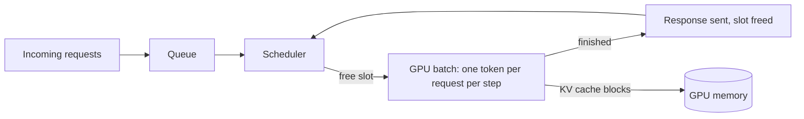

# Inference Serving and Batching
> **Level:** Advanced · **Reading time:** 10 min · **Phase:** 3 · LLM Concepts

**In one line:** Serving an LLM is a scheduling problem: a GPU is only efficient when it works on many requests at once, and good servers keep it busy by swapping finished requests out and new ones in at every step.

**Before you start:** [KV Cache](07-kv-cache.md) and [Calling an LLM API](16-calling-an-llm-api.md).

**Words to know:**
- **Inference:** running a trained model to get answers (not training it).
- **Batch:** several requests processed together in one GPU step.
- **Slot:** one place in the batch that holds one request.

## Explain it like I'm new
Picture a bus. A bus that drives with one passenger wastes fuel. A bus that waits until it is full makes everyone wait at the stop. The best plan is a bus that keeps moving, drops people off when they arrive, and picks up new people at the next stop.

A GPU is the bus. Running one request at a time wastes most of its power, so servers put many requests on it together. This is called **batching**. The hard part is doing it without making short requests wait for long ones.

Two words you must know:
- **Latency:** how long one user waits. For chat, we often split it into **time to first token** (TTFT: how long until the first word shows up) and the speed after that (**tokens per second** for that user).
- **Throughput:** how many tokens the whole server makes per second, across all users.

These two pull against each other. Bigger batches raise throughput, but each user may wait longer. Serving is about finding a good balance.

## How it works
1. **Prefill.** The server reads the whole prompt in one parallel pass. This is heavy on compute. It decides most of the time to first token.
2. **Decode.** The model then makes one token at a time. Each step is small, and it is limited mostly by how fast the GPU can read memory (the model weights and the [KV cache](07-kv-cache.md)). This is why batching helps so much: reading the weights once can serve many requests in the same step.
3. **Static batching.** Collect a fixed group, run it, and release it only when the *longest* request is done. Short requests finish early but their slots sit idle. Everyone waits for the slowest.
4. **Continuous batching.** After every decode step, finished requests leave at once and waiting requests take the free slots. No slot sits idle while work is waiting. The [Orca paper](https://www.usenix.org/conference/osdi22/presentation/yu) calls this iteration-level scheduling.
5. **Paged KV cache.** Each request's KV cache grows as it writes tokens, and nobody knows its final length in advance. Reserving the maximum for everyone wastes memory. **PagedAttention**, the idea behind the open-source server **vLLM**, stores the cache in small fixed-size blocks, like pages in an operating system. Blocks are given out as needed, so more requests fit in memory. This page covers the concept only.
6. **Speculative decoding.** A small, fast "draft" model guesses the next few tokens. The big model then checks all the guesses in one parallel pass and keeps the ones it agrees with. When the guesses are good, you get several tokens for the price of one big-model step, and the output is the same as the big model alone.



**Queues and the tail.** When requests arrive faster than the server can finish them, a queue builds up, and waiting time grows quickly as the server gets busy. Averages hide this. Look at **p95** or **p99** latency: the time that 95% or 99% of requests beat. A few slow users matter, and one slow step in a chain of agent calls slows the whole task. Set targets on the tail, not the mean.

### Worked example
Take 6 requests that all arrive at step 0 and need 2, 2, 2, 10, 2 and 2 steps. The demo runs them on 4 slots:
1. Static batching: the first batch of 4 is held until its longest request is done, so all four finish at step 10. The last two finish at 12. Mean finish time is 10.67.
2. Continuous batching: a short request frees its slot at once, and a waiting request takes it. Finish times are 2, 2, 2, 10, 4, 4, with a mean of 4.00.
3. Result: the same work, but slots are busy 50.0% of the time instead of 41.7%, and users wait far less.

## Code example
[`llm_serving_sim.py`](../code/llm_serving_sim.py) is a toy simulator with the standard library only. Time is counted in decode steps. In one step, each request in a slot makes one token. Each request is `(arrival_step, output_tokens)`.

Definitions used in the code:
- **Latency** = finish step minus arrival step.
- **p95** uses *nearest rank*: sort the values and take the item at rank `ceil(0.95 * n)`. With 6 requests that is rank 6, the largest.
- **Throughput** = total tokens / total steps.
- **Utilization** = tokens made / (slots x total steps). It is the share of slot-steps doing real work.

Hand check with four requests, all at step 0, lengths 2, 2, 2, 10 and 4 slots. Static: one batch of 10 steps, so everyone finishes at 10 and the mean latency is 10. Continuous: the three short ones finish at step 2 and the long one at 10, so the mean latency is (2+2+2+10)/4 = 4.

```python
from llm_serving_sim import run

four = [(0, 2), (0, 2), (0, 2), (0, 10)]
res = run(four, slots=4)
print(res["static"]["finish"], res["static"]["mean_latency"])          # -> [10, 10, 10, 10] 10.0
print(res["continuous"]["finish"], res["continuous"]["mean_latency"])  # -> [2, 2, 2, 10] 4.0
```

With four slots and only one long request, the two methods use the GPU the same way on this tiny case. The gain shows when more requests are waiting for slots. The built-in sample has six requests (2, 2, 2, 10, 2, 2) and four slots. Real output of `python 03-llm-concepts/code/llm_serving_sim.py`:

```text
static     finish=[10, 10, 10, 10, 12, 12] mean=10.67 p95=12 throughput=1.67 tok/step util=41.7%
continuous finish=[2, 2, 2, 10, 4, 4] mean=4.00 p95=10 throughput=2.00 tok/step util=50.0%
```

The last two requests wait in both cases. Under static batching they must wait for the first batch of 10 steps. Under continuous batching they take the slots that the short requests freed at step 2, so they finish at step 4. Mean latency falls from 10.67 to 4.00, throughput rises, and utilization goes from 41.7% to 50.0%. The tests in [`test_llm_serving_sim.py`](../code/test_llm_serving_sim.py) check these numbers by hand, and that every request makes exactly its `output_tokens` tokens.

This toy ignores prefill, memory and real GPU costs. Its numbers are for learning, not a benchmark.

**In real projects** you rarely write the scheduler. You run a serving engine such as [vLLM](https://github.com/vllm-project/vllm) (continuous batching and paged KV cache built in), or use a hosted API that does it for you. Flags and defaults change between versions, so read the current docs.

## When to use it / when not to
| Situation | What to do |
|---|---|
| Many users, steady traffic, self-hosted open model | Use a serving engine with continuous batching and a paged KV cache |
| Calls to a hosted API | The provider does this. Focus on your own limits, retries and timeouts |
| Interactive chat | Set goals on TTFT and p95 or p99, and keep batches modest |
| Offline jobs (summaries, labelling) | Maximize throughput with large batches. Latency matters less |
| A few requests a day | Do not build a serving stack. A hosted API is cheaper and simpler |
| Draft model is much weaker than the big one | Speculative decoding may not help, since few guesses are accepted. Measure first |

## Common mistakes
- Looking only at average latency. Slow outliers hide in the tail, so track p95 and p99.
- Raising batch size to chase throughput until chat users complain about delay.
- Mixing up TTFT (prefill-heavy) with per-token speed (decode-heavy), then fixing the wrong one.
- Reserving the full maximum context for every request, and running out of GPU memory early. Paged caches avoid this.
- Testing with identical, evenly sized requests. Real traffic has short and long mixed, which is exactly when static batching hurts.
- Trusting a toy result as a benchmark. Measure on your own model, hardware and traffic.

## Recap
If you remember only three things:
- Batching makes the GPU efficient but can make individual users wait.
- Continuous batching swaps finished requests out after every step, so slots do not sit idle.
- Watch p95 and p99 latency, not just the average.

## Interview questions
<details>
<summary><b>1. Why is continuous batching better than static batching for LLM serving?</b></summary>

Output lengths differ. In static batching, a batch is held until its longest request finishes, so short requests wait and their slots sit idle. In continuous batching, a finished request leaves after any step and a waiting one takes its slot. Latency for short requests falls and the GPU stays busier.
</details>

<details>
<summary><b>2. What is the difference between prefill and decode, and why does it matter?</b></summary>

Prefill reads the whole prompt in one parallel pass and is compute-heavy. It sets the time to first token. Decode makes one token per step and is mostly limited by memory reads of the weights and the KV cache. Because they stress different things, they are tuned and sometimes scheduled separately. Long prompts slow TTFT, and long answers cost decode steps.
</details>

<details>
<summary><b>3. Your p50 latency is fine but users complain. What do you check?</b></summary>

Look at p95 and p99. The median can hide a slow tail from queueing under load, very long requests blocking a batch, or cache memory running out. Check queue wait time, batch composition and memory use, then fix the tail, for example with continuous batching, request limits or more capacity.
</details>

## Go deeper
- vLLM / PagedAttention paper: https://arxiv.org/abs/2309.06180
- Orca, continuous batching: https://www.usenix.org/conference/osdi22/presentation/yu
- Speculative decoding: https://arxiv.org/abs/2211.17192
- vLLM repo: https://github.com/vllm-project/vllm

**Prev:** [LoRA and PEFT](19-lora-and-peft.md) · **Next:** [How an LLM Works End to End](21-how-an-llm-works-end-to-end.md) · **Back to phase:** [Phase 3](../README.md)
