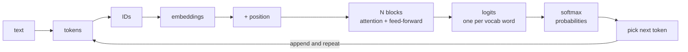

# How an LLM Works End to End
> **Level:** Beginner · **Reading time:** 10 min · **Phase:** 3 · LLM Concepts

**In one line:** An LLM turns text into numbers, runs those numbers through a stack of identical blocks, scores every word in its vocabulary as the possible next token, picks one, and repeats, one token at a time.

**Before you start:** [Transformer Architecture](01-transformer-architecture.md) for the big picture. You only need to know that an LLM reads text and predicts what comes next.

## Explain it like I'm new
Imagine a very well-read friend playing a guessing game. You say "the cat sat on the…" and they answer "mat". You then say the whole thing again with "mat" added, and they guess the next word again. They never write a whole paragraph in one go. They only ever guess **one next word**, then look at everything so far and guess again.

An LLM (large language model) is that friend, built from arithmetic. Some plain definitions first:

- **Token:** a small chunk of text, often a word or part of a word. The model reads and writes tokens, not letters.
- **Vector:** a list of numbers, like `[0.0, 1.0, 0.5, 0.0]`. Think of it as coordinates that describe something, here the meaning of a token.
- **Parameter:** one number inside the model that was **learned** during training. A model's "size" (7B, 70B) is how many of these it has. They sit in tables called **weight matrices** (grids of numbers).
- **Logit:** a raw score. The model produces one logit per vocabulary word. Bigger means "more likely next". Logits can be negative and do not add up to 1.
- **Vocabulary:** the fixed list of every token the model knows. Real ones have 30,000 to 250,000 entries. Our toy has 8.

## How it works


Here is one sentence, `"the cat sat on the"`, through a toy model with 8 vocabulary words: `the, cat, sat, on, mat, dog, ran, .`. Every number below is printed by [`llm_e2e_walkthrough.py`](../code/llm_e2e_walkthrough.py).

1. **Text → tokens.** Split into pieces: `['the', 'cat', 'sat', 'on', 'the']`. Real tokenizers split into sub-words (for example BPE), so "unbelievable" might become `un`, `believ`, `able`.
2. **Tokens → IDs.** Each token is looked up in the vocabulary: `[0, 1, 2, 3, 0]`. The same word always gets the same ID. This step is fixed code, not learned.
3. **IDs → embeddings.** An **embedding table** (one row per vocabulary word) turns each ID into a vector. `cat` becomes `[1, 0, 0, 0]`. The sentence is now a grid of shape **5 × 4** (5 tokens, 4 numbers each). Real models use 4,096 or more numbers per token.
4. **Add position.** "Dog bites man" and "man bites dog" have the same words, so the model needs word order. A small position vector is added to each embedding. Now the first `the` and the last `the` have different vectors. See [Positional Encoding](04-positional-encoding.md).
5. **N blocks.** Each block does two jobs. **Attention** lets every token look at earlier tokens and mix in what is useful. A **feed-forward layer** then processes each token on its own. Both add their result onto the old vector (a **residual connection**), so nothing gets lost. Our toy uses 2 blocks, GPT-style models use dozens.
6. **Logits.** Only the **last** token's vector is used for the prediction. A final matrix turns its 4 numbers into 8 logits, one per vocabulary word.
7. **Softmax.** Softmax converts logits into probabilities that are positive and add up to 1.
8. **Pick.** Choose a token from those probabilities. Greedy means take the biggest. Sampling adds controlled randomness (see [Temperature](09-temperature.md), [Top-k](10-top-k.md), [Top-p](11-top-p.md)).
9. **Append and repeat.** Add the chosen token to the input and run again. This is the **autoregressive loop**: the model's own output becomes its next input.

**Tiny worked example.** The toy's final logits for the last position, from the demo:

| Word | the | cat | sat | on | mat | dog | ran | . |
|---|---|---|---|---|---|---|---|---|
| Logit | 0.15 | 0 | 0 | 0 | 4.98 | 0 | 0 | -5.90 |
| Probability | 0.008 | 0.007 | 0.007 | 0.007 | **0.959** | 0.007 | 0.007 | 0.000 |

`mat` wins. We append it and run `"the cat sat on the mat"` through the whole pipeline again, and the model predicts `.` with probability 0.861. The loop stops.

```text
the cat sat on the        -> 'mat'  (p=0.959)
the cat sat on the mat    -> '.'    (p=0.861)   stop
```

### Why only ONE next token?
The model is trained on a single task: given the tokens so far, predict the next one. Output text is built by repeating that task. A key benefit is that every token you generate can use all the tokens before it, including ones the model wrote seconds ago. The cost is that generation is sequential, which is why speed tricks like the [KV cache](07-kv-cache.md) matter.

### What is learned and what is fixed?
| Part | Learned in training? |
|---|---|
| Tokenizer and vocabulary | No, built beforehand and then frozen |
| Embedding table | **Yes** |
| Attention matrices (`W_q`, `W_k`, `W_v`, output) | **Yes** |
| Feed-forward weights | **Yes** |
| Final matrix that makes logits | **Yes** |
| Softmax, residual connections, position formula | No, plain math |
| Attention weights for a given input | Neither: computed fresh each time from the input |

Training shows the model huge amounts of text, checks how often its next-token guess was right, and nudges every parameter to be slightly better. In our toy, the 128 parameters were hand-picked instead, so the demo is deterministic and you can read every number.

### Worked example
Here is the loop for the toy model, from real output of [`llm_e2e_walkthrough.py`](../code/llm_e2e_walkthrough.py).

1. Text `the cat sat on the` becomes five tokens, then the IDs `[0, 1, 2, 3, 0]`. The first and last are both `the`, so both have ID 0.
2. Each ID becomes a vector of 4 numbers. After position is added, the two `the` vectors differ slightly, so the model can tell them apart.
3. Two blocks mix the tokens. Only the **last** position is used to predict what comes next.
4. The model gives each of the 8 words in its vocabulary a score. `mat` gets about 4.975 and `.` gets about -5.896.
5. Softmax turns the scores into probabilities: `mat` 0.959, `the` 0.008, and so on. They add up to 1.
6. Greedy decoding picks `mat`. The new text `the cat sat on the mat` goes round the loop again.

## Code example
```python
from llm_e2e_walkthrough import generate

tokens, steps = generate("the cat sat on the", max_new_tokens=4)
print(" ".join(tokens))          # the cat sat on the mat .
print(len(steps))                # 2 forward passes, one per new token
```

Run `python 03-llm-concepts/code/llm_e2e_walkthrough.py` to see every stage with its shape. Tests live in [`test_llm_e2e_walkthrough.py`](../code/test_llm_e2e_walkthrough.py).

**In real projects** you use a library and never write these stages yourself:

```python
from transformers import AutoModelForCausalLM, AutoTokenizer

tok = AutoTokenizer.from_pretrained("gpt2")
model = AutoModelForCausalLM.from_pretrained("gpt2")
ids = tok("the cat sat on the", return_tensors="pt")
out = model.generate(**ids, max_new_tokens=5, do_sample=False)  # the autoregressive loop
print(tok.decode(out[0]))
```

## When to use it / when not to
Use this mental model whenever you debug or budget LLM behavior. Most "weird" behaviors fall out of it: the model only sees tokens (so letter counting is hard), it only predicts the next token (so it can talk itself into an error), and cost grows with tokens in and out.

It is a simplification. Real models add layer normalization, multiple attention heads, and many more blocks, but the flow is the same.

| Question | Where the pipeline answers it |
|---|---|
| Why does cost depend on tokens? | Every token is one row through every block |
| Why can answers differ run to run? | The pick step can sample |
| Why is long output slow? | One forward pass per new token |
| Why can't it count letters well? | It sees token IDs, not letters |

## Where to go deeper on each stage
| Stage | Topic page |
|---|---|
| Whole architecture | [Transformer Architecture](01-transformer-architecture.md) |
| Attention in blocks | [Self Attention](02-self-attention.md), [Multi Head Attention](03-multi-head-attention.md) |
| Position vectors | [Positional Encoding](04-positional-encoding.md) |
| Decoder-only loop | [Decoder-Only Models](05-decoder-only-models.md) |
| Reusing past work | [KV Cache](07-kv-cache.md) |
| Max tokens in the input | [Context Window](08-context-window.md) |
| Picking the next token | [Temperature](09-temperature.md), [Top-k](10-top-k.md), [Top-p](11-top-p.md), [Beam Search](12-beam-search.md) |
| Wrong but confident output | [Hallucination](13-hallucination.md) |
| Changing the learned parameters | [Fine-Tuning](15-fine-tuning.md), [LoRA and PEFT](19-lora-and-peft.md) |
| Shrinking the parameters | [Quantization](18-quantization.md) |
| Running it for many users | [Inference Serving and Batching](20-inference-serving-and-batching.md) |

## Common mistakes
- Thinking the model plans the whole answer first. It decides one token at a time.
- Confusing logits with probabilities. Logits are raw scores, probabilities come after softmax.
- Believing the model "looks up" facts in a database. Knowledge is stored implicitly in the parameters.
- Thinking tokens are words. A word can be several tokens, and a token can be a space or punctuation.
- Believing the model learns from your chat. At inference time the parameters are frozen. Only the context you send changes the output.

## Recap

**If you remember only three things:**
- An LLM turns text into token IDs, then vectors, mixes them with attention blocks, and scores every word in its vocabulary.
- It predicts only ONE next token per turn. Longer text comes from feeding each new token back in.
- Parameters (the learned numbers) are what training changes. The steps themselves are fixed.

## Interview questions
**1. Why does an LLM generate text one token at a time?**
<details><summary>Answer</summary>
It is trained to predict the next token from all earlier tokens. To produce a longer text, you append each predicted token to the input and run the model again (autoregressive generation). This means each new token can depend on everything before it, but generation cannot be fully parallelized across output tokens.
</details>

**2. What is the difference between logits and probabilities?**
<details><summary>Answer</summary>
Logits are the raw, unnormalized scores the final layer outputs, one per vocabulary token. They can be any real number. Softmax turns them into probabilities that are positive and sum to 1. Sampling settings such as temperature act on the logits before softmax.
</details>

**3. Which parts of an LLM are learned, and which are fixed?**
<details><summary>Answer</summary>
The parameters are learned: the embedding table, attention projection matrices, feed-forward weights, and the output matrix. The tokenizer, the vocabulary, the softmax, the positional formula (for sinusoidal encodings), and the architecture are fixed in advance. Attention weights are not parameters. They are computed from each input at run time.
</details>

## Go deeper
- [Attention Is All You Need (Vaswani et al., 2017)](https://arxiv.org/abs/1706.03762)
- [Language Models are Few-Shot Learners (Brown et al., 2020)](https://arxiv.org/abs/2005.14165), the GPT-3 paper
- [Neural Machine Translation of Rare Words with Subword Units (Sennrich et al., 2015)](https://arxiv.org/abs/1508.07909), the BPE tokenizer idea

**Prev:** [Inference Serving and Batching](20-inference-serving-and-batching.md) · **Next:** [Q, K and V Explained From Scratch](22-qkv-explained-from-scratch.md) · **Back to phase:** [Phase 3](../README.md)
