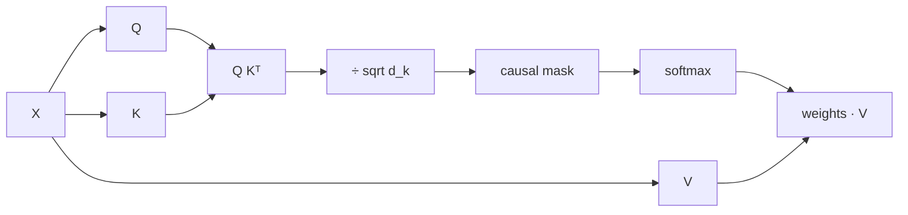

# Q, K and V Explained From Scratch
> **Level:** Intermediate · **Reading time:** 12 min · **Phase:** 3 · LLM Concepts

**In one line:** Each token's vector is multiplied by three different learned matrices to make a Query (what I am looking for), a Key (how I advertise myself) and a Value (what I hand over), and attention is a Query-versus-Key match that decides how much of each Value to blend.

**Before you start:** [Self Attention](02-self-attention.md), because this page slows that one down. You should know that attention blends information from other tokens.

## Explain it like I'm new
[Self Attention](02-self-attention.md) introduced Q, K and V in a few lines. This page slows down and builds them from zero.

**Analogy 1: the library.** You walk in with a **question** ("books about rivers"). Each book has a **spine label** ("Rivers of Asia", "Cooking for Two"). You compare your question with every label. You then read the **contents** of the matching books, weighted by how well each label matched. Notice that the label and the contents are different things. A book's label is short and made for matching, and its contents are what you actually take away.

**Analogy 2: the classroom.** A teacher says "who here knows about the animal we just discussed?" That is a **query** from the word *it*. Every student wears a **name tag** listing their topic. That is the **key**. The students whose tags match well raise their hands more eagerly. Each student also holds **notes** they can hand over. That is the **value**. *It* collects notes from all students, taking more from the eager ones. The name tag ("animal-noun") is not the same as the notes (the full details about the animal), and that is the whole point.

| | Library | Classroom | In the model |
|---|---|---|---|
| Query | your question | the teacher's question | `q = x W_q` |
| Key | spine label | name tag | `k = x W_k` |
| Value | book contents | notes handed over | `v = x W_v` |

## Why three separate matrices?
Why not use the token's vector `x` directly for all three roles? Because the three jobs want different things:

- **What I look for** (query). The word *it* wants a noun nearby. That is a need, not a description of *it*.
- **How I advertise myself** (key). The word *animal* wants to say "I'm a noun, a living thing". That is a label tuned for matching.
- **What I hand over** (value). Once chosen, *animal* should pass on rich details, not just its label.

With one shared vector, a token's need, label and payload would be forced to be the same thing. Three matrices let training learn three views of the same token. The two views Q and K are compared, and the V view is the thing that is mixed. This is also why you can ask a question that looks nothing like the label that answers it.

## How it works
Let `X` hold one row per token: `n` tokens by `d_model` numbers each. The three matrices turn it into Q, K and V:

```text
Q = X · W_q      (n × d_model) · (d_model × d_k)  →  n × d_k
K = X · W_k      (n × d_model) · (d_model × d_k)  →  n × d_k
V = X · W_v      (n × d_model) · (d_model × d_k)  →  n × d_k
```

Row by row it is `q_i = x_i W_q`, `k_i = x_i W_k`, `v_i = x_i W_v`. `d_model` is the size of a token's vector. `d_k` is the smaller size we project into (in multi-head attention it is `d_model / heads`, see [Multi Head Attention](03-multi-head-attention.md)).

The formula `softmax(Q Kᵀ / sqrt(d_k)) V` breaks down into five small steps:

1. `Q Kᵀ` is an `n × n` table of scores. Entry `[i][j]` is "how well does token i's query match token j's key".
2. Divide by `sqrt(d_k)` so scores do not get large as vectors grow.
3. Add the **causal mask**: `-inf` for `j > i`, so a token cannot peek at later tokens.
4. **Softmax** each row so it becomes weights that add up to 1.
5. Multiply the weights by `V`. Each output row is a weighted average of value rows.



### Worked example: a full walk-through
Three tokens, `the animal it`, with `d_model = 4` and `d_k = 2`. Every number below is computed by [`llm_qkv.py`](../code/llm_qkv.py) (run `python 03-llm-concepts/code/llm_qkv.py`). The matrices are hand-picked, where a real model would have learned them.

```text
X (3×4)                  W_q (4×2)   W_k (4×2)   W_v (4×2)
the    [1, 0, 0, 0]      [1, 0]      [0, 1]      [1, 0]
animal [0, 1, 1, 0]      [0, 0]      [1, 0]      [0, 2]
it     [0, 0, 1, 1]      [0, 1]      [1, 1]      [1, 1]
                         [1, 1]      [0, 0]      [0, 1]
```

**Step 1: project.** A row of `X` times a matrix just adds up the matrix rows that the 1s pick out. For `animal = [0,1,1,0]` with `W_q`, take rows 1 and 2 of `W_q`: `[0,0] + [0,1] = [0,1]`.

| token | Q (looks for) | K (advertises) | V (hands over) |
|---|---|---|---|
| the | [1, 0] | [0, 1] | [1, 0] |
| animal | [0, 1] | [2, 1] | [1, 3] |
| it | [1, 2] | [1, 1] | [1, 2] |

**Step 2: score table `Q Kᵀ`.** Row = who is asking, column = who is being checked. For `it` vs `animal`: `[1,2]·[2,1] = 2 + 2 = 4`.

| | the | animal | it |
|---|---|---|---|
| the | 0 | 2 | 1 |
| animal | 1 | 1 | 1 |
| it | 2 | **4** | 3 |

**Step 3: scale** by `sqrt(2) ≈ 1.414`: the `it` row becomes `[1.414, 2.828, 2.121]`.

**Step 4: causal mask.** `the` can only see itself, `animal` sees `the` and itself, `it` sees all three. The upper triangle becomes `-inf`.

**Step 5: softmax** each row gives the weight table:

| | the | animal | it |
|---|---|---|---|
| the | 1.000 | 0 | 0 |
| animal | 0.500 | 0.500 | 0 |
| it | 0.140 | **0.576** | 0.284 |

**Step 6: output** = weights · V. For `it`: `0.140·[1,0] + 0.576·[1,3] + 0.284·[1,2] = [1.000, 2.296]`. The new vector for `it` is dominated by the content of `animal`.

### Reading the heat table
Read a weight table **row by row**: row `it` says "when building my new meaning, take 58% from *animal*, 28% from myself and 14% from *the*". Each row sums to 1. The zeros in the upper right are the causal mask. That is how a model can resolve "The animal didn't cross the street because **it** was too tired".

### What is learned and what is computed fresh
- `W_q`, `W_k`, `W_v` are **learned parameters**. They are fixed after training and the same for every input.
- Q, K, V and the attention weights are **computed fresh** for every input. Give the model a different sentence and you get different weights, with the same matrices. A test in [`test_llm_qkv.py`](../code/test_llm_qkv.py) checks this.

### Cross-attention
In self-attention Q, K and V all come from the same sequence. In **cross-attention**, Q comes from one sequence (such as the translation being written) and K and V come from another (such as the source sentence). Same formula, different sources. See [Encoder-Decoder Models](06-encoder-decoder-models.md).

### How many parameters?
Each projection is `d_model × d_k`. For a full-width single head with `d_model = 4096` (the size of 7B-class models) the three matrices have `3 × 4096 × 4096 = 50,331,648` parameters per layer, about 50 million. With 32 layers that is about 1.6 billion, before counting the output projection, feed-forward layers or embeddings. Multi-head attention splits those same numbers across heads (for example 32 heads of `d_k = 128`) and does not add more.

### Relation to the KV cache
When generating, token 50 needs the keys and values of tokens 1 to 49, and those never change. Only the **newest** token needs a fresh query. So we store old K and V rows (the **KV cache**), compute `q, k, v` for the new token only, append its `k` and `v`, and compute one row of weights. That is why it is called a KV cache and not a QKV cache. See [KV Cache](07-kv-cache.md).

## Code example
```python
from llm_qkv import X, W_Q, W_K, W_V, attention_with_trace, print_trace

trace = attention_with_trace(X, W_Q, W_K, W_V, causal=True)
print(trace["weights"][2])       # [0.140.., 0.576.., 0.284..]  -> "it" attends to "animal"
print(trace["output"][2])        # [1.0, 2.296..]
print_trace(trace)               # every intermediate, labelled by token
```

The module offers `project(x, W)`, `qkv(x, Wq, Wk, Wv)`, `attention_with_trace(...)` and `qkv_param_count(d_model, d_k)`.

**In real projects** the three matrices are usually one fused linear layer:

```python
import torch
import torch.nn as nn
import torch.nn.functional as F

d_model, d_k = 4, 2
qkv_proj = nn.Linear(d_model, 3 * d_k, bias=False)   # W_q, W_k, W_v side by side
x = torch.randn(1, 3, d_model)                       # (batch, tokens, d_model)
q, k, v = qkv_proj(x).chunk(3, dim=-1)
out = F.scaled_dot_product_attention(q, k, v, is_causal=True)
```

## When to use it / when not to
Q, K, V attention is how a transformer mixes information across tokens. For a short fixed input, a plain feed-forward layer can do the job, and for very long inputs the `n × n` table gets expensive, so people use sliding windows, cached K/V and fused kernels.

| Shape | Value |
|---|---|
| X | n × d_model |
| W_q, W_k, W_v | d_model × d_k |
| Q, K, V | n × d_k |
| Scores and weights | n × n |
| Output | n × d_k |

## Common mistakes
- Thinking Q, K and V are three different inputs. They are three projections of the same `X` (in self-attention).
- Thinking attention weights are learned. The matrices are learned, the weights are recomputed per input.
- Mixing up the axes: softmax is over each **row** (a query's choices), and the output mixes **V**, not K.
- Swapping the roles: `Q Kᵀ` compares queries with keys. Values never enter the score.
- Believing a heat table proves the model "reasoned" this way. It shows information flow in one head of one layer.
- Assuming a bigger `d_k` is free. It raises parameters and compute, and the `sqrt(d_k)` scale is needed to keep softmax well behaved.

## Recap

**If you remember only three things:**
- Q is what a token looks for, K is how it advertises itself, and V is what it hands over.
- Scores come from Q matching K. The output is a weighted blend of V.
- The three matrices W_q, W_k, W_v are learned. The attention weights are computed fresh for every input.

## Interview questions
**1. Why use separate W_q, W_k and W_v instead of one shared projection?**
<details><summary>Answer</summary>
The three roles differ: the query says what a token needs, the key says what it offers for matching, and the value is the content it passes on. Separate matrices let the model learn each view independently. With one shared projection, the thing used for matching would have to equal the thing handed over, and the score `q·k` would be forced to be symmetric (`x W (x' W)ᵀ` is the same both ways), so a token could not look for something unlike itself.
</details>

**2. What are the shapes in attention, and how many parameters do the Q, K, V projections have?**
<details><summary>Answer</summary>
X is n × d_model. Each W is d_model × d_k, so Q, K and V are n × d_k, the score table is n × n, and the output is n × d_k. The three matrices have 3 × d_model × d_k parameters (plus biases if used). For d_model = d_k = 4096 that is about 50.3 million per layer.
</details>

**3. Why does the KV cache store keys and values but not queries?**
<details><summary>Answer</summary>
In a causal decoder, the keys and values of past tokens never change, and every new token needs them. Queries are only used by the token that is currently being computed, and an old token's query is never needed again. So we cache K and V, and compute only the newest token's Q, K and V on each step.
</details>

## Go deeper
- [Attention Is All You Need (Vaswani et al., 2017)](https://arxiv.org/abs/1706.03762), section 3.2
- [Neural Machine Translation by Jointly Learning to Align and Translate (Bahdanau et al., 2014)](https://arxiv.org/abs/1409.0473)
- [Fast Transformer Decoding: One Write-Head is All You Need (Shazeer, 2019)](https://arxiv.org/abs/1911.02150), shows why K and V caching dominates decoding memory

**Prev:** [How an LLM Works End to End](21-how-an-llm-works-end-to-end.md) · **Next:** [Inside a Transformer Block](23-inside-a-transformer-block.md) · **Back to phase:** [Phase 3](../README.md)
