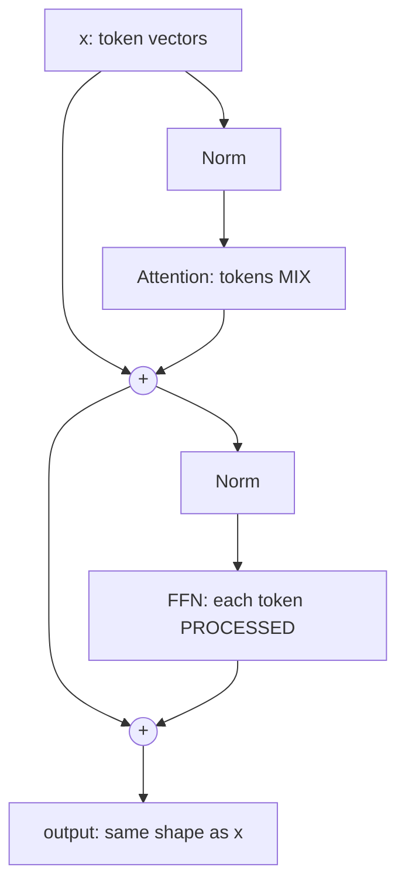

# Inside a Transformer Block: Residuals, LayerNorm and the Feed-Forward Network
> **Level:** Intermediate · **Reading time:** 11 min · **Phase:** 3 · LLM Concepts

**In one line:** A transformer block is attention plus three supporting parts: residual connections that carry the signal past each step, a normalisation layer that keeps numbers in a healthy range, and a feed-forward network that processes each token on its own.

**Before you start:** [Self Attention](02-self-attention.md) and [Q, K and V Explained From Scratch](22-qkv-explained-from-scratch.md). Attention is only half of a block, and this page covers the other half.

## Explain it like I'm new
Earlier topics covered attention ([self-attention](02-self-attention.md), [multi-head](03-multi-head-attention.md)). But a real model is a tall stack of identical **blocks**, often 30 to 100 of them, and attention is only one ingredient in each block. Picture a factory line with many stations:

- **Attention station:** workers (tokens) look at each other and share information. This is the *only* place tokens talk.
- **Feed-forward station:** each worker goes to a private desk and thinks about what they just learned, alone.
- **Residual connection:** a conveyor belt that carries the original item past every station, so each station only *adds notes* to it instead of rebuilding it.
- **Normalisation:** a quality-control step that rescales the item so it never gets too big or too small for the next station.

Plain definitions:
- **Residual connection** (or skip connection): output = input + what the layer computed. Written `x + f(x)`.
- **Normalisation:** rescaling a vector of numbers so they have a predictable size.
- **Feed-forward network (FFN)**, also called MLP: two matrix multiplications with a nonlinear function in between.
- **Nonlinearity** (activation): a bend in the function (for example "negative numbers become zero"). Without it, stacked matrix multiplies would collapse into a single one and the model could not learn complex patterns.
- **d_model:** the width of each token's vector (4096 in many 7B-class models).

## How it works
Here is one block in the common modern layout, called **pre-norm**:



1. **Normalise** the input, then run **attention**. Add the result back onto the original `x` (first residual).
2. **Normalise** again, run the **FFN** on every token separately. Add the result back (second residual).
3. The output has exactly the same shape as the input, so blocks can be stacked as many times as you like.

### Residual connections: a highway for signal and gradients
Imagine a layer that computes `f(x) = 0.5 · x`. Stack 20 layers.

| Design | Each layer does | After 20 layers | Gradient factor |
|---|---|---|---|
| No residual | `0.5·x` | signal × 0.5²⁰ ≈ 0.000001 (gone) | 0.5²⁰ ≈ 0.00000095 |
| Residual | `x + 0.5·x` = `1.5·x` | signal × 1.5²⁰ ≈ 3,325 (alive) | 1.5²⁰ ≈ 3,325 |

The numbers come from `depth_experiment` and `residual_gradient_factor` in [`llm_block.py`](../code/llm_block.py). Real sub-layers are not so extreme; the point is the direction. Without the residual, every layer can shrink the signal and the **gradient** (the learning signal sent backward during training, see [topic 24](24-how-llms-are-trained.md)) is multiplied by a small number 20 or 100 times and **vanishes**. With a residual, the derivative of `x + f(x)` is `1 + f'(x)`. That "1" is a highway: learning signal always has a direct path from the loss to early layers. Each layer also only has to learn a small *correction* to the input, which is easier than learning a whole new representation. Notice that the residual version in the toy grows fast. That is the second reason for normalisation.

### LayerNorm by hand
**LayerNorm** takes one token's vector and forces its numbers to average 0 with variance 1. Take `x = [2, 4, 6, 8]`.

1. Mean = (2+4+6+8)/4 = **5**.
2. Subtract the mean: `[-3, -1, 1, 3]`.
3. Variance = average of squares = (9+1+1+9)/4 = **5**. Standard deviation = √5 ≈ 2.236.
4. Divide: `[-1.342, -0.447, 0.447, 1.342]`. Check: mean 0, variance 1.
5. Apply learned **gamma** (scale) and **beta** (shift): `out = gamma · normalised + beta`. Gamma starts at 1 and beta at 0; training lets the model undo the normalisation where that helps.

A tiny `eps` (like 0.00001) is added to the variance so we never divide by zero.

**RMSNorm** is the leaner modern variant (used in Llama-style models). It skips the mean and the beta and only divides by the **root mean square**: for the same vector, squares are 4+16+36+64 = 120, mean 30, RMS ≈ 5.477, result `[0.365, 0.730, 1.095, 1.461]`. It is cheaper and works about as well in practice.

### Pre-norm vs post-norm
| | Post-norm (original 2017 paper) | Pre-norm (most modern LLMs) |
|---|---|---|
| Formula | `x = Norm(x + f(x))` | `x = x + f(Norm(x))` |
| Highway clean? | No, the norm sits on the highway | Yes, `x` passes untouched |
| Training deep stacks | Fragile, needs careful warm-up | Much more stable |

### The feed-forward network
For each token vector (width `d`):
1. **Expand** with a matrix to `4d` (a wider "scratch space").
2. Apply a **nonlinearity**: **ReLU** (`max(0, v)`) in the original paper, **GELU** (a smooth version of ReLU) in GPT-style models, or **SwiGLU** in many newer ones. SwiGLU multiplies two projections together, one passed through a smooth gate, using three matrices; the hidden width is shrunk to about 8/3·d so the parameter count stays close to the classic design.
3. **Project back** down to `d`.

Crucially, the FFN looks at **one token at a time**; token 5's output does not depend on token 6. So the division of labour is: **attention mixes tokens, the FFN processes each token**. Research on trained models suggests the FFN layers act like a big memory of facts and patterns, and they hold roughly **two thirds of the parameters** of the block, as the table shows.

### Parameter counts at d_model = 4096
| Part | Matrices | Formula | Weights | Share |
|---|---|---|---|---|
| Attention (Q, K, V, output) | 4 of d × d | 4d² | 67,108,864 | 33% |
| FFN (4× expansion) | d × 4d and 4d × d | 8d² | 134,217,728 | 67% |
| **Block total** | | 12d² | **201,326,592** | 100% |

(Biases and norm weights are tiny and ignored.) Multiply by the number of layers to get most of the model's size. For how those weights are then shrunk, see [quantization](18-quantization.md).

## Code example
```python
import math

def layer_norm(x, eps=1e-5):
    mean = sum(x) / len(x)
    var = sum((v - mean) ** 2 for v in x) / len(x)
    return [(v - mean) / math.sqrt(var + eps) for v in x]

def residual_stack(depth, scale, residual):
    x = 1.0
    for _ in range(depth):
        x = x + scale * x if residual else scale * x
    return x

print(layer_norm([2, 4, 6, 8]))        # [-1.342, -0.447, 0.447, 1.342]
print(residual_stack(20, 0.5, False))  # ~0.000001  (vanished)
print(residual_stack(20, 0.5, True))   # ~3325      (survives)
```

The full demo, including `rms_norm`, `gelu`, `ffn`, `block_forward` (pre-norm and post-norm) and `param_counts`, is in [`llm_block.py`](../code/llm_block.py). Run `python 03-llm-concepts/code/llm_block.py`; tests are in [`test_llm_block.py`](../code/test_llm_block.py).

**In real projects** you use the framework's layers:

```python
import torch.nn as nn

class Block(nn.Module):
    def __init__(self, d, heads):
        super().__init__()
        self.n1, self.n2 = nn.LayerNorm(d), nn.LayerNorm(d)
        self.attn = nn.MultiheadAttention(d, heads, batch_first=True)
        self.ffn = nn.Sequential(nn.Linear(d, 4 * d), nn.GELU(), nn.Linear(4 * d, d))

    def forward(self, x):
        h = self.n1(x)
        x = x + self.attn(h, h, h, need_weights=False)[0]   # residual 1
        return x + self.ffn(self.n2(x))                      # residual 2
```

## When to use it / when not to
- Keep residuals and normalisation in every deep network; they are what make 50+ layer stacks trainable.
- Use **pre-norm** for new deep models; post-norm only to reproduce older models.
- Prefer **RMSNorm** when you want a slightly cheaper norm; **SwiGLU** or **GELU** over ReLU for language models.
- For a shallow network (2 to 3 layers) residuals add little, but they rarely hurt.

| Part | Job | Looks across tokens? | Share of block weights |
|---|---|---|---|
| Attention | mix information between tokens | Yes | ~1/3 |
| FFN | transform and store knowledge per token | No | ~2/3 |
| Residual | carry signal and gradients | No | 0 |
| Norm | keep scale stable | No | tiny |

## Common mistakes
- Thinking attention is "the whole transformer". Most parameters sit in the FFN.
- Normalising across the wrong axis. LayerNorm works over the features of **one token**, not across tokens or the batch.
- Forgetting `eps`, which gives NaNs on constant vectors.
- Confusing pre-norm and post-norm when loading weights: they are not interchangeable.
- Assuming the FFN mixes tokens. It does not; only attention does.

## Recap

**If you remember only three things:**
- Attention mixes information between tokens. The feed-forward network then processes each token on its own.
- The residual connection adds the input back, so signals and learning can skip a layer. LayerNorm keeps numbers in a steady range.
- In a block with a 4x feed-forward expansion, roughly two thirds of the parameters sit in the feed-forward network.

## Interview questions
**1. Why do transformers use residual connections?**
<details><summary>Answer</summary>
The derivative of `x + f(x)` is `1 + f'(x)`, so gradients always have a direct path back to early layers and do not vanish in deep stacks. Each layer also only learns a small correction to its input, which is easier to optimise.
</details>

**2. What is the difference between LayerNorm and RMSNorm, and what is pre-norm?**
<details><summary>Answer</summary>
LayerNorm subtracts the mean, divides by the standard deviation and applies gamma and beta. RMSNorm skips the mean subtraction and beta and divides by the root mean square, which is cheaper. Pre-norm applies the norm to the input of each sub-layer (`x + f(Norm(x))`), keeping the residual path clean, which makes deep models train more stably than post-norm.
</details>

**3. What does the feed-forward network do, and how many parameters does it hold?**
<details><summary>Answer</summary>
It expands each token vector to about 4× width, applies a nonlinearity (GELU, SwiGLU), and projects back, independently per token. Attention is 4d² weights and the FFN is 8d², so the FFN holds about two thirds of a block's parameters and is thought to store much of the model's factual knowledge.
</details>

## Go deeper
- [Attention Is All You Need (Vaswani et al., 2017)](https://arxiv.org/abs/1706.03762)
- [Deep Residual Learning for Image Recognition (He et al., 2015)](https://arxiv.org/abs/1512.03385)
- [Layer Normalization (Ba et al., 2016)](https://arxiv.org/abs/1607.06450)
- [Root Mean Square Layer Normalization (Zhang and Sennrich, 2019)](https://arxiv.org/abs/1910.07467)
- [On Layer Normalization in the Transformer Architecture (Xiong et al., 2020)](https://arxiv.org/abs/2002.04745)
- [GLU Variants Improve Transformer (Shazeer, 2020)](https://arxiv.org/abs/2002.05202)
- [Transformer Feed-Forward Layers Are Key-Value Memories (Geva et al., 2020)](https://arxiv.org/abs/2012.14913)

**Prev:** [Q, K and V Explained From Scratch](22-qkv-explained-from-scratch.md) · **Next:** [How LLMs Are Trained](24-how-llms-are-trained.md) · **Back to phase:** [Phase 3](../README.md)
