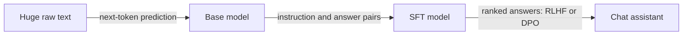

# How LLMs Are Trained: Loss, Backprop, Pretraining, SFT and RLHF
> **Level:** Intermediate · **Reading time:** 12 min · **Phase:** 3 · LLM Concepts

**In one line:** An LLM first learns language by guessing the next token over a huge pile of text (pretraining), then learns to follow instructions from example answers (SFT), then learns what people prefer from ranked answers (RLHF or DPO).

**Before you start:** [How an LLM Works End to End](21-how-an-llm-works-end-to-end.md). You should know that a model turns text into scores for the next token.

## Explain it like I'm new
Think of raising a very well-read assistant in three stages:

1. **Reading everything (pretraining).** The model reads a vast amount of text and plays one game over and over: *"Here are the words so far. Guess the next one."* Each wrong guess gets a small correction. After enough rounds it has absorbed grammar, facts and style, but it only *continues text*. Ask a question and it might continue with more questions.
2. **Learning the job (SFT, supervised fine-tuning).** It is shown thousands of examples of "instruction, good answer" and learns to answer instead of ramble.
3. **Learning taste (preference tuning).** Humans (or AI judges) say which of two answers is better. The model is nudged toward the better kind: more helpful, safer, less rambling.

Plain definitions:
- **Token:** a word piece, the unit the model reads and predicts.
- **Loss:** one number saying how wrong the model is. Training means making it smaller.
- **Parameters (weights):** the adjustable numbers inside the model. Training changes them.
- **Gradient:** for each parameter, which direction and how strongly to change it to reduce loss.

## How it works



### Step 1: the loss (cross-entropy)
At each position the model outputs a probability for every token in its vocabulary (via softmax, see [self-attention](02-self-attention.md)). The loss for that position is `-ln(p)`, where `p` is the probability it gave the **correct** token.

| p on correct token | loss = -ln(p) | feeling |
|---|---|---|
| 1.00 | 0.000 | certain and right |
| 0.90 | 0.105 | confident |
| 0.25 | **1.386** | a 1-in-4 guess |
| 0.01 | 4.605 | badly surprised |

Hand example: the text is "the cat sat" and the model gives `sat` probability 0.25, so loss = -ln 0.25 = **1.386**. **Perplexity** is `e^loss`; here e^1.386 = **4.0**, meaning "as unsure as picking between 4 equally likely tokens". Lower is better. Both are computed in [`llm_training.py`](../code/llm_training.py).

### Step 2: gradient descent
Imagine standing on a foggy hill and wanting the valley. You cannot see it, but you can feel the slope under your feet. Step downhill, repeat. With one parameter `w` and loss `(w - 3)²`, the slope is `2(w - 3)`. Start at `w = 0`, learning rate 0.1:

| step | w | slope | new w = w - 0.1·slope |
|---|---|---|---|
| 0 | 0.0 | -6.0 | 0.6 |
| 1 | 0.6 | -4.8 | 1.08 |
| 2 | 1.08 | -3.84 | 1.464 |

It slides toward 3, with smaller steps as the slope flattens. An LLM does exactly this, but with billions of parameters at once.

### Step 3: backpropagation, in plain words
A model is a long chain of operations. When the loss is high, **backpropagation** works backward from the loss through the chain and uses the **chain rule** (the effect of a change = the effect at each link multiplied together) to compute the gradient for every parameter. It is *blame assignment*: "this weight pushed the answer the wrong way by this much." This is also why the residual highways in [topic 23](23-inside-a-transformer-block.md) matter: they keep the blame signal from fading in deep stacks.

### Training knobs
| Term | Meaning | Too much / too little |
|---|---|---|
| Learning rate | size of each downhill step | too big: loss bounces or explodes; too small: crawls |
| Batch | examples averaged per update | small: noisy; large: smooth but costly |
| Epoch | one full pass over the data | many passes on small data risk memorising |
| Overfitting | great on training text, poor on new text | watch loss on held-out data |

### Pretraining demo: a bigram model with real gradients
The smallest language model: a `V × V` table of scores. Row `i` holds the scores for the token that follows token `i`. Softmax turns a row into probabilities. For a training pair (current, next) the gradient of the loss on that row is simply **`softmax - one_hot(next)`**: push the correct token's score up by `1 - p` and every other score down by its own `p`. The demo trains on a 30-token corpus ("the cat sat on the mat . the dog sat on the rug . ...") with zero starting weights, so it is fully deterministic.

Real output of `python llm_training.py`:

```text
step   0 loss 2.3026      (= ln 10, a uniform guess over 10 tokens)
step  10 loss 2.0954
step  50 loss 1.5280
step 100 loss 1.2076
step 200 loss 0.9852
after 'the': cat 0.35, dog 0.35, mat 0.09     <- learned!
after 'sat': on 0.88
```

It discovered that "the" is followed by "cat" or "dog" (and sometimes "mat" or "rug") and that "sat" is nearly always followed by "on". The loss does not reach 0 because "the" genuinely has several valid followers. A real LLM is the same loop with a transformer instead of a table, trillions of tokens and billions of weights.

### Stage 2: SFT and the loss mask
SFT data is `(prompt, answer)` pairs (see [fine-tuning](15-fine-tuning.md), and [LoRA and PEFT](19-lora-and-peft.md) for the cheap way to do it). The loss is the same next-token loss, except computed **only on answer tokens**, because we want the model to learn to *produce* answers, not to imitate user prompts.

```text
tokens: [ Q:  2+2?  A:  |  4   <eos> ]
mask:   [ 0    0    0   |  1    1    ]   -> loss counts only the last two
```

With per-token losses `[9, 9, 9, 1, 3]` the masked average is (1+3)/2 = **2.0**; the large prompt losses are ignored.

### Stage 3: RLHF vs DPO
After SFT the model can answer, but "good" is subjective. We collect pairs: for one prompt, a **chosen** and a **rejected** answer.

- **RLHF (reinforcement learning from human feedback):** (a) train a **reward model** to score answers so that chosen scores above rejected; (b) use reinforcement learning to nudge the **policy** (the LLM) toward answers with high reward, while a penalty keeps it close to the SFT model so it does not drift into nonsense.
- **DPO (direct preference optimization):** skip the separate reward model and RL loop. A single loss directly raises the probability of chosen answers relative to rejected ones, measured against a frozen reference copy of the model.

The reward model uses the **Bradley-Terry** idea: `P(chosen wins) = sigmoid(r_chosen - r_rejected)`. If the rewards are 2 and 0, `P = 0.881`, loss `-ln 0.881 = 0.127`. If the reward model got it backwards (0 vs 2), loss is 2.127. DPO's loss has the same shape, with the reward replaced by how much the policy has moved from the reference on each answer. In the demo, a policy that already favours the chosen answer gets a lower loss (0.598) than one that favours the rejected one.

### The scale story
Pretraining cost grows with parameters times tokens, and every token needs a forward and a backward pass through every weight. That means thousands of accelerators running for weeks, plus a large curated dataset and engineers to babysit failures. That is why only a few organisations pretrain frontier models from scratch, while most teams start from an open base model and do SFT or LoRA, which is orders of magnitude cheaper. Even our toy needs `V × V` weights: a vocabulary of 10 gives 100 numbers, but a vocabulary of 100,000 would already need 10 billion, which is why real models use the compact transformer instead of a giant table.

## Code example
```python
import math

def softmax(z):
    m = max(z); e = [math.exp(v - m) for v in z]; s = sum(e)
    return [v / s for v in e]

# one training step on one row of logits; correct next token is index 2
logits, target, lr = [0.0, 0.0, 0.0, 0.0], 2, 0.5
p = softmax(logits)
print("loss", -math.log(p[target]))                 # 1.386
grad = [pi - (1.0 if i == target else 0.0) for i, pi in enumerate(p)]
logits = [l - lr * g for l, g in zip(logits, grad)]
print("new p(correct)", softmax(logits)[target])    # higher than 0.25
```

The full bigram trainer, loss mask, Bradley-Terry and DPO loss are in [`llm_training.py`](../code/llm_training.py), with tests in [`test_llm_training.py`](../code/test_llm_training.py).

**In real projects:**

```python
import torch, torch.nn.functional as F

logits = model(input_ids)                       # (batch, tokens, vocab)
labels = input_ids.clone()
labels[:, :prompt_len] = -100                   # SFT mask: ignore prompt tokens
loss = F.cross_entropy(logits[:, :-1].reshape(-1, logits.size(-1)),
                       labels[:, 1:].reshape(-1), ignore_index=-100)
loss.backward(); optimizer.step(); optimizer.zero_grad()
```

## When to use it / when not to
| Goal | Stage to use |
|---|---|
| New language, domain or modality from scratch | Pretraining (very expensive) |
| Teach a format, tone or task | SFT (often with LoRA) |
| Make outputs more helpful or safer by preference | RLHF or DPO |
| Add fresh facts | Retrieval, not training |

Do not pretrain unless you have the data and compute budget. Do not use preference tuning before SFT works: it only refines a model that already answers reasonably.

## Common mistakes
- Believing the model "looks up" its training text. It stores statistical patterns in weights.
- Computing SFT loss on the prompt too, which wastes capacity and can teach the model to imitate user messages.
- Using a learning rate copied from pretraining for fine-tuning; it is usually much smaller.
- Judging progress by training loss alone. Always track held-out loss to catch overfitting.
- Treating RLHF as teaching new knowledge. It mostly shapes style and behaviour.

## Recap

**If you remember only three things:**
- Pretraining teaches next-token prediction. The loss is minus the log of the probability given to the right token, so p = 0.25 gives 1.386.
- Gradient descent nudges every parameter a little to lower the loss, and backpropagation works out which way each should move.
- After pretraining, SFT teaches the model to follow instructions (loss only on the answer), and RLHF or DPO tune it toward preferred answers.

## Interview questions
**1. What is the pretraining objective and what does cross-entropy measure?**
<details><summary>Answer</summary>
Next-token prediction: at each position the model predicts a distribution over the vocabulary, and the loss is -ln of the probability given to the true next token. Assigning 0.25 to the right token costs 1.386; assigning 1.0 costs 0. Perplexity is e raised to the average loss.
</details>

**2. Explain backpropagation and gradient descent simply.**
<details><summary>Answer</summary>
The forward pass computes predictions and loss. Backpropagation applies the chain rule backward through the network to find how much each parameter contributed to the loss (its gradient). Gradient descent then moves each parameter a small step (the learning rate) opposite its gradient, and this repeats over many batches.
</details>

**3. How do SFT, RLHF and DPO differ?**
<details><summary>Answer</summary>
SFT trains on instruction-answer pairs with next-token loss on the answer tokens only. RLHF trains a reward model from ranked answers, then uses reinforcement learning (with a penalty to stay near the SFT model) to raise reward. DPO folds that into one supervised-style loss that directly prefers chosen over rejected answers relative to a reference model, with no separate reward model or RL loop.
</details>

## Go deeper
- [Language Models are Few-Shot Learners (GPT-3, Brown et al., 2020)](https://arxiv.org/abs/2005.14165)
- [Training language models to follow instructions with human feedback (InstructGPT, 2022)](https://arxiv.org/abs/2203.02155)
- [Direct Preference Optimization (Rafailov et al., 2023)](https://arxiv.org/abs/2305.18290)
- [Training Compute-Optimal Large Language Models (Chinchilla, Hoffmann et al., 2022)](https://arxiv.org/abs/2203.15556)
- [Scaling Laws for Neural Language Models (Kaplan et al., 2020)](https://arxiv.org/abs/2001.08361)
- [Learning representations by back-propagating errors (Rumelhart, Hinton, Williams, 1986)](https://www.nature.com/articles/323533a0)

**Prev:** [Inside a Transformer Block](23-inside-a-transformer-block.md) · **Next:** [Modern Attention Variants](25-modern-attention-variants.md) · **Back to phase:** [Phase 3](../README.md)
