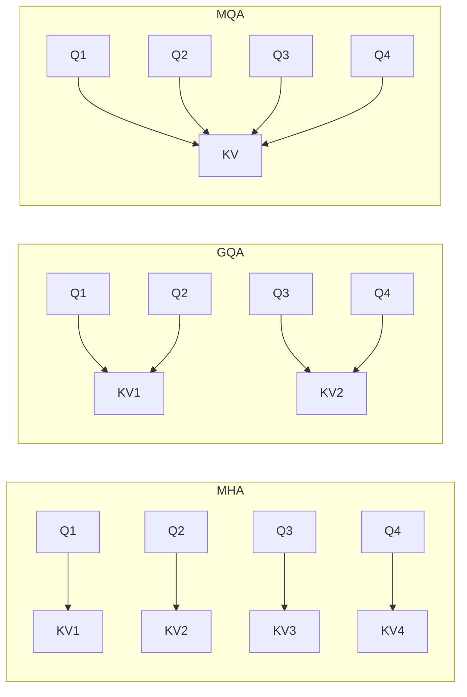

# Modern Attention: MQA, GQA, FlashAttention, Sliding Window and RoPE
> **Level:** Advanced · **Reading time:** 12 min · **Phase:** 3 · LLM Concepts

**In one line:** Modern LLMs keep the attention idea from [self-attention](02-self-attention.md) but change how it is stored and computed (shared K/V heads, tiled exact math, local windows, rotary positions) so long contexts and many users fit on a GPU.

**Before you start:** [KV Cache](07-kv-cache.md) and [Multi Head Attention](03-multi-head-attention.md). This page is about making that attention cheaper.

## Explain it like I'm new
Picture a library with 32 readers (the attention heads). In vanilla [multi-head attention](03-multi-head-attention.md), every reader keeps a private, full set of index cards about every page read so far. That is a lot of cards, and the [KV cache](07-kv-cache.md) is exactly that pile of cards. During generation the GPU spends much of its time just fetching the pile from memory, not doing math.

Five fixes appear in almost every recent model:

| Idea | Plain-words version | What it saves |
|---|---|---|
| **MQA** (multi-query) | All readers share ONE set of index cards | KV-cache memory |
| **GQA** (grouped-query) | Readers form small groups; each group shares a set | Most of the memory, little quality loss |
| **FlashAttention** | Same exact answer, but computed in small tiles that stay in fast on-chip memory | Memory traffic and the giant score matrix |
| **Sliding window** | Each token only looks at the last W tokens | Compute and cache for long inputs |
| **RoPE** | Encode position by *rotating* queries and keys | Gives relative-position awareness, extends well |

Only the first four are about speed and memory. RoPE is a better way to tell the model where words are (compare [positional encoding](04-positional-encoding.md)).

<!-- anim:25-modern-attention-variants -->
## Watch it


*It plays on a loop. Read the caption in the box, one step at a time. Want to go at your own pace? [Step through it with Previous and Next](https://techsaurabh-394.github.io/ai-engineer-roadmap/#25-modern-attention-variants).*

## How it works
### 1. Why vanilla attention is expensive at inference
Every generated token must read the K and V of all earlier tokens, in every layer and head. The cache size is:

```text
2 (K and V) × layers × kv_heads × head_dim × seq_len × bytes_per_number
```

For a 32-layer model with 32 heads, head_dim 128, 8,192 tokens, 16-bit numbers (2 bytes), the module computes `2 × 32 × 32 × 128 × 8192 × 2 = 4 GiB` for **one** conversation. Ten users at once is 40 GiB of cache before counting the model weights. (These are illustrative sizes, not a specific model.)

### 2. MQA and GQA: share the K/V heads
Queries keep all 32 heads, so the model can still ask 32 different questions. Only the keys and values are shared:

- **MHA:** 32 query heads, 32 K/V heads (one each).
- **GQA:** 32 query heads in 8 groups of 4; each group reads one K/V head, so 8 K/V heads.
- **MQA:** 32 query heads all read 1 K/V head.



The size table, straight from `llm_attn_variants.py` (same 32-layer, head_dim 128, 8k, fp16 setup):

| Variant | K/V heads | Cache for one 8k conversation | vs MHA |
|---|---|---|---|
| MHA | 32 | 4.000 GiB | 1x |
| GQA (8 groups) | 8 | 1.000 GiB | 4x smaller |
| MQA | 1 | 0.125 GiB | 32x smaller |

MQA was proposed in [Fast Transformer Decoding](https://arxiv.org/abs/1911.02150); it is the most memory-friendly but can cost some quality. GQA ([Ainslie et al., 2023](https://arxiv.org/abs/2305.13245)) is the middle road and is common in open models. Rule: the number of query heads must divide evenly by the number of K/V heads.

### 3. FlashAttention: exact, but IO-aware
Standard attention builds the full `n × n` score matrix, writes it to GPU main memory (slow), reads it back for softmax, writes again, and so on. For long sequences the traffic, not the arithmetic, is the bottleneck.

FlashAttention ([Dao et al., 2022](https://arxiv.org/abs/2205.14135); [v2](https://arxiv.org/abs/2307.08691)) gives the **same exact result** but:
1. **Tiles** Q, K, V into blocks small enough for fast on-chip memory.
2. Processes one block of scores at a time and **never stores the whole `n × n` matrix**.
3. Uses an **online softmax** so the softmax can be finished incrementally.

The obstacle: softmax needs the maximum and the sum of the *whole* row. The trick is to keep a running max `m` and running denominator `d`. When a new value raises the max, rescale the old denominator by `exp(old_m - new_m)`.

Tiny worked example for scores `[1, 3]`:
- See 1: `m = 1`, `d = e^0 = 1`.
- See 3: new max 3. Rescale: `d = 1 × e^(1-3) + e^(3-3) = 0.1353 + 1 = 1.1353`.
- Probabilities: `e^(1-3)/1.1353 = 0.119` and `1/1.1353 = 0.881`. Identical to ordinary softmax, in one pass.

FlashAttention is an **implementation** change, not a different model: outputs match, only speed and memory differ.

### 4. Sliding-window attention
Instead of looking at every earlier token, a token looks at the last `W` ones (used in [Longformer](https://arxiv.org/abs/2004.05150) and several open LLMs, often mixed with a few full-attention layers). For `n = 8`, `W = 3` (`X` = allowed):

```text
X . . . . . . .
X X . . . . . .
X X X . . . . .
. X X X . . . .
. . X X X . . .
. . . X X X . .
. . . . X X X .
. . . . . X X X
```

The module counts 21 allowed pairs versus 36 for full causal attention. The gap grows quickly: full causal is about `n²/2`, a window is about `n × W`. Information can still travel far because stacked layers pass it along, like a message whispered down a line.

### 5. RoPE: position as rotation
Rotary position embedding ([RoFormer](https://arxiv.org/abs/2104.09864)) does not add a position vector. It takes pairs of numbers in each query and key and **rotates** each pair by an angle proportional to the token's position. Think of each pair as a clock hand: token 5's hand is turned 5 steps, token 2's hand 2 steps.

The key property: the dot product of a rotated query (position `m`) and rotated key (position `n`) depends only on the angle *difference*, which is `(m - n)` steps. So attention naturally sees "3 tokens apart", not "position 103 and 100". From the demo:

```text
m=  5 n=  2 m-n=3  score=0.860824
m= 10 n=  7 m-n=3  score=0.860824
m=103 n=100 m-n=3  score=0.860824
```

Real models use many pairs with different rotation speeds (fast hands for fine local order, slow hands for long range).

### Worked example
The cache sizes below come from [`llm_attn_variants.py`](../code/llm_attn_variants.py): a 32-layer model with 32 heads, head size 128 and 8,192 tokens in 16-bit numbers needs 4 GiB of cache for one conversation.

1. **Multi-head attention** stores K and V for all 32 heads: 4 GiB.
2. **GQA with 8 groups** shares each K/V head among 4 query heads. Only 8 K/V heads are stored: 1 GiB.
3. **MQA** shares one K/V head among all 32: 0.125 GiB.

Same model shape and same text. Only the number of K/V heads changed, and the cache shrank 4x and 32x.

## Code example
From [`llm_attn_variants.py`](../code/llm_attn_variants.py):

```python
def online_softmax(xs):
    m, d = float("-inf"), 0.0
    for x in xs:
        new_m = max(m, x)
        d = d * math.exp(m - new_m) + math.exp(x - new_m)  # rescale old sum
        m = new_m
    return [math.exp(x - m) / d for x in xs]

def rope_2d(vec2, position, theta=0.1):
    x, y = vec2
    a = position * theta
    return (x * math.cos(a) - y * math.sin(a), x * math.sin(a) + y * math.cos(a))
```

Run `python 03-llm-concepts/code/llm_attn_variants.py` for the cache table, the mask and the RoPE check. Tests: `pytest 03-llm-concepts/code/test_llm_attn_variants.py`.

**In real projects** you rarely write these. In Hugging Face you pick them through config and loading options, for example (needs `pip install transformers torch`):

```python
from transformers import AutoModelForCausalLM
model = AutoModelForCausalLM.from_pretrained(name, attn_implementation="sdpa")  # fused, FlashAttention-style kernels when available
print(model.config.num_attention_heads, model.config.num_key_value_heads)  # GQA if the second is smaller
```

## When to use it / when not to
| Technique | Use when | Be careful when |
|---|---|---|
| GQA / MQA | Serving many users or long contexts (memory-bound decoding) | Training from scratch is needed; you cannot just flip a trained MHA model to MQA without extra training |
| FlashAttention | Almost always on supported GPUs, especially long sequences | Unusual custom attention masks or old hardware may fall back to slower kernels |
| Sliding window | Very long inputs where local context dominates | Tasks needing exact recall of a far-away token in a single layer |
| RoPE | Decoder LLMs that need relative-position behavior | Going far beyond the trained length needs scaling tricks and testing |

As an app builder, you mostly *choose a model* that already uses these. The effect shows up as lower price, longer context, and more concurrency (see [inference serving](20-inference-serving-and-batching.md)).

## Common mistakes
- Thinking GQA/MQA shrink the number of *queries*. Only K/V heads are reduced.
- Believing FlashAttention is an approximation. It is exact; it only reorders the computation.
- Assuming a sliding window means the model "forgets" everything older. Deeper layers can still carry older information indirectly, just less reliably.
- Saying RoPE "adds" a position vector. It rotates Q and K instead, and V is untouched.
- Forgetting that memory, not arithmetic, is often the real bottleneck when decoding.

## Recap

**If you remember only three things:**
- GQA and MQA shrink the KV cache by sharing key/value heads between query heads.
- FlashAttention gives the exact same answer as normal attention but works in tiles, so it never stores the whole n by n score table.
- RoPE rotates queries and keys by their position, so the attention score depends on how far apart two tokens are.

## Interview questions
**1. Why does GQA reduce KV-cache size, and by how much?**
<details><summary>Answer</summary>
The cache stores K and V per K/V head, so its size scales with `kv_heads`. With 32 query heads and 8 K/V heads, the cache is 4 times smaller than MHA (32 / 8). MQA, with one K/V head, would be 32 times smaller. Query heads stay the same, so compute for the queries is unchanged.
</details>

**2. FlashAttention is exact. So where does the speedup come from?**
<details><summary>Answer</summary>
From reducing slow GPU memory reads and writes. It tiles the computation so blocks stay in fast on-chip memory and never materializes the full n x n score matrix, using an online softmax (running max and denominator) to combine blocks. The math result is identical; the data movement is much smaller.
</details>

**3. Why does RoPE give relative-position behavior?**
<details><summary>Answer</summary>
Rotating q by angle m·θ and k by n·θ makes their dot product depend on the rotation difference (m − n)·θ, because rotations compose. Shifting both positions by the same amount changes nothing, so the attention score depends on relative distance.
</details>

## Go deeper
- [Fast Transformer Decoding: One Write-Head is All You Need (MQA)](https://arxiv.org/abs/1911.02150)
- [GQA: Training Generalized Multi-Query Transformer Models (Ainslie et al., 2023)](https://arxiv.org/abs/2305.13245)
- [FlashAttention (Dao et al., 2022)](https://arxiv.org/abs/2205.14135) and [FlashAttention-2](https://arxiv.org/abs/2307.08691)
- [Longformer: sliding-window attention](https://arxiv.org/abs/2004.05150)
- [RoFormer: Rotary Position Embedding](https://arxiv.org/abs/2104.09864)

**Prev:** [How LLMs Are Trained](24-how-llms-are-trained.md) · **Next:** [Mixture of Experts and Scaling Laws](26-mixture-of-experts-and-scaling-laws.md) · **Back to phase:** [Phase 3](../README.md)
