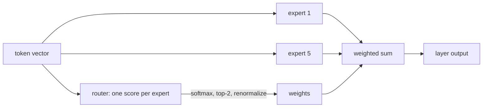

# Mixture of Experts and Scaling Laws
> **Level:** Advanced · **Reading time:** 11 min · **Phase:** 3 · LLM Concepts

**In one line:** A Mixture of Experts (MoE) model has many specialist feed-forward blocks but runs only a few per token, and scaling laws tell us how much model size, data and compute we need for a given quality.

**Before you start:** [Inside a Transformer Block](23-inside-a-transformer-block.md). A mixture of experts replaces the feed-forward network described there.

## Explain it like I'm new
Imagine a hospital. A dense model is a single doctor who handles every patient and must know everything. An MoE model is a hospital with 8 specialists and a **receptionist** (the router). Each patient (token) is sent to the 2 most suitable specialists, and their opinions are blended. The hospital employs 8 doctors (big knowledge capacity) but each patient only costs 2 doctors' time (cheap per patient).

The second half of this page answers a different question: *if I have a fixed budget, should I build a bigger model or train a smaller one longer?* Researchers found that quality improves along smooth, predictable curves, called **scaling laws**. That predictability is why labs can plan multi-million-dollar training runs.

## How it works
### 1. Replace the FFN with experts plus a router
In a [transformer block](01-transformer-architecture.md), attention is followed by a feed-forward network (FFN). MoE ([Shazeer et al., 2017](https://arxiv.org/abs/1701.06538); in transformers, [Switch Transformer](https://arxiv.org/abs/2101.03961)) swaps that single FFN for `E` expert FFNs plus a small router. Attention layers stay as they are.



### 2. The router, step by step
1. Score: the router gives each expert a number (a dot product between the token and the router's weights).
2. Softmax: turn scores into probabilities.
3. Top-k: keep the `k` best experts (commonly 1 or 2); the others do **no work** for this token.
4. Renormalize: divide the kept probabilities by their sum, so they add up to 1.
5. Output = the weighted sum of the chosen experts' outputs.

Tiny worked example: probabilities `[0.5, 0.3, 0.15, 0.05]`, top-2 keeps `0.5` and `0.3`; their sum is `0.8`, so the final weights are `0.625` and `0.375`.

### 3. Total versus active parameters
All experts must exist, but a token only uses `k` of them. With the demo's sizes (`d_model` 4096, `d_ff` 14336, an FFN with two weight matrices, 8 experts, top-2) the module computes, for one MoE FFN layer:

| | Parameters |
|---|---|
| Per expert FFN (`2 × 4096 × 14336`) | 117,440,512 |
| Router (`4096 × 8`) | 32,768 |
| **Total** (8 experts + router) | 939,556,864 |
| **Active per token** (2 experts + router) | 234,913,792 |
| Active / total | 0.25 |

So the layer holds about 4x the knowledge capacity of one expert while costing roughly the compute of two. These are arithmetic on illustrative sizes, not a particular released model.

### 4. The load-balancing problem
Routers can be lazy: a few popular experts get most tokens, the others never learn. Then you pay for memory you do not use, and in a distributed setup the busy expert becomes a bottleneck. The demo's fixed toy router shows it on six tokens:

```text
the -> expert 5 (w=0.52), expert 0 (w=0.48)
cat -> expert 0 (w=0.53), expert 5 (w=0.47)
sat -> expert 4 (w=0.76), expert 0 (w=0.24)
 ...
load per expert: [0.5, 0.0, 0.0, 0.0, 0.25, 0.25, 0.0, 0.0]   imbalance: 4.0
```

Imbalance is `max load × number of experts`. Perfect balance is `1.0`; everything on a single expert would be `8.0`. Here expert 0 handles half of all assignments and four experts get nothing, giving `4.0`.

The usual cure is an **auxiliary balance loss** added during training. In the Switch Transformer form it is `E × Σ f_e × P_e`, where `f_e` is the fraction of tokens sent to expert `e` and `P_e` is its average router probability. It equals `1.0` when both are uniform and rises when routing collapses, so minimizing it nudges the router to spread tokens out. Many systems also cap each expert's capacity per batch.

### 5. Trade-offs
| | Dense model | MoE model |
|---|---|---|
| Compute per token | All parameters | Only the active ones |
| Memory for weights | Equals total | Equals **total** (all experts loaded) |
| Training | Simpler | Needs balancing tricks, can be less stable |
| Serving | Simple | Needs routing and often multi-GPU communication |

Key point: MoE saves **compute**, not **memory**. You still must hold every expert's weights (see [quantization](18-quantization.md) to shrink them).

### 6. Scaling laws
[Kaplan et al. (2020)](https://arxiv.org/abs/2001.08361) found that test loss falls as a **power law** with model parameters `N`, data `D` and compute `C`: roughly `L = a × N^(-α)`. On ordinary axes this is a curve that flattens. On **log-log** axes (take the log of both sides) it is a straight line: `log L = log a − α × log N`, and the slope is `−α`. Fitting a line to a few small runs lets you extrapolate to a larger one.

The demo generates **synthetic** points from `10 × N^(-0.076)` for `N` from 10^6 to 10^9 (made-up numbers, not real measurements; the exponent 0.076 is just an illustration) and recovers `a = 10.000, α = 0.0760` using least squares on the logs.

### 7. The Chinchilla idea and 6·N·D
Training compute is approximately:

```text
FLOPs ≈ 6 × N (parameters) × D (training tokens)
```

[Chinchilla (Hoffmann et al., 2022)](https://arxiv.org/abs/2203.15556) argued that for a fixed compute budget, model size and training tokens should grow *together*; many earlier models were too big and under-trained. A commonly quoted **rule of thumb** from that paper is about 20 training tokens per parameter. The table below is arithmetic from the formula, not measured results:

| Parameters N | Tokens D (20 × N) | FLOPs (6·N·D) |
|---|---|---|
| 100 million | 2 billion | 1.2e18 |
| 1 billion | 20 billion | 1.2e20 |
| 7 billion | 140 billion | 5.88e21 |
| 70 billion | 1.4 trillion | 5.88e23 |

Note the pattern: 10x more parameters with 10x more tokens means 100x more compute. Today's practice often trains small models on far more than 20 tokens per parameter, because a smaller model is cheaper to *serve* forever. Compute-optimal for training is not the same as cheapest overall.

For MoE, use **active** parameters for per-token compute but **total** parameters for memory.

### Worked example
From real output of [`llm_moe_scaling.py`](../code/llm_moe_scaling.py), a toy layer with 8 experts and top-2 routing.

1. The word `sat` goes to the router. Its two best experts are expert 4 (weight 0.76) and expert 0 (weight 0.24). The weights add up to 1.
2. Only those two experts run. The other six do nothing for this token.
3. For one real-sized layer (d_model 4096, d_ff 14336) the total is 939,556,864 parameters but only 234,913,792 are active per token. That is 0.25, which is 2 of 8 experts.
4. Look at the load: expert 0 handles half the tokens while four experts get none (imbalance 4.0). That uneven use is the load-balancing problem.

## Code example
From [`llm_moe_scaling.py`](../code/llm_moe_scaling.py):

```python
def route(scores, k):
    probs = softmax(scores)
    top = sorted(range(len(probs)), key=lambda i: (-probs[i], i))[:k]
    total = sum(probs[i] for i in top)
    return [(i, probs[i] / total) for i in top]      # weights sum to 1

def training_flops(params, tokens):
    return 6 * params * tokens

print(route([0.1, 5.0, 0.2, 4.0], 2))   # experts 1 and 3, weights ~0.73 / 0.27
print(training_flops(1e9, 20e9))        # 1.2e+20
```

Run `python 03-llm-concepts/code/llm_moe_scaling.py`; tests: `pytest 03-llm-concepts/code/test_llm_moe_scaling.py`.

**In real projects** you will not implement MoE; you pick a released MoE model and read its model card for *total* and *active* parameter counts. Check the memory needed for total parameters before deploying. Use the 6·N·D formula for rough cost planning, never for exact bills.

## When to use it / when not to
- **MoE helps** when you want large capacity with lower compute per token and have enough memory and multi-GPU setup to host all experts.
- **MoE is awkward** for tiny or single-GPU deployments, where a smaller dense model is simpler and the whole thing must fit in memory anyway.
- **Scaling laws help** for planning: estimating whether more data, a bigger model, or a longer run is worth the budget.
- **Don't over-trust them**: fits are extrapolations on a given setup. They predict loss, not whether a model can do a specific task or avoid [hallucination](13-hallucination.md).

## Common mistakes
- Saying an MoE model "has 2 experts" when it has 8 and uses 2. Total and active are different numbers.
- Assuming MoE cuts memory. It cuts compute per token only.
- Forgetting the router can collapse onto a few experts unless balanced.
- Reading `6·N·D` as a measured value. It is a rule-of-thumb estimate.
- Treating "20 tokens per parameter" as a law of nature. It is a rule of thumb for compute-optimal training under one study's setup.
- Believing a straight line on a log-log plot means linear growth; it means a power law.

## Recap

**If you remember only three things:**
- A mixture of experts has many feed-forward experts. A router sends each token to only its top few.
- Total parameters stay large (all must sit in memory), but active parameters per token are a small fraction.
- Scaling laws say loss falls smoothly with more parameters, data and compute. Training cost is roughly 6 times parameters times tokens.

## Interview questions
**1. What is the difference between total and active parameters in an MoE model?**
<details><summary>Answer</summary>
Total parameters count all experts (plus shared layers); active parameters count only what one token actually uses, i.e. the top-k experts plus shared layers. With 8 experts and top-2, active expert parameters are about a quarter of total. Compute scales with active, memory with total.
</details>

**2. Why is load balancing needed, and how is it encouraged?**
<details><summary>Answer</summary>
Without it the router may send most tokens to a few experts, wasting the rest and creating hotspots on the GPUs holding them. An auxiliary loss, such as Switch Transformer's E × Σ f_e × P_e, penalizes uneven token fractions and router probabilities; capacity limits per expert also help.
</details>

**3. What does the Chinchilla result say, and what is 6·N·D?**
<details><summary>Answer</summary>
For a fixed training-compute budget, parameters and training tokens should be scaled together instead of only making the model bigger; a commonly quoted rule of thumb is roughly 20 tokens per parameter. 6·N·D is the approximate training FLOPs for N parameters trained on D tokens (about 6 operations per parameter per token), used for quick planning.
</details>

## Go deeper
- [Outrageously Large Neural Networks: The Sparsely-Gated Mixture-of-Experts Layer](https://arxiv.org/abs/1701.06538)
- [Switch Transformers (Fedus et al., 2021)](https://arxiv.org/abs/2101.03961)
- [Scaling Laws for Neural Language Models (Kaplan et al., 2020)](https://arxiv.org/abs/2001.08361)
- [Training Compute-Optimal Large Language Models (Chinchilla, 2022)](https://arxiv.org/abs/2203.15556)

**Prev:** [Modern Attention: MQA, GQA, FlashAttention, Sliding Window and RoPE](25-modern-attention-variants.md) · **Next:** [Phase 4 · Agentic AI](../../04-agentic-ai/README.md) · **Back to phase:** [Phase 3](../README.md)
