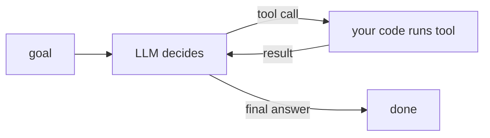

# What is an AI Agent?
> **Level:** Beginner · **Reading time:** 6 min · **Phase:** 4 · Agentic AI

**In one line:** An AI agent is an LLM running in a loop that decides which actions (tool calls) to take, sees the results, and keeps going until the goal is done.

## Explain it like I'm new
A plain chatbot is like asking a friend a question by text message: you ask, they reply, done. An agent is like giving an assistant a task: "Find three flights to Delhi under ₹8,000 and add the cheapest to my calendar." The assistant searches, reads results, compares, then uses the calendar, deciding each next step based on what they just learned.

Key words:
- **LLM:** the language model that does the thinking (deciding).
- **Tool:** a function your code exposes, such as `search_flights` or `add_event`.
- **Loop:** ask the model → run the tool it picked → give it the result → ask again.
- **Environment:** everything outside the model that tools touch (files, APIs, databases).

The model never runs code itself. It **asks** for a tool; **your code** runs it. That boundary is where you put safety checks.

## How it works
1. Send the model the goal, the conversation so far, and a list of available tools (names, descriptions, input schemas).
2. The model replies with either a final answer or one or more **tool calls** (tool name + arguments).
3. Your code validates and runs each tool call.
4. You send the tool results back as new messages.
5. Repeat until the model gives a final answer or you hit a step limit.




**Agent vs workflow.** Anthropic's guide *Building effective agents* draws a useful line:
- A **workflow** follows code paths you wrote in advance (step 1, then step 2), with LLM calls inside.
- An **agent** lets the model choose the steps and how many to take.

Workflows are more predictable and cheaper. Agents are more flexible for open-ended tasks where you cannot predict the steps.

## Code example
The core loop from [`agent.py`](../code/agent.py) (runs offline with a scripted model):

```python
def run_agent(llm, user_goal, max_steps=6):
    messages = [{"role": "user", "content": user_goal}]
    for step in range(1, max_steps + 1):
        reply = llm.step(messages, TOOL_SPECS)
        messages.append({"role": "assistant", "content": reply["raw"]})
        if not reply["tool_calls"]:
            return reply["text"]                         # model says it is done
        results = []
        for call in reply["tool_calls"]:
            fn = TOOLS.get(call["name"])
            out = fn(**call["input"]) if fn else f"Error: unknown tool {call['name']}"
            results.append({"type": "tool_result", "tool_use_id": call["id"], "content": out})
        messages.append({"role": "user", "content": results})
    return "Stopped: reached max steps without finishing."   # always cap the loop
```

Run it: `python 04-agentic-ai/code/agent.py`. With `ANTHROPIC_API_KEY` set and `pip install anthropic`, it also runs against Claude.

## When to use it / when not to
| Situation | Better choice |
|---|---|
| Steps are known and fixed (extract → classify → store) | Workflow |
| One question, answer from documents | RAG, no agent |
| Open-ended, steps depend on results (research, debugging, multi-tool tasks) | Agent |
| High-risk actions (payments, deleting data) | Agent only with approvals and strict guardrails |

- Start with the simplest thing that works. Add agent autonomy only when it clearly helps.
- Agents cost more (many calls) and fail in more ways (loops, wrong tool, bad arguments).

## Common mistakes
- No step limit, so a confused agent loops and spends money.
- Giving the agent powerful tools (shell, email, payments) without checks.
- Building an agent when a fixed workflow would be simpler and more reliable.
- Not logging each step, so failures can't be replayed.
- Trusting text from tools or web pages as if it were the user's instruction.

## Interview questions
**1. What is the difference between an LLM call and an agent?**
<details><summary>Answer</summary>
An LLM call is one request and one response. An agent puts the LLM in a loop with tools: it decides an action, observes the result, and decides again until the goal is met or a limit is reached.
</details>

**2. When would you choose a workflow over an agent?**
<details><summary>Answer</summary>
When the steps are known in advance. Workflows are more predictable, cheaper, easier to test, and easier to debug. Use an agent when the path depends on intermediate results.
</details>

**3. Who executes the tools in an agent, the model or your code?**
<details><summary>Answer</summary>
Your code. The model only outputs a structured request (tool name and arguments). This is why validation, permissions, and approvals belong in your code.
</details>

## Go deeper
- [Anthropic: Building effective agents](https://www.anthropic.com/research/building-effective-agents)
- [ReAct: Synergizing Reasoning and Acting in Language Models (Yao et al., 2022)](https://arxiv.org/abs/2210.03629)

**Prev:** [Phase 4 overview](../README.md) · **Next:** [Tool Calling](02-tool-calling.md) · **Back to phase:** [Phase 4](../README.md)
