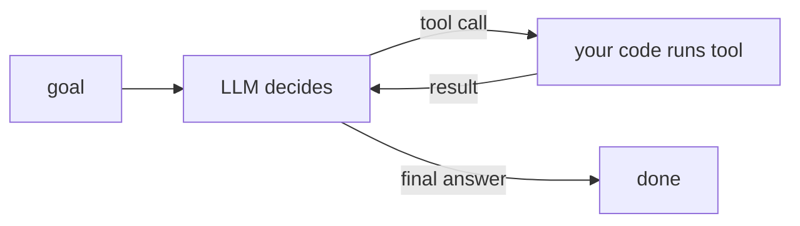
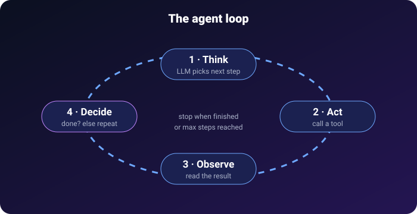

# What is an AI Agent?
> **Level:** Beginner · **Reading time:** 7 min · **Phase:** 4 · Agentic AI

**In one line:** An AI agent is an LLM running in a loop that decides which actions (tool calls) to take, sees the results, and keeps going until the goal is done.

**Before you start:** Nothing, this is a starting point. You only need to know that an LLM is a program that takes text in and writes text back.

## Explain it like I'm new
A plain chatbot is like asking a friend a question by text message: you ask, they reply, done. An agent is like giving an assistant a task: "Find three flights to Delhi under ₹8,000 and add the cheapest to my calendar." The assistant searches, reads results, compares, then uses the calendar, deciding each next step based on what they just learned.

Words to know:
- **LLM (large language model):** a program trained on lots of text that writes text in reply to text. It does the thinking (deciding).
- **Agent:** an LLM plus tools plus a loop, so it can take several steps toward a goal.
- **Tool:** a function your code exposes, such as `search_flights` or `add_event`.
- **Loop:** ask the model → run the tool it picked → give it the result → ask again.
- **Environment:** everything outside the model that tools touch (files, APIs, databases).
- **API (application programming interface):** a way for one program to ask another program for something.

The model never runs code itself. It **asks** for a tool; **your code** runs it. That boundary is where you put safety checks.

## How it works
1. Send the model the goal, the conversation so far, and a list of available tools. Each tool has a name, a description, and an input schema (a description of the arguments it accepts).
2. The model replies with either a final answer or one or more **tool calls** (tool name + arguments).
3. Your code validates and runs each tool call.
4. You send the tool results back as new messages.
5. Repeat until the model gives a final answer or you hit a step limit.





**Agent vs workflow.** Anthropic's guide *Building effective agents* draws a useful line:
- A **workflow** follows code paths you wrote in advance (step 1, then step 2), with LLM calls inside.
- An **agent** lets the model choose the steps and how many to take.

Workflows are more predictable and cheaper. Agents are more flexible when you cannot predict the steps in advance.

### Worked example
Goal: *"What is 12*7+5? Save the answer as a note."* This is the real output of `python 04-agentic-ai/code/agent.py` (the model is a scripted stand-in, so no API key is needed):

```text
step 1: calculator({"expression": "12*7+5"}) -> 89
step 2: save_note({"text": "12*7+5 = 89"}) -> Saved note #1.
12*7+5 is 89, and I saved it as a note.
```

Trace it:
1. Your code sends the goal and the tool list to the model.
2. The model replies with a tool call: `calculator` with `expression = "12*7+5"`. It does no maths itself.
3. Your code runs `calculator` and gets `89`. It sends `89` back to the model as a tool result.
4. The model sees the answer, but the goal also says to save it. So it asks for `save_note` with the text `12*7+5 = 89`.
5. Your code runs `save_note`, which returns `Saved note #1.`, and sends that back.
6. The model now has nothing left to do. It replies with plain text and no tool call. That reply is the final answer, and the loop ends.

Notice that the model picked the second step *because of* the first result. That choosing is what makes it an agent.

## Code example
The core loop from [`agent.py`](../code/agent.py) (runs offline with a scripted model):

```python
def run_agent(llm, user_goal, max_steps=6):
    messages = [{"role": "user", "content": user_goal}]
    for step in range(1, max_steps + 1):
        reply = llm.step(messages, TOOL_SPECS)
        messages.append({"role": "assistant", "content": reply["raw"]})
        if not reply["tool_calls"]:
            return reply["text"]                         # model says it is done
        results = []
        for call in reply["tool_calls"]:
            fn = TOOLS.get(call["name"])
            out = fn(**call["input"]) if fn else f"Error: unknown tool {call['name']}"
            results.append({"type": "tool_result", "tool_use_id": call["id"], "content": out})
        messages.append({"role": "user", "content": results})
    return "Stopped: reached max steps without finishing."   # always cap the loop
```

Run it: `python 04-agentic-ai/code/agent.py`. With `ANTHROPIC_API_KEY` set and `pip install anthropic`, it also runs against Claude.

## When to use it / when not to
| Situation | Better choice |
|---|---|
| Steps are known and fixed (extract → classify → store) | Workflow |
| One question, answer from documents | RAG, no agent |
| Open-ended, steps depend on results (research, debugging, multi-tool tasks) | Agent |
| High-risk actions (payments, deleting data) | Agent only with approvals and strict guardrails |

- Start with the simplest thing that works. Add agent autonomy only when it clearly helps.
- Agents cost more (many calls) and fail in more ways (loops, wrong tool, bad arguments).

## Common mistakes
- No step limit, so a confused agent loops and spends money.
- Giving the agent powerful tools (shell, email, payments) without checks.
- Building an agent when a fixed workflow would be simpler and more reliable.
- Not logging each step, so failures can't be replayed.
- Trusting text from tools or web pages as if it were the user's instruction.
- Thinking the agent "runs" the tools itself. The model only asks, and your code does the running.

## Recap
If you remember only three things:
- An agent is an LLM in a loop: decide, act with a tool, read the result, decide again.
- The model only asks for tools. Your code runs them, so your code is where safety checks live.
- Always cap the number of steps, and use a plain workflow when the steps are known in advance.

## Interview questions
**1. What is the difference between an LLM call and an agent?**
<details><summary>Answer</summary>
An LLM call is one request and one response. An agent puts the LLM in a loop with tools: it decides an action, observes the result, and decides again until the goal is met or a limit is reached.
</details>

**2. When would you choose a workflow over an agent?**
<details><summary>Answer</summary>
When the steps are known in advance. Workflows are more predictable, cheaper, easier to test, and easier to debug. Use an agent when the path depends on intermediate results.
</details>

**3. Who executes the tools in an agent, the model or your code?**
<details><summary>Answer</summary>
Your code. The model only outputs a structured request (tool name and arguments). This is why validation, permissions, and approvals belong in your code.
</details>

## Go deeper
- [Anthropic: Building effective agents](https://www.anthropic.com/research/building-effective-agents)
- [ReAct: Synergizing Reasoning and Acting in Language Models (Yao et al., 2022)](https://arxiv.org/abs/2210.03629)

**Prev:** [Phase 4 overview](../README.md) · **Next:** [Tool Calling](02-tool-calling.md) · **Back to phase:** [Phase 4](../README.md)
