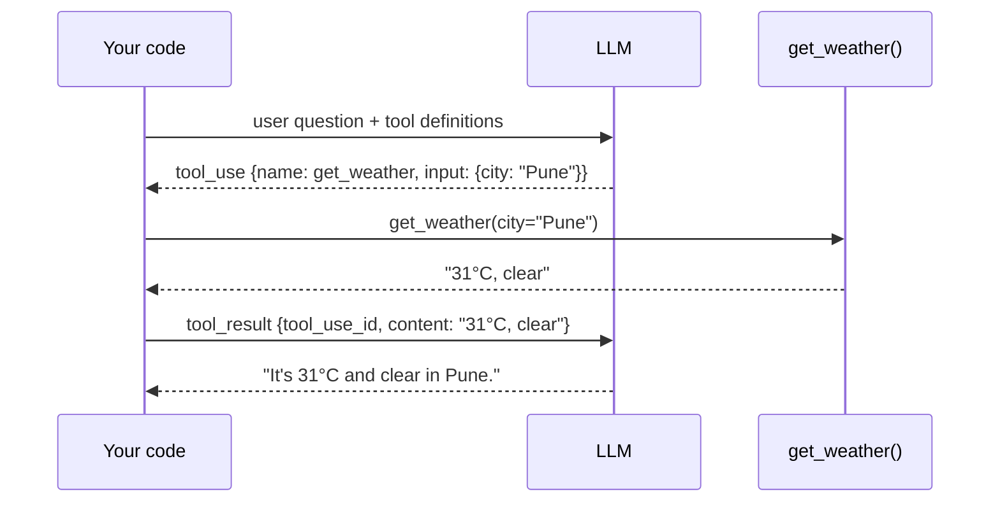

# Tool Calling
> **Level:** Beginner · **Reading time:** 7 min · **Phase:** 4 · Agentic AI

**In one line:** Tool calling is how an LLM asks your program to run a function for it, by outputting the tool's name and arguments in a structured format.

## Explain it like I'm new
Think of a manager on the phone who can't touch a computer. They say, "Look up order 1234 and tell me the status." An assistant at a desk does the lookup and reads back the result. The manager is the LLM; the assistant is your code; the computer system is the tool.

LLMs on their own can only produce text. They can't check today's weather, read your database, or do exact math reliably. **Tools** fix that. You describe each tool to the model:
- a **name** (`get_weather`),
- a **description** (when to use it),
- an **input schema** in **JSON Schema** (a standard way to describe what fields a JSON object has and their types).

The model reads these descriptions and, when useful, replies with a **tool call** instead of plain text. Your code runs the function and sends back a **tool result**.

## How it works
Using the Anthropic Messages API as the example (other providers are similar):

1. You send `tools=[...]` with each tool's `name`, `description`, and `input_schema`.
2. The model replies with a content block of type `tool_use` containing an `id`, `name`, and `input` (the arguments). The response's `stop_reason` is `"tool_use"`.
3. Your code looks up the function by name, validates `input`, and runs it.
4. You send a new `user` message with a `tool_result` block that has the same `tool_use_id` and the output as `content`.
5. The model reads the result and either calls another tool or writes the final answer.



**Tool definition example:**

```json
{
  "name": "get_weather",
  "description": "Get the current weather for a city. Use when the user asks about weather.",
  "input_schema": {
    "type": "object",
    "properties": {"city": {"type": "string", "description": "City name, e.g. Pune"}},
    "required": ["city"]
  }
}
```

## Code example
Offline: [`agent.py`](../code/agent.py) defines tools as plain functions plus a `TOOL_SPECS` list in exactly this format. [`agent_react.py`](../code/agent_react.py) adds argument validation.

```python
from agent_react import tool_specs, dispatch

print(tool_specs()[1]["name"], tool_specs()[1]["input_schema"]["required"])  # multiply ['a', 'b']
print(dispatch("multiply", {"a": 6, "b": 7}))     # 42
print(dispatch("multiply", {"a": "6"}))           # Error: missing required argument 'b'
```

**In real projects** (Anthropic Python SDK):

```python
import anthropic

client = anthropic.Anthropic()
tools = [{
    "name": "get_weather",
    "description": "Get the current weather for a city.",
    "input_schema": {"type": "object", "properties": {"city": {"type": "string"}}, "required": ["city"]},
}]
messages = [{"role": "user", "content": "What's the weather in Pune?"}]
resp = client.messages.create(model="claude-sonnet-4-5", max_tokens=500, tools=tools, messages=messages)

if resp.stop_reason == "tool_use":
    call = next(b for b in resp.content if b.type == "tool_use")
    result = "31°C, clear"                      # your real function would run here
    messages += [
        {"role": "assistant", "content": resp.content},
        {"role": "user", "content": [{"type": "tool_result", "tool_use_id": call.id, "content": result}]},
    ]
    final = client.messages.create(model="claude-sonnet-4-5", max_tokens=500, tools=tools, messages=messages)
    print(final.content[0].text)
```

## When to use it / when not to
- **Use** tools for fresh data (APIs, search), private data (databases), exact work (math, code execution), and actions (send, create, update).
- **Don't** use a tool for what the model does well alone (rewording, summarizing text already in the prompt).
- Fewer, well-described tools beat many overlapping ones. Models pick wrong tools when names and descriptions are vague.

## Common mistakes
- Vague descriptions like "does stuff with data". Say what it does, when to use it, and what it returns.
- Not validating arguments. The model can send wrong types or missing fields.
- Raising exceptions instead of returning a readable error string the model can recover from.
- Forgetting to echo the `tool_use_id` in the result, so the API rejects the message.
- Returning huge outputs (whole web pages) that flood the [context window](../../03-llm-concepts/topics/08-context-window.md).

## Interview questions
**1. What does the model actually return when it "calls a tool"?**
<details><summary>Answer</summary>
A structured block naming the tool and giving JSON arguments (for Anthropic, a tool_use block with id, name, input). It does not run anything; your code does.
</details>

**2. What makes a tool easy for a model to use correctly?**
<details><summary>Answer</summary>
A clear, distinct name; a description of what it does and when to use it; a strict input schema with described fields; and short, readable outputs and error messages.
</details>

**3. How should a tool report errors?**
<details><summary>Answer</summary>
As a normal, readable tool result (Anthropic also supports an is_error flag) explaining what went wrong and how to fix it, so the model can retry with corrected arguments instead of the program crashing.
</details>

## Go deeper
- [Anthropic docs: Tool use with Claude](https://docs.anthropic.com/en/docs/build-with-claude/tool-use)
- [JSON Schema](https://json-schema.org/)

**Prev:** [What is an AI Agent?](01-what-is-an-ai-agent.md) · **Next:** [Function Calling](03-function-calling.md) · **Back to phase:** [Phase 4](../README.md)
