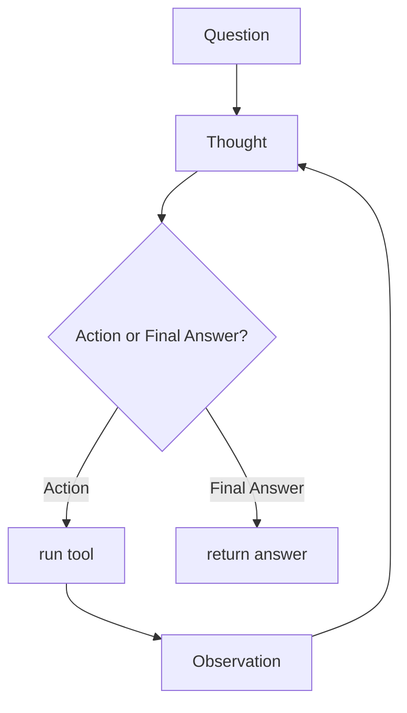

# ReAct Pattern
> **Level:** Intermediate · **Reading time:** 8 min · **Phase:** 4 · Agentic AI

**In one line:** ReAct (Reason + Act) is an agent pattern where the model alternates between writing a short thought, taking an action with a tool, and reading the observation, until it can answer.

## Explain it like I'm new
Think of how a detective solves a case. "I think the butler was in the kitchen" (thought). "Let me check the kitchen camera" (action). "The camera shows nobody at 9 pm" (observation). "So the butler lied; let me check his phone records" (next thought). Each clue changes the next step.

The ReAct paper (Yao et al., 2022) showed that mixing **reasoning traces** (thoughts in plain text) with **actions** (tool calls) works better than either alone on several tasks:
- Reasoning only (chain-of-thought) can drift into made-up facts because it never checks anything.
- Acting only can wander, because the model doesn't plan what to look for next.

Interleaving the two lets the model plan, gather facts, and adjust.

## How it works
The model writes text in a fixed format, and your code parses it:

```text
Question: What is double the population of France?
Thought: I need France's population.
Action: lookup
Action Input: {"topic": "france"}
Observation: France has a population of about 68 million. Capital: Paris.
Thought: About 68 million. Double that.
Action: multiply
Action Input: {"a": 68, "b": 2}
Observation: 136
Thought: I have the result.
Final Answer: Double France's population is about 136 million.
```

1. Build a prompt: instructions, tool list, the question, and the transcript so far.
2. Call the model. It writes a **Thought** and either an **Action** + **Action Input**, or a **Final Answer**.
3. If it's an action: parse it, run the tool, append `Observation: <result>` to the transcript.
4. If parsing fails: append an error as the observation so the model can fix its format.
5. Repeat until **Final Answer** or **max steps**.



**ReAct today.** The original paper used plain text and parsing. Modern APIs have native tool calling, so the "Action" is a structured tool call instead of text. The idea is the same: think, act, observe, repeat. Most agent frameworks (for example LangGraph's prebuilt ReAct agent) implement this loop.

## Code example
From [`agent_react.py`](../code/agent_react.py), runnable offline with a scripted model:

```python
import json, re
from agent_react import dispatch   # validates and runs a tool, returns a string

_ACTION = re.compile(r"Action:\s*(\S+)\s*\nAction Input:\s*(\{.*\})", re.S)
_FINAL = re.compile(r"Final Answer:\s*(.*)", re.S)

def parse(text):
    if m := _FINAL.search(text):
        return ("final", m.group(1).strip())
    m = _ACTION.search(text)
    if not m:
        return ("error", "Use 'Action' + 'Action Input' or 'Final Answer'.")
    try:
        return ("action", m.group(1), json.loads(m.group(2)))
    except json.JSONDecodeError as e:
        return ("error", f"Action Input is not valid JSON: {e.msg}")

def run_react(llm, question, max_steps=5):
    transcript = f"Question: {question}\n"
    for _ in range(max_steps):
        text = llm(transcript)
        transcript += text.strip() + "\n"
        kind, *rest = parse(text)
        if kind == "final":
            return rest[0]
        obs = f"Error: {rest[0]}" if kind == "error" else dispatch(rest[0], rest[1])
        transcript += f"Observation: {obs}\n"
    return "Stopped: reached max steps without a final answer."
```

Run `python 04-agentic-ai/code/agent_react.py` to see the full trace. The tests in [`test_agent_react.py`](../code/test_agent_react.py) check that observations are fed back, bad formats are recovered from, and the step cap works.

**In real projects** (LangGraph prebuilt agent; check the [LangGraph docs](https://langchain-ai.github.io/langgraph/) for the current signature):

```python
from langgraph.prebuilt import create_react_agent

def multiply(a: float, b: float) -> float:
    """Multiply two numbers."""
    return a * b

agent = create_react_agent("anthropic:claude-sonnet-4-5", tools=[multiply])
result = agent.invoke({"messages": [{"role": "user", "content": "What is 6 times 7?"}]})
```

## When to use it / when not to
- **Use** for multi-step questions where each step depends on the last (research, lookups, troubleshooting).
- **Don't** use for single-step tasks; a plain tool call or a workflow is cheaper.
- Every step is another model call: cost and latency grow with steps.

| Pattern | Thinks | Acts | Risk |
|---|---|---|---|
| Chain-of-thought | yes | no | made-up facts |
| Act-only | no | yes | aimless actions |
| ReAct | yes | yes | more calls, needs step cap |

## Common mistakes
- No step cap, so it loops on the same action.
- Brittle parsing that crashes on small format changes. Return parse errors as observations instead.
- Letting the model invent the Observation line itself. Stop generation before "Observation:" (or use native tool calling), and only your code writes observations.
- Huge observations that bury earlier thoughts. Truncate or summarize tool outputs.

## Interview questions
**1. What problem does ReAct solve compared with chain-of-thought alone?**
<details><summary>Answer</summary>
Chain-of-thought reasons only from what the model already knows, so errors and made-up facts compound. ReAct grounds reasoning with real observations from tools, and uses reasoning to decide which action to take next.
</details>

**2. What are the three repeating parts of a ReAct step?**
<details><summary>Answer</summary>
Thought (reasoning text), Action (tool name and input), Observation (the tool result inserted by your code). It ends with a Final Answer.
</details>

**3. How do you stop a ReAct agent from looping forever?**
<details><summary>Answer</summary>
A hard max_steps limit, detecting repeated identical actions, a token or cost budget, and a clear stop condition in the prompt. Return a "stopped" result when the limit is hit.
</details>

## Go deeper
- [ReAct: Synergizing Reasoning and Acting in Language Models (Yao et al., 2022)](https://arxiv.org/abs/2210.03629)
- [Chain-of-Thought Prompting (Wei et al., 2022)](https://arxiv.org/abs/2201.11903)

**Prev:** [Function Calling](03-function-calling.md) · **Next:** [Planning Agents](05-planning-agents.md) · **Back to phase:** [Phase 4](../README.md)
