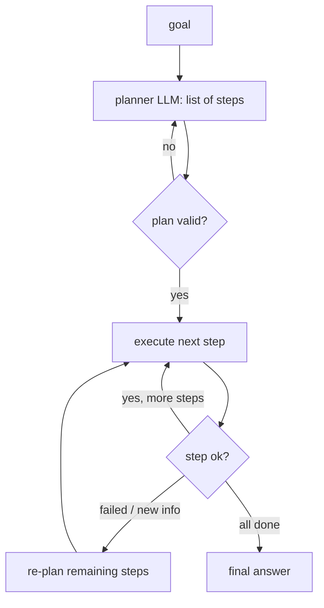

# Planning Agents
> **Level:** Intermediate · **Reading time:** 7 min · **Phase:** 4 · Agentic AI

**In one line:** A planning agent first writes a list of steps for the whole task, then executes them one by one, re-planning if something goes wrong.

## Explain it like I'm new
Compare two ways to cook a new dish. One cook reads one line of the recipe, does it, reads the next line, does it (that is like [ReAct](04-react-pattern.md)). Another cook reads the whole recipe first, lays out a plan ("chop everything, boil water, then fry"), and then works through it, adjusting if the shop was out of an ingredient. That second cook is a **planning agent**.

A plan helps with long tasks because the model doesn't have to keep the whole goal "in its head" at every step. It also gives you, the developer, something to show a user ("here is what I'm going to do, OK?") and something to log and test.

Common names you'll see:
- **Plan-and-execute:** a planner LLM writes steps; an executor (often a ReAct agent) runs each step.
- **Re-planning:** after each step, check results and update the remaining plan.
- **Task decomposition:** breaking a big goal into smaller sub-goals.

## How it works
1. **Plan.** Ask the model for a list of steps in a structured format (for example JSON: `[{"step": 1, "tool": "...", "goal": "..."}]`).
2. **Validate the plan.** Check tools exist, the number of steps is reasonable, and risky steps are flagged for approval.
3. **Execute** each step, passing in results from earlier steps.
4. **Check** after each step: did it succeed? Is the plan still valid?
5. **Re-plan** if a step fails or new information changes things.
6. **Finish** by combining results into the final answer.



**Example plan** for "Write a short report on our top 3 customers by revenue and email it to the sales lead":

```json
[
  {"step": 1, "tool": "sql_query", "goal": "get top 3 customers by revenue this quarter"},
  {"step": 2, "tool": "write_text", "goal": "draft a 200-word report"},
  {"step": 3, "tool": "send_email", "goal": "send to sales lead", "needs_approval": true}
]
```

## Code example
[`agent_multi.py`](../code/agent_multi.py) has a simple rule-based planner (a real one would be an LLM call that returns JSON) and an executor with guardrails:

```python
from agent_multi import planner, run_pipeline

print(planner("agents"))
# [{'tool': 'write_text', 'arg': 'agents'}]
print(planner("agents and email it"))
# [{'tool': 'write_text', 'arg': 'agents and email it'}, {'tool': 'send_email', 'arg': None}]

result = run_pipeline("agents and email it", approver=lambda tool, preview: True)
print(result["status"])     # done
for line in result["log"]:
    print(line)
```

A plan validator you can add before execution:

```python
def validate_plan(plan, allowed_tools, max_steps=8):
    if not plan or len(plan) > max_steps:
        return "plan is empty or too long"
    for s in plan:
        if s.get("tool") not in allowed_tools:
            return f"unknown tool in plan: {s.get('tool')}"
    return None
```

**In real projects**, frameworks like [LangGraph](https://langchain-ai.github.io/langgraph/) let you build plan → execute → re-plan as a graph with explicit state, so you can pause, inspect, and resume.

## When to use it / when not to
- **Use** for long tasks with several distinct parts, when users want to review the plan first, or when you need predictable cost.
- **Don't** use for short tasks; planning adds an extra model call.
- Plans made before seeing any data can be wrong. Allow re-planning.

| | ReAct | Plan-and-execute |
|---|---|---|
| Decides steps | one at a time | mostly up front |
| Good for | short, exploratory tasks | longer, multi-part tasks |
| Human review | hard (steps appear one by one) | easy (review the plan) |
| Adapts to surprises | naturally | needs re-planning |

## Common mistakes
- Treating the first plan as fixed and never re-planning.
- Free-text plans that code can't parse. Ask for JSON and validate it.
- Plans with dozens of tiny steps. Each step is a call, a cost, and a chance to fail.
- Executing risky steps in the plan without a human approval gate.

## Interview questions
**1. When is plan-and-execute better than ReAct?**
<details><summary>Answer</summary>
For long, multi-part tasks where an overall structure helps, when a human should approve the plan, or when you want more predictable cost. ReAct is better for short, exploratory tasks where each step depends heavily on the last.
</details>

**2. Why re-plan?**
<details><summary>Answer</summary>
The first plan is made before seeing real data. Tool failures or new information can make later steps wrong or unnecessary, so the agent should update the remaining steps.
</details>

**3. How do you make an LLM-produced plan safe to execute?**
<details><summary>Answer</summary>
Require structured output, validate it in code (known tools, step limit, argument checks), flag risky steps for human approval, and enforce guardrails during execution regardless of the plan.
</details>

## Go deeper
- [Plan-and-Solve Prompting (Wang et al., 2023)](https://arxiv.org/abs/2305.04091)
- [Anthropic: Building effective agents](https://www.anthropic.com/research/building-effective-agents)
- [LangGraph documentation](https://langchain-ai.github.io/langgraph/)

**Prev:** [ReAct Pattern](04-react-pattern.md) · **Next:** [Reflection](06-reflection.md) · **Back to phase:** [Phase 4](../README.md)
