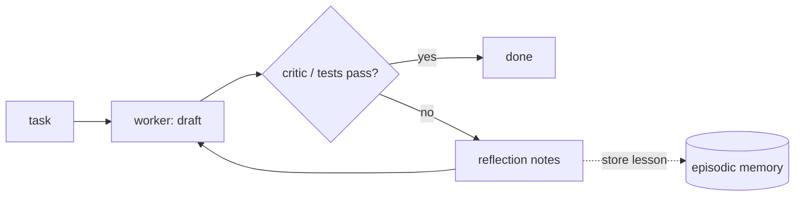

# Reflection
> **Level:** Intermediate · **Reading time:** 7 min · **Phase:** 4 · Agentic AI

**In one line:** Reflection is when an agent reviews its own output (or gets feedback from a critic), writes down what went wrong, and tries again using that feedback.

## Explain it like I'm new
When you write an important email, you often re-read it before sending: "Too long. I forgot the deadline. Fix that." Then you send the better version. That re-read-and-fix step is **reflection**.

For agents, reflection usually takes one of two forms:
- **Self-critique:** the same model checks its draft against the task and revises.
- **Critic agent:** a separate prompt or model plays reviewer and sends feedback to the worker.

The **Reflexion** paper (Shinn et al., 2023) went further: after a failed attempt, the agent writes a short verbal lesson ("I searched the wrong name; next time search the full title") and stores it in memory. The next attempt reads those lessons. The paper calls this "verbal reinforcement learning", because the model improves across tries without changing its weights.

Reflection works best when there is a **real signal** to check against: a failing test, a validation error, a rubric, or a tool result. Pure "are you sure?" checks without new information help less and can even make correct answers worse.

## How it works
1. **Generate** a draft (an answer, code, or plan).
2. **Evaluate** it. Best: an objective check (run the tests, validate the JSON, check citations). Otherwise: a critic prompt with a clear rubric.
3. **Reflect.** Turn the feedback into specific, short notes: what is wrong and what to change.
4. **Revise** using the draft plus the notes.
5. **Repeat** until the check passes or you hit `max_revisions`.
6. Optionally **store** the lesson in [episodic memory](11-episodic-memory.md) for future tasks.



## Code example
From [`agent_multi.py`](../code/agent_multi.py): a rule-based critic and a revision loop. In a real system the critic could be an LLM with a rubric, or real tests.

```python
def critic(draft):
    problems = []
    if "Example:" not in draft:
        problems.append("needs a concrete example")
    if len(draft) > 300:
        problems.append("too long")
    return problems

def add_example(text):
    return text + " Example: a support bot that looks up orders."

draft = "Draft about agents."
for attempt in range(2):                    # max_revisions
    problems = critic(draft)
    if not problems:
        break
    print("critic:", problems)
    draft = add_example(draft)              # the "worker" revises using the feedback
print(draft)
```

`run_pipeline()` in the same file wires this between a planner and a worker, and runs the critic **before** any risky action (sending an email), so the human approver sees the revised draft. See `test_critic_reflection_revises_draft` in [`test_agent_multi.py`](../code/test_agent_multi.py).

A useful critic prompt shape:

```text
You are reviewing a draft against this rubric:
1. Answers the question asked.  2. Every claim has a citation from <sources>.  3. Under 150 words.
Return JSON: {"pass": true|false, "problems": ["..."], "fix": "one-sentence instruction"}
```

## When to use it / when not to
- **Use** when you have an objective check (tests, schema, linter, citation check). Reflection plus real feedback is strong.
- **Use** for high-value outputs where an extra call is worth it (reports, code, plans).
- **Avoid** endless self-critique loops without new information; quality can plateau or drift.
- Each round costs at least one more model call.

| Feedback source | Reliability | Cost |
|---|---|---|
| Unit tests / validators | high | low |
| LLM critic with rubric | medium | one call per round |
| Same model, "check your work" | lower | one call per round |
| Human reviewer | high | slow |

## Common mistakes
- Vague critic prompts ("is this good?") that approve everything.
- No limit on revision rounds.
- Letting the critic and worker share the same blind spot (same prompt, same context). Give the critic the rubric and sources.
- Not saving lessons, so the agent repeats the same mistake on the next task.

## Interview questions
**1. What is Reflexion?**
<details><summary>Answer</summary>
A method where an agent, after a failed attempt, writes a natural-language reflection about what went wrong, stores it in memory, and uses it in the next attempt. It improves performance across trials without updating model weights.
</details>

**2. When does reflection help most?**
<details><summary>Answer</summary>
When there is an external, informative signal (test failures, error messages, rubric checks, tool results). Without new information, self-correction is much less reliable.
</details>

**3. How would you add a critic to an agent safely and cheaply?**
<details><summary>Answer</summary>
Use deterministic checks first (schema, tests), then an LLM critic with a specific rubric returning structured JSON, cap the number of revision rounds, and run the critic before any irreversible action.
</details>

## Go deeper
- [Reflexion: Language Agents with Verbal Reinforcement Learning (Shinn et al., 2023)](https://arxiv.org/abs/2303.11366)
- [Self-Refine: Iterative Refinement with Self-Feedback (Madaan et al., 2023)](https://arxiv.org/abs/2303.17651)

**Prev:** [Planning Agents](05-planning-agents.md) · **Next:** [Memory](07-memory.md) · **Back to phase:** [Phase 4](../README.md)
