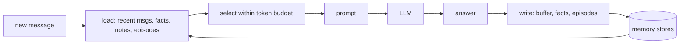

# Memory
> **Level:** Beginner · **Reading time:** 7 min · **Phase:** 4 · Agentic AI

**In one line:** Agent memory is everything your code stores and feeds back to the model so it can use past information, because the model itself forgets everything between calls.

## Explain it like I'm new
Imagine a very capable assistant with a strange condition: every time they leave the room, they forget everything. To work with them, you keep a notebook. Before each conversation, you hand them the relevant pages: today's chat so far, facts about the client, and notes from similar past jobs.

That is exactly how LLM memory works. The model is **stateless**: each API call starts fresh. Any "memory" is text (or data) your application saves and then puts back into the prompt. Memory design is about deciding **what to save, where, and what to load back** each time, because the [context window](../../03-llm-concepts/topics/08-context-window.md) is limited and costs money.

A common breakdown, borrowed loosely from psychology (and used in the CoALA paper on agent architectures):

| Type | Holds | Example | Topic |
|---|---|---|---|
| Short-term (working) | the current conversation | last 10 messages | [08](08-short-term-memory.md) |
| Long-term | anything saved across sessions | notes, documents | [09](09-long-term-memory.md) |
| Semantic | stable facts | "user's timezone is IST" | [10](10-semantic-memory.md) |
| Episodic | past events and outcomes | "last deploy failed: forgot migrations" | [11](11-episodic-memory.md) |
| Procedural | how to do things | system prompt, tool code, skills | (your prompts and code) |

## How it works
Every turn, a memory-aware agent does roughly this:

1. **Load:** gather candidates: recent messages, facts about the user, notes matching the question (keyword or vector search), similar past episodes.
2. **Select:** keep only what fits the token budget and is relevant.
3. **Assemble the prompt:** system prompt + selected memory + current question.
4. **Call the model** and run any tools.
5. **Write:** save new messages to short-term memory; extract new facts or lessons into long-term stores.



## Code example
[`agent_memory.py`](../code/agent_memory.py) has one small class per memory type and a function that assembles them into a prompt:

```python
from agent_memory import ShortTermMemory, LongTermMemory, SemanticMemory, build_context

stm, ltm, sem = ShortTermMemory(max_messages=3), LongTermMemory(), SemanticMemory()
stm.add("user", "Hi, I need help deploying.")
stm.add("assistant", "Sure, which environment?")
ltm.save("The deploy script lives in scripts/deploy.sh")
sem.set("user", "name", "Asha")

print(build_context("How do I deploy to staging?", stm, ltm, sem))
# Known facts about user: {'name': 'Asha'}
# Relevant note: The deploy script lives in scripts/deploy.sh
# user: Hi, I need help deploying.
# assistant: Sure, which environment?
# user: How do I deploy to staging?
```

Run `python 04-agentic-ai/code/agent_memory.py` for a demo of all four types.

**In real projects**, frameworks provide memory building blocks, for example LangGraph's checkpointers (short-term, per conversation thread) and stores (long-term, across threads). See the [LangGraph docs](https://langchain-ai.github.io/langgraph/).

## When to use it / when not to
- **Short-term only** is enough for many single-session chat apps.
- **Add long-term memory** when users return and expect the system to remember preferences or past work.
- **Be careful** with personal data: memory is stored user data. Get consent, allow deletion, and set retention rules.
- More memory in the prompt is not always better; irrelevant memories distract the model.

## Common mistakes
- Thinking the model "remembers" on its own. Only what you send exists for it.
- Stuffing all history into every prompt until the context overflows.
- Saving everything, including wrong or outdated facts, with no way to update or delete.
- Letting untrusted content (a web page) write directly into long-term memory. It can plant instructions that come back later (memory poisoning).

## Interview questions
**1. Do LLMs have memory between API calls?**
<details><summary>Answer</summary>
No. Each call is stateless. Memory is implemented by the application: it stores history and facts and includes the relevant parts in later prompts.
</details>

**2. Name four kinds of agent memory and an example of each.**
<details><summary>Answer</summary>
Short-term (recent conversation turns), long-term (saved notes searchable across sessions), semantic (stable facts like a user's timezone), episodic (records of past tasks and their outcomes, such as a failed deploy and the lesson learned).
</details>

**3. What are the risks of long-term memory?**
<details><summary>Answer</summary>
Privacy and retention of personal data, stale or wrong facts persisting, irrelevant memories confusing the model, and memory poisoning when untrusted content is saved and later treated as trusted.
</details>

## Go deeper
- [Cognitive Architectures for Language Agents (CoALA, Sumers et al., 2023)](https://arxiv.org/abs/2309.02427)
- [Generative Agents: Interactive Simulacra of Human Behavior (Park et al., 2023)](https://arxiv.org/abs/2304.03442)
- [LangGraph documentation](https://langchain-ai.github.io/langgraph/)

**Prev:** [Reflection](06-reflection.md) · **Next:** [Short-term Memory](08-short-term-memory.md) · **Back to phase:** [Phase 4](../README.md)
