# Short-term Memory
> **Level:** Beginner · **Reading time:** 6 min · **Phase:** 4 · Agentic AI

**In one line:** Short-term memory is the recent conversation (and tool results) that you re-send to the model on every turn, usually trimmed to a window so it fits the context.

**Before you start:** [Memory](07-memory.md) and the [context window](../../03-llm-concepts/topics/08-context-window.md). You should know that the model forgets between calls, so you re-send the conversation.

## Explain it like I'm new
Think of a sticky note on your desk during a phone call. You jot down the last few things the caller said so you can follow along. When the note fills up, you erase the oldest lines. You don't keep a full transcript on the note, just what you need right now.

In an agent, short-term memory is the list of messages for the current session: user messages, assistant replies, tool calls, and tool results. It is also called **working memory** or the **conversation buffer**. On each turn, you send this list to the model again. That's how it "remembers" what you said two messages ago.

The problem: the list keeps growing. Each turn costs more tokens (small chunks of text that models count and charge by). Eventually it doesn't fit in the [context window](../../03-llm-concepts/topics/08-context-window.md), which is the most text the model can read at once. So you need a policy for trimming.

Words to know:
- **Turn:** one round of the conversation.
- **Buffer:** the list of recent messages you keep.
- **Sliding window:** keep only the newest N messages, and let older ones slide out.
- **Summary:** a short text that stands in for older messages.
- **System prompt:** the standing instructions you give the model at the start.
- **Deque:** a Python list-like container. With `maxlen`, it drops the oldest item when full.

<!-- anim:08-short-term-memory -->
## Watch it


*It plays on a loop. Read the caption in the box, one step at a time. Want to go at your own pace? [Step through it with Previous and Next](https://techsaurabh-394.github.io/ai-engineer-roadmap/#08-short-term-memory).*

## How it works
Common policies:

1. **Sliding window (buffer window):** keep only the last N messages (or last N tokens). Simple and predictable.
2. **Summary + window:** keep the last N messages in full, plus a running summary of older ones written by the model.
3. **Token budget:** drop the oldest messages until the total fits a budget.
4. **Always keep:** the system prompt, the original goal, and any pinned facts, no matter what.

```text
window size = 3
turn 1: [m0]
turn 2: [m0, m1]
turn 3: [m0, m1, m2]
turn 4: [m1, m2, m3]        <- m0 falls off
turn 5: [m2, m3, m4]        <- m1 falls off
```

**Tool-call pairs.** If you trim in the middle of a tool call and its result, some APIs reject the history (a result without its call). Trim at turn boundaries.

## Code example
From [`agent_memory.py`](../code/agent_memory.py), using `collections.deque` with `maxlen`, which drops the oldest item automatically:

```python
from collections import deque

class ShortTermMemory:
    def __init__(self, max_messages=4):
        self.buffer = deque(maxlen=max_messages)

    def add(self, role, content):
        self.buffer.append({"role": role, "content": content})

    def messages(self):
        return list(self.buffer)

stm = ShortTermMemory(max_messages=3)
for i in range(5):
    stm.add("user", f"message {i}")
print([m["content"] for m in stm.messages()])   # ['message 2', 'message 3', 'message 4']
```

### Worked example
Five messages go into a window of size 3. Real output of the code above:

```text
['message 2', 'message 3', 'message 4']
```

Trace it: messages 0 and 1 went in first. When message 3 arrived, message 0 slid out. When message 4 arrived, message 1 slid out. Only the newest three remain, and that is exactly what you would re-send to the model.

Now the summary + window version. Take 8 messages `m0` to `m7` and call `compact(messages, keep_last=3)`. Real output:

```text
['Summary of earlier conversation: 5 earlier messages about deployment', 'm5', 'm6', 'm7']
```

The last 3 messages stay word for word. The 5 older ones (`m0` to `m4`) become one summary line. Details in those 5 may be lost, but the gist stays and the prompt is shorter.

A summary + window version (the summarizer would be an LLM call in practice):

```python
def compact(messages, keep_last=6, summarize=lambda msgs: f"{len(msgs)} earlier messages about deployment"):
    if len(messages) <= keep_last:
        return messages
    old, recent = messages[:-keep_last], messages[-keep_last:]
    return [{"role": "user", "content": f"Summary of earlier conversation: {summarize(old)}"}] + recent
```

## When to use it / when not to
| Policy | Pros | Cons |
|---|---|---|
| Full history | nothing lost | cost grows, overflows eventually |
| Sliding window | simple, bounded cost | forgets older details |
| Summary + window | keeps gist of long chats | summary can lose or distort details, extra call |
| Token budget | precise fit | needs token counting |

- For short sessions, keeping the full history is fine.
- For long sessions, use summary + window, and move durable facts into [semantic memory](10-semantic-memory.md).

## Common mistakes
- Dropping the system prompt or the original goal when trimming.
- Splitting a tool call from its result.
- Counting messages instead of tokens when one message is huge (a pasted document).
- Never summarizing, so the agent forgets a decision made 30 turns ago.
- Thinking trimmed messages are saved somewhere. A message that falls out of the window is gone unless you stored it elsewhere.

## Recap
If you remember only three things:
- Short-term memory is the recent conversation that you re-send on every turn.
- Trim it with a sliding window, a summary plus recent messages, or a token budget.
- Always keep the system prompt and the goal, and trim a tool call together with its result.

## Interview questions
**1. What is a buffer window memory?**
<details><summary>Answer</summary>
A short-term memory that keeps only the last N messages (or tokens) of the conversation, dropping the oldest, so the prompt stays within budget.
</details>

**2. How do you keep a long chat coherent without exceeding the context window?**
<details><summary>Answer</summary>
Keep the system prompt and recent turns verbatim, replace older turns with a running summary, and store durable facts in long-term or semantic memory to retrieve when relevant.
</details>

**3. Why must tool calls and results be trimmed together?**
<details><summary>Answer</summary>
APIs expect each tool result to follow its matching tool call. Removing one but not the other produces an invalid message history or confuses the model.
</details>

## Go deeper
- [Anthropic docs: context windows](https://docs.anthropic.com/en/docs/build-with-claude/context-windows)
- [MemGPT: Towards LLMs as Operating Systems (Packer et al., 2023)](https://arxiv.org/abs/2310.08560)

**Prev:** [Memory](07-memory.md) · **Next:** [Long-term Memory](09-long-term-memory.md) · **Back to phase:** [Phase 4](../README.md)
