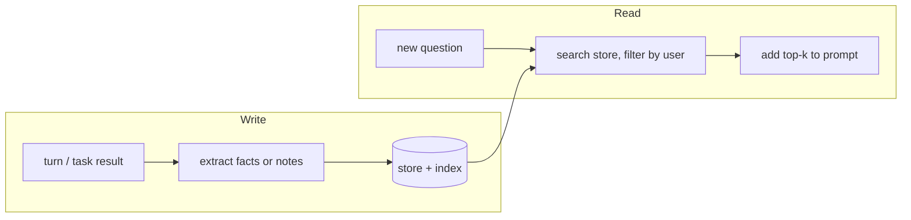

# Long-term Memory
> **Level:** Intermediate · **Reading time:** 6 min · **Phase:** 4 · Agentic AI

**In one line:** Long-term memory is information an agent saves outside the model (in a database or file) so it can search and reuse it in future sessions.

## Explain it like I'm new
Short-term memory is the sticky note for today's call. Long-term memory is the filing cabinet. You file away things worth keeping ("client prefers email, not calls"; "the deploy script is in scripts/deploy.sh"), and the next time a related topic comes up, you pull the right folder.

For an agent, the filing cabinet is a **store**: a database table, a JSON file, or a **vector database** (a database that finds items by meaning using embeddings). The flow has two halves:
- **Write:** decide what is worth saving and save it, with metadata (who, when, source).
- **Read:** given a new question, **retrieve** the most relevant saved items and add them to the prompt.

If that sounds like RAG, it is. Long-term memory is RAG over things the agent (or user) learned, instead of over a fixed document set. See [Phase 1 · RAG Foundations](../../01-rag-foundations/README.md).

## How it works
1. **Extract.** After a turn or a task, decide what to save. Options: save everything; save only what the user explicitly asks ("remember that…"); or ask the LLM to extract key facts.
2. **Store** each item with metadata: `user_id`, timestamp, source, and type (fact, note, episode).
3. **Index** for search: keywords (simple), embeddings (meaning-based), or both (**hybrid**).
4. **Retrieve** top-k items for the new question, **filtered by user** so one user never sees another's memories.
5. **Inject** them into the prompt with a clear label ("Relevant notes from past sessions:").
6. **Maintain:** update, merge duplicates, and delete stale or wrong items.



## Code example
From [`agent_memory.py`](../code/agent_memory.py): a keyword store with save, ranked search, and JSON persistence. Swap `tokenize` + overlap for embeddings + cosine similarity to get a vector store.

```python
import json, re

STOP = {"the", "a", "is", "of", "to", "in", "how", "where"}
def tokenize(text):
    return [w for w in re.findall(r"[a-z0-9]+", text.lower()) if w not in STOP]

class LongTermMemory:
    def __init__(self):
        self.items = []

    def save(self, text):
        self.items.append({"text": text, "words": set(tokenize(text))})

    def search(self, query, k=2):
        q = set(tokenize(query))
        scored = [(len(q & it["words"]), i, it["text"]) for i, it in enumerate(self.items)]
        scored = [s for s in scored if s[0] > 0]
        scored.sort(key=lambda s: (-s[0], -s[1]))      # most overlap, then newest
        return [text for _, _, text in scored[:k]]

    def dump(self):
        return json.dumps([{"text": it["text"]} for it in self.items])

ltm = LongTermMemory()
ltm.save("The deploy script lives in scripts/deploy.sh")
ltm.save("Staging database password rotates every 30 days")
print(ltm.search("where is the deploy script"))   # ['The deploy script lives in scripts/deploy.sh']
```

`dump()` / `load()` let the memory survive a restart; `test_long_term_survives_dump_and_load` checks it.

**In real projects** you'd use a vector store such as FAISS, Chroma, or pgvector, or a framework memory store (for example LangGraph's long-term memory store). The read/write logic stays the same.

## When to use it / when not to
- **Use** when users come back and expect continuity (preferences, project details, past decisions).
- **Use** for agents that should learn from past tasks (combine with [episodic memory](11-episodic-memory.md)).
- **Skip** for one-off, single-session tools; it adds storage, privacy, and complexity.

| Retrieval | Finds | Misses |
|---|---|---|
| Keyword | exact terms, IDs, names | synonyms ("car" vs "vehicle") |
| Vector | similar meaning | exact codes, rare names |
| Hybrid | both | more moving parts |

## Common mistakes
- No user filter, so memories leak between users.
- Saving everything, so retrieval returns noise.
- Never deleting or updating, so outdated facts win.
- Saving untrusted tool output as trusted memory (memory poisoning).
- Not telling the model where a memory came from or how old it is.

## Interview questions
**1. How is long-term memory related to RAG?**
<details><summary>Answer</summary>
It uses the same retrieve-then-generate mechanism. The difference is the source: long-term memory stores information gathered during use (facts, notes, past outcomes), often per user, while classic RAG searches a prepared document set.
</details>

**2. How do you decide what to write to long-term memory?**
<details><summary>Answer</summary>
Common strategies: explicit user requests, LLM-based extraction of durable facts at the end of a session, and saving task outcomes. Filter out trivia and untrusted content, de-duplicate, and attach metadata.
</details>

**3. What security issue is specific to agent memory?**
<details><summary>Answer</summary>
Memory poisoning: malicious content saved into memory can resurface later as trusted context and steer the agent. Mitigate by tagging sources, not auto-saving untrusted text, and reviewing or expiring memories.
</details>

## Go deeper
- [Generative Agents: Interactive Simulacra of Human Behavior (Park et al., 2023)](https://arxiv.org/abs/2304.03442)
- [MemGPT: Towards LLMs as Operating Systems (Packer et al., 2023)](https://arxiv.org/abs/2310.08560)
- [LangGraph documentation](https://langchain-ai.github.io/langgraph/)

**Prev:** [Short-term Memory](08-short-term-memory.md) · **Next:** [Semantic Memory](10-semantic-memory.md) · **Back to phase:** [Phase 4](../README.md)
