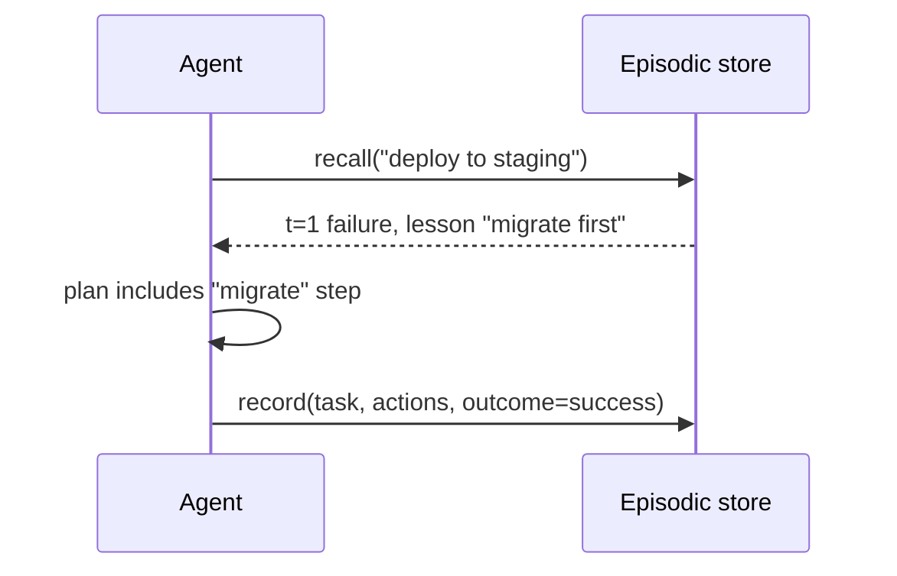

# Episodic Memory
> **Level:** Intermediate · **Reading time:** 6 min · **Phase:** 4 · Agentic AI

**In one line:** Episodic memory is a log of the agent's past experiences (what task it tried, what it did, and how it turned out) that it can recall to do better next time.

## Explain it like I'm new
Last time you assembled flat-pack furniture, you put the doors on before the shelves and had to start over. Next time, you remember that **episode** and do the shelves first. You're not recalling a general fact; you're recalling a specific event and its lesson.

Agents can do the same. After each task, save a record:
- **task:** "deploy to staging"
- **actions:** ["run tests", "deploy"]
- **outcome:** failure
- **lesson:** "run database migrations before deploying"

Next time a similar task arrives, the agent looks up similar episodes and adds them to the prompt: "Last time this failed because migrations weren't run." This is the memory side of [Reflection](06-reflection.md); the **Reflexion** paper stores exactly these kinds of verbal lessons between attempts.

Episodic memory is also gold for **you**, the developer: it's a record of what the agent did, useful for debugging and [evaluation](15-agent-evaluation.md).

## How it works
1. **Record** at the end of each task (or each attempt): task description, key actions, outcome, timestamp, and an optional lesson. The lesson can come from a reflection step.
2. **Index** by task similarity (keywords or embeddings) and time.
3. **Recall** the most similar episodes when a new task starts. Prefer recent ones and include both failures (to avoid) and successes (to copy).
4. **Inject** a short summary, not the raw logs: "Similar past task: deploy staging → failed. Lesson: migrate first."
5. **Prune** old or irrelevant episodes so recall stays useful.



## Code example
From [`agent_memory.py`](../code/agent_memory.py):

```python
from agent_memory import EpisodicMemory

epi = EpisodicMemory()
epi.record("deploy to staging", ["run tests", "deploy"], "failure", lesson="run migrations before deploy")
epi.record("write weekly report", ["draft"], "success")
epi.record("deploy to staging", ["run tests", "migrate", "deploy"], "success")

for e in epi.recall("deploy staging", k=2):
    print(e["t"], e["outcome"], e["actions"], e["lesson"])
# 3 success ['run tests', 'migrate', 'deploy']
# 1 failure ['run tests', 'deploy'] run migrations before deploy

print([e["lesson"] for e in epi.failures()])   # ['run migrations before deploy']
```

Turning recalled episodes into prompt text:

```python
def episodes_to_prompt(episodes):
    lines = ["Similar past tasks:"]
    for e in episodes:
        lesson = f" Lesson: {e['lesson']}" if e["lesson"] else ""
        lines.append(f"- {e['task']} -> {e['outcome']} via {', '.join(e['actions'])}.{lesson}")
    return "\n".join(lines)
```

## When to use it / when not to
- **Use** for agents that repeat similar tasks (ops runbooks, support, coding agents) and can learn from mistakes.
- **Use** the same records for debugging and evals.
- **Skip** for one-off assistants with no repeated tasks.
- Old lessons can become wrong when systems change. Add timestamps and expiry.

## Common mistakes
- Storing full raw transcripts and injecting them, which wastes tokens. Store summaries and lessons.
- Only saving successes; failures carry the most useful lessons.
- No similarity filter, so unrelated episodes clutter the prompt.
- Treating an old lesson as permanent truth after the environment changed.

## Interview questions
**1. What does an episodic memory record usually contain?**
<details><summary>Answer</summary>
The task, the key actions taken, the outcome (success/failure, scores), a timestamp, and optionally a lesson or reflection for next time.
</details>

**2. How does episodic memory relate to Reflexion?**
<details><summary>Answer</summary>
Reflexion has the agent write verbal reflections after failed attempts and keep them in a memory buffer that is added to the context on later attempts. That buffer is a form of episodic memory.
</details>

**3. How would you keep episodic memory useful over months?**
<details><summary>Answer</summary>
Retrieve by similarity and recency, store compact summaries rather than raw logs, expire or re-validate old lessons, and de-duplicate repeated episodes.
</details>

## Go deeper
- [Reflexion: Language Agents with Verbal Reinforcement Learning (Shinn et al., 2023)](https://arxiv.org/abs/2303.11366)
- [Generative Agents: Interactive Simulacra of Human Behavior (Park et al., 2023)](https://arxiv.org/abs/2304.03442)

**Prev:** [Semantic Memory](10-semantic-memory.md) · **Next:** [Agent Loops](12-agent-loops.md) · **Back to phase:** [Phase 4](../README.md)
