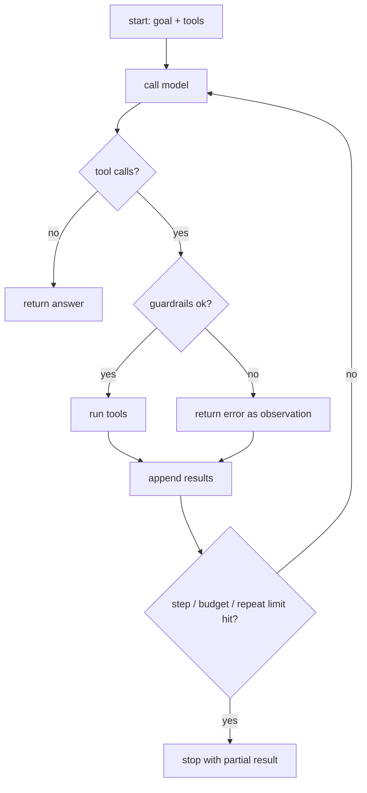

# Agent Loops
> **Level:** Intermediate · **Reading time:** 8 min · **Phase:** 4 · Agentic AI

**In one line:** The agent loop is the code that repeatedly calls the model, runs the tools it asks for, feeds back the results, and decides when to stop.

**Before you start:** [ReAct Pattern](04-react-pattern.md) and [Tool Calling](02-tool-calling.md). You should know that the model asks for a tool by name and your code runs it.

## Explain it like I'm new
Think of a thermostat. It checks the temperature, decides whether to heat, acts, waits, and checks again, forever. An agent loop is similar but with a goal and a finish line: check the situation, decide, act, observe, and stop when the job is done or when something says "enough".

Every agent, whatever the framework, has this loop at its core. In [`agent.py`](../code/agent.py) it's about 15 lines. Frameworks add features around it (state saving, streaming, retries), but if you understand the loop, you understand agents.

The most important part of the loop is not the "keep going" part. It's the **stop conditions**. An agent without good stop conditions can run for hundreds of steps, repeat the same failing action, and run up a large bill.

Words to know:
- **Step:** one trip around the loop (one model call plus any tool runs).
- **Observation:** the result of a tool, sent back to the model.
- **Stop condition:** a rule that ends the loop, such as a step cap.
- **Budget:** a limit on tokens (units of text the model reads and writes), money, or time.
- **Idempotent:** safe to run twice with the same effect as once. Reading is idempotent; charging a card is not.

<!-- anim:agent-loop-anim -->
## Watch it


*It plays on a loop. Read the caption in the box, one step at a time. Want to go at your own pace? [Step through it with Previous and Next](https://techsaurabh-394.github.io/ai-engineer-roadmap/#agent-loop-anim).*

## How it works
1. **Initialize** state: messages (goal + system prompt), step counter, budget.
2. **Call the model** with messages and tool definitions.
3. **Check for finish:** if there are no tool calls, return the text answer.
4. **Execute tool calls:** validate, check guardrails, run, capture result or error.
5. **Append** the assistant turn and the tool results to messages.
6. **Check stop conditions:** step cap, token/cost budget, time limit, repeated actions, user cancel.
7. Go back to step 2.



### Worked example
The demo in [`agent.py`](../code/agent.py) runs the loop with a scripted model. Real output for the goal "What is 12*7+5? Save the answer as a note." (the model's replies are scripted, so no API key is needed):

```text
step 1: calculator({"expression": "12*7+5"}) -> 89
step 2: save_note({"text": "12*7+5 = 89"}) -> Saved note #1.
12*7+5 is 89, and I saved it as a note.
```

1. Step 1: the model asks for `calculator`. The loop runs it and appends the result `89` to the messages.
2. Step 2: the model sees `89` and asks for `save_note`. The loop runs it and appends `Saved note #1.`.
3. Step 3: the model replies with plain text and no tool call. That is the normal finish, so the loop returns the text.

If the model never stopped asking for tools, `max_steps` would end the run with `Stopped: ...` instead. The test `test_agent_stops_at_max_steps` checks this, and it passes.

**Stop conditions to always have:**

| Condition | Why |
|---|---|
| `max_steps` | hard cap on iterations |
| token or cost budget | stop runaway spend |
| wall-clock timeout | users won't wait forever |
| repeated identical tool call | stuck in a loop |
| explicit "done" (no tool calls) | normal finish |

## Code example
The loop from [`agent.py`](../code/agent.py) plus a repeat detector you can add:

```python
import json

def run_agent(llm, user_goal, tools, specs, max_steps=6):
    messages = [{"role": "user", "content": user_goal}]
    seen = set()
    for step in range(1, max_steps + 1):
        reply = llm.step(messages, specs)
        messages.append({"role": "assistant", "content": reply["raw"]})
        if not reply["tool_calls"]:
            return reply["text"]
        results = []
        for call in reply["tool_calls"]:
            key = (call["name"], json.dumps(call["input"], sort_keys=True))
            if key in seen:
                out = "Error: you already made this exact call. Try something different or finish."
            else:
                seen.add(key)
                fn = tools.get(call["name"])
                out = fn(**call["input"]) if fn else f"Error: unknown tool {call['name']}"
            results.append({"type": "tool_result", "tool_use_id": call["id"], "content": out})
        messages.append({"role": "user", "content": results})
    return "Stopped: reached max steps without finishing."
```

`test_agent_stops_at_max_steps` in [`test_agent.py`](../code/test_agent.py) proves the cap works with a model that never stops calling tools.

**In real projects**, LangGraph models the loop as a graph (a model node and a tool node with a conditional edge) and has a `recursion_limit` setting that caps steps. The concept is identical.

## When to use it / when not to
- Write your own loop to learn, or when you need full control and few dependencies.
- Use a framework when you need persistence (pause/resume), streaming, human-in-the-loop interrupts, or complex branching.
- Keep loops short: if tasks regularly need 30+ steps, split them into a planned workflow.

## Common mistakes
- No `max_steps`. This is the most common and most expensive bug.
- Crashing on tool errors instead of returning them to the model.
- Dropping the assistant's tool-call message before appending results (the API needs both).
- Not logging each step (inputs, outputs, tokens, time), so failures can't be reproduced.
- Retrying non-idempotent actions (like "charge card") on error and doing them twice.

## Recap
If you remember only three things:
- The agent loop is: call the model, run the requested tools, append the results, and repeat.
- Stop conditions (step cap, budget, timeout, repeat detection) matter more than the loop itself.
- Return tool errors to the model instead of crashing, and be careful with actions that cannot be undone.

## Interview questions
**1. What are the essential stop conditions for an agent loop?**
<details><summary>Answer</summary>
A normal finish (no tool calls / final answer), a hard max-steps limit, a token or cost budget, a timeout, and detection of repeated or stuck actions.
</details>

**2. What should happen when a tool raises an exception?**
<details><summary>Answer</summary>
Catch it and return a readable error as the tool result, so the model can adjust. Log it. Only abort the loop for errors the model can't fix (auth failure, guardrail violation).
</details>

**3. Why does idempotency matter in agent loops?**
<details><summary>Answer</summary>
Loops and retries may repeat a tool call. If the action isn't idempotent (sending an email, charging a card), repeating it causes real harm. Use idempotency keys, check-before-act, or human approval.
</details>

## Go deeper
- [Anthropic: Building effective agents](https://www.anthropic.com/research/building-effective-agents)
- [Anthropic docs: Tool use with Claude](https://docs.anthropic.com/en/docs/build-with-claude/tool-use)
- [LangGraph documentation](https://langchain-ai.github.io/langgraph/)

**Prev:** [Episodic Memory](11-episodic-memory.md) · **Next:** [Multi-Agent Systems](13-multi-agent-systems.md) · **Back to phase:** [Phase 4](../README.md)
