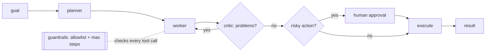

# Multi-Agent Systems
> **Level:** Advanced · **Reading time:** 8 min · **Phase:** 4 · Agentic AI

**In one line:** A multi-agent system splits a job across several LLM "agents", each with its own role, prompt, and tools, that pass work between them.

## Explain it like I'm new
A newspaper doesn't have one person do everything. An editor plans the stories, reporters write them, and a fact-checker reviews them before print. Each has a narrow job and different tools.

A multi-agent system copies that structure. Common roles:
- **Planner (or orchestrator):** breaks the goal into tasks and assigns them.
- **Workers:** each does one kind of task with a small, focused set of tools.
- **Critic (or reviewer):** checks the output and sends it back if needed ([Reflection](06-reflection.md)).

"Agent" here often just means "an LLM call with its own system prompt and tool list". Several agents can even use the same model.

Why split? A single agent with 40 tools and a giant prompt gets confused. Smaller agents with focused prompts are easier to test and improve one at a time. Work can also run in parallel. The price: more model calls, more cost, and more places for things to go wrong.

## How it works
Common shapes:

1. **Pipeline (sequential):** planner → worker → critic, each passing its output to the next.
2. **Orchestrator-workers:** a central agent sends subtasks to workers (possibly in parallel) and combines results.
3. **Supervisor / router:** a supervisor picks which specialist handles each step.
4. **Debate / peer review:** agents propose and critique each other's answers.



**Design rules:**
- Pass **structured** messages between agents (JSON with fields), not long free text.
- Give each agent the **fewest tools** it needs.
- Share state explicitly (a shared object or graph state), so you can log and replay.
- Put **guardrails** and **approval gates** in code, outside all agents, so no agent can talk its way past them.

## Code example
[`agent_multi.py`](../code/agent_multi.py) implements planner → worker → critic with a human approval gate and guardrails, fully offline:

```python
from agent_multi import run_pipeline

def approver(tool, preview):
    print(f"Approve {tool}? -> {preview!r}")
    return True                                   # a real app would ask a person

result = run_pipeline("agents and email it", approver)
print(result["status"])                           # done
for line in result["log"]:
    print(" ", line)
# plan: ['write_text', 'send_email']
# write_text -> Draft about agents and email it.
# critic: ['needs a concrete example']
# add_example -> Draft about agents and email it. Example: a support bot that looks up orders.
# human approved send_email
# send_email -> EMAIL SENT: ...

blocked = run_pipeline("agents and email it", approver, allowed_tools=("write_text", "add_example"))
print(blocked["status"], blocked["log"][-1])      # blocked guardrail: tool 'send_email' is not on the allowlist
```

The tests in [`test_agent_multi.py`](../code/test_agent_multi.py) cover reflection, approval rejection, the allowlist, and the step cap.

**In real projects**, frameworks such as [LangGraph](https://langchain-ai.github.io/langgraph/) (graph of agent nodes with shared state), CrewAI, or AutoGen provide orchestration, state, and interrupts. See [Phase 5 · Frameworks](../../05-frameworks/README.md).

## When to use it / when not to
- **Use** when a task has clearly different sub-skills (research vs writing vs checking), when parallel work helps, or when a single agent's prompt/tool list has become unmanageable.
- **Don't** start here. Try one agent with good tools first. Many problems don't need more than one.

| | Single agent | Multi-agent |
|---|---|---|
| Simplicity | high | low |
| Cost per task | lower | higher (more calls) |
| Debugging | easier | harder (handoffs) |
| Specialization | limited | strong |
| Parallelism | limited | natural |

## Common mistakes
- Splitting into many agents "because it looks cool", multiplying cost and failure points.
- Unstructured chatter between agents that drifts off task or loops.
- Each agent having all tools, defeating the point of specialization.
- No overall step or budget limit across the whole system.
- Trusting one agent's output as instructions to another without validation (a prompt-injection path).

## Interview questions
**1. When would you choose a multi-agent design over a single agent?**
<details><summary>Answer</summary>
When sub-tasks need different prompts, tools, or expertise; when they can run in parallel; or when one agent's context and tool list became too large to work reliably. Otherwise a single agent is simpler and cheaper.
</details>

**2. Describe an orchestrator-workers pattern.**
<details><summary>Answer</summary>
A central LLM breaks a task into subtasks at run time, delegates each to worker LLM calls (often in parallel), then combines their results. It suits tasks where you can't predict the subtasks in advance.
</details>

**3. Where should guardrails live in a multi-agent system?**
<details><summary>Answer</summary>
In the orchestration code that executes tools, outside any agent's prompt: tool allowlists per agent, global step and budget limits, argument validation, and human approval for risky actions. Agents can be manipulated; code checks can't be argued with.
</details>

## Go deeper
- [Anthropic: Building effective agents](https://www.anthropic.com/research/building-effective-agents)
- [AutoGen: Enabling Next-Gen LLM Applications via Multi-Agent Conversation (Wu et al., 2023)](https://arxiv.org/abs/2308.08155)
- [LangGraph documentation](https://langchain-ai.github.io/langgraph/)

**Prev:** [Agent Loops](12-agent-loops.md) · **Next:** [Human in the Loop](14-human-in-the-loop.md) · **Back to phase:** [Phase 4](../README.md)
