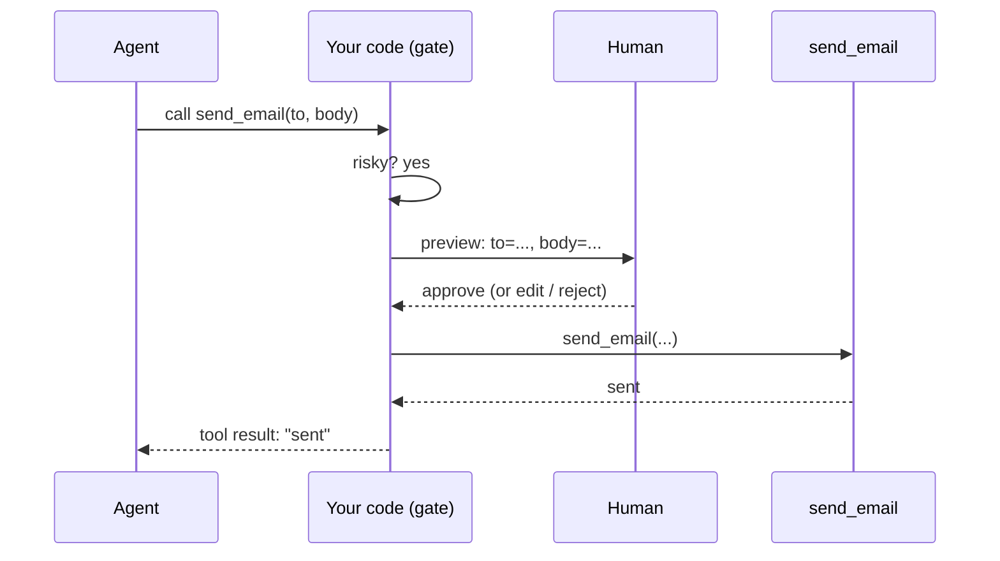

# Human in the Loop
> **Level:** Intermediate · **Reading time:** 6 min · **Phase:** 4 · Agentic AI

**In one line:** Human in the loop (HITL) means the agent pauses at chosen points so a person can approve, edit, or reject what it is about to do.

## Explain it like I'm new
At many companies, a junior employee can draft a payment, but a manager must click "approve" before money moves. The junior does the work; the manager signs off on the risky part. That's human in the loop.

Agents make mistakes: wrong tool, wrong arguments, misunderstood goal, or being tricked by injected text. For actions that are cheap and reversible (searching, reading), mistakes don't matter much. For actions that are **irreversible** or **high-impact** (sending an email to a customer, deleting files, paying money, merging code), a human check is the most reliable safety net.

Forms of HITL:
- **Approve / reject** a specific action before it runs.
- **Edit** the action's arguments (fix the email text) and then run it.
- **Answer a question** the agent asks when it is unsure ("Which account did you mean?").
- **Review the plan** before execution starts ([Planning Agents](05-planning-agents.md)).

## How it works
1. **Classify tools by risk** in code: read-only, reversible write, irreversible / external.
2. When the agent requests a **risky** tool, **pause** before running it.
3. **Show** the human a clear preview: what will happen, with what exact arguments, and why.
4. The human **approves, edits, or rejects**.
5. **Resume:** run the (possibly edited) action, or return "rejected by user: <reason>" to the agent as the tool result so it can adjust.
6. **Log** who approved what and when.



For long waits (hours or days), the agent's state must be **saved** so it can resume later; frameworks call this checkpointing or interrupts.

## Code example
From [`agent_multi.py`](../code/agent_multi.py): the worker asks an `approver` callback before any tool in `risky_tools`. Tests pass a stub; the CLI version asks on the console.

```python
def worker(step, draft, guard, approver, log):
    tool = step["tool"]
    guard.check(tool)                              # guardrails first: allowlist + max steps
    if guard.needs_approval(tool):
        preview = draft if step["arg"] is None else step["arg"]
        if not approver(tool, preview):
            log.append(f"human rejected {tool}")
            return draft, False                    # do NOT run the tool
        log.append(f"human approved {tool}")
    out = TOOLS[tool](draft if step["arg"] is None else step["arg"])
    log.append(f"{tool} -> {out}")
    return out, True

def console_approver(tool, preview):
    return input(f"Allow {tool}? Preview: {preview!r} [y/N] ").strip().lower() == "y"
```

```python
from agent_multi import run_pipeline
res = run_pipeline("agents and email it", approver=lambda tool, preview: False)
print(res["status"])   # rejected  -> the email was never sent
```

Note the default is **No**: if the human just presses Enter, nothing risky happens.

**In real projects**, LangGraph supports pausing a graph with an `interrupt` and resuming it later from a checkpoint; see the [LangGraph docs](https://langchain-ai.github.io/langgraph/) for human-in-the-loop.

## When to use it / when not to
| Action type | Example | Approval? |
|---|---|---|
| Read-only | search, read file | usually no |
| Reversible write | create draft, add label | optional / batch review |
| Irreversible or external | send email, pay, delete, deploy | yes |

- **Use** for risky actions, low-confidence decisions, and early in a rollout while you build trust.
- **Don't** ask for approval on everything. People start clicking "yes" without reading (approval fatigue), which removes the safety benefit.

## Common mistakes
- Approval gates written as prompt instructions ("ask the user first") instead of enforced in code.
- Previews that hide the real arguments ("Send email?" without showing the recipient and body).
- Default-yes behaviour on timeout or empty input.
- Not returning the rejection reason to the agent, so it retries the same thing.
- No saved state, so the agent loses its work while waiting for a human.

## Interview questions
**1. Which agent actions should require human approval?**
<details><summary>Answer</summary>
Irreversible, external, or high-impact actions: sending messages, spending money, deleting or modifying important data, deploying, or anything with legal or safety impact. Read-only actions usually don't.
</details>

**2. Why enforce approval in code rather than in the prompt?**
<details><summary>Answer</summary>
A model can ignore or be tricked out of prompt instructions (for example by prompt injection). A code gate around the tool runs regardless of what the model says.
</details>

**3. What is approval fatigue and how do you avoid it?**
<details><summary>Answer</summary>
When people approve so many prompts that they stop reading them. Avoid it by gating only risky actions, showing clear, concise previews, batching low-risk reviews, and tracking how often approvals are edited or rejected.
</details>

## Go deeper
- [Anthropic: Building effective agents](https://www.anthropic.com/research/building-effective-agents)
- [LangGraph documentation](https://langchain-ai.github.io/langgraph/)

**Prev:** [Multi-Agent Systems](13-multi-agent-systems.md) · **Next:** [Agent Evaluation](15-agent-evaluation.md) · **Back to phase:** [Phase 4](../README.md)
