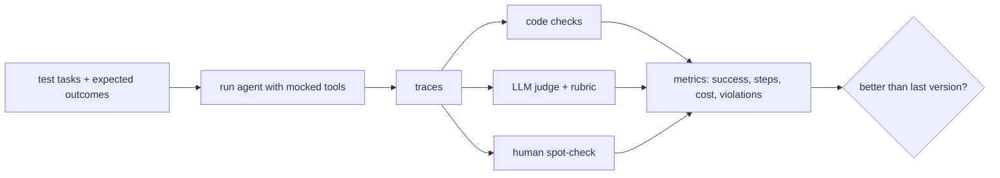

# Agent Evaluation
> **Level:** Advanced · **Reading time:** 8 min · **Phase:** 4 · Agentic AI

**In one line:** Agent evaluation is measuring, with a fixed set of test tasks, whether an agent reaches the right outcome, takes sensible steps, and stays within cost, time, and safety limits.

## Explain it like I'm new
A driving test doesn't just check that you arrived. The examiner also checks that you stopped at red lights, didn't take a crazy route, and didn't hit anything. Agent evaluation works the same way. You check:
- **Outcome:** did it finish the task correctly?
- **Trajectory:** were the steps (tool calls) sensible? The sequence of steps is called the **trajectory** or **trace**.
- **Efficiency:** how many steps, tokens, dollars, seconds?
- **Safety:** did it avoid forbidden actions and respect approvals?

Agents are harder to test than a single prompt because they take many steps, call real tools, and can behave differently each run. So you need a **test set** (tasks with known good outcomes), a way to **run** the agent on them repeatably (often with mocked tools), and **graders** that score the results.

## How it works
1. **Collect tasks.** 20-100 realistic tasks to start, including edge cases and known past failures. For each, write what success looks like (expected answer, expected final state, or a rubric).
2. **Make runs repeatable.** Use mocked or sandboxed tools with fixed data, low temperature, and a fixed agent version.
3. **Run** every task (several times if output varies) and **record the full trace**: each tool call, arguments, results, tokens, time.
4. **Grade:**
   - **Code checks** (preferred where possible): exact answer, final database state, required tool called, forbidden tool never called.
   - **LLM-as-judge** with a rubric for open-ended answers. Spot-check the judge against human labels.
   - **Human review** for a sample.
5. **Aggregate** metrics and compare against the previous version before shipping.
6. **Monitor** in production with the same metrics on real traffic, and add new failures to the test set.



**Useful metrics:**

| Metric | What it tells you |
|---|---|
| Task success rate | does it work? |
| Tool-call accuracy | right tool, valid arguments |
| Steps / tokens / cost per task | efficiency |
| Latency | user experience |
| Guardrail violations | safety (target: 0) |
| pass^k (success on all k repeated runs) | consistency |

## Code example
A tiny evaluator for the offline ReAct agent in [`agent_react.py`](../code/agent_react.py). It grades the outcome, the trajectory, and efficiency.

```python
from agent_react import ScriptedLLM, run_react, DEMO_SCRIPT

CASES = [
    {"question": "What is double the population of France?", "script": DEMO_SCRIPT,
     "expect_in_answer": "136", "must_call": {"lookup", "multiply"}, "max_steps": 4},
    {"question": "Loop forever", "script": ['Action: lookup\nAction Input: {"topic": "japan"}'],
     "expect_in_answer": "Stopped", "must_call": {"lookup"}, "max_steps": 3},
]

def evaluate(cases):
    rows = []
    for c in cases:
        answer, trace = run_react(ScriptedLLM(c["script"]), c["question"], max_steps=c["max_steps"])
        called = {t["tool"] for t in trace if t["type"] == "action"}
        rows.append({
            "outcome_ok": c["expect_in_answer"] in answer,
            "trajectory_ok": c["must_call"] <= called,
            "steps": len(trace),
            "errors": sum(1 for t in trace if "Error" in t.get("observation", "")),
        })
    success = sum(r["outcome_ok"] and r["trajectory_ok"] for r in rows) / len(rows)
    return success, rows

print(evaluate(CASES))
```

With a real model you'd replace `ScriptedLLM` with an API-backed one and keep tools mocked. More on evaluation methods: [Phase 2 · Advanced RAG](../../02-advanced-rag/README.md).

## When to use it / when not to
- **Always** have some eval before changing prompts, models, or tools. Otherwise you can't tell improvements from regressions.
- Start small (20 tasks) and grow from real failures.
- Don't rely only on LLM judges; they have biases and should be checked against human labels.

## Common mistakes
- Judging only the final answer and missing dangerous or wasteful steps.
- Running each task once when the agent is non-deterministic.
- Evaluating against live tools, so results change because the world changed, not the agent.
- A test set that never grows, so new failure types go unmeasured.
- Ignoring cost and latency until production.

## Interview questions
**1. What is the difference between outcome and trajectory evaluation?**
<details><summary>Answer</summary>
Outcome evaluation checks whether the final result is correct. Trajectory evaluation checks the steps: which tools were called, with what arguments, in what order, and whether any forbidden or wasteful actions happened.
</details>

**2. How do you make agent evals repeatable?**
<details><summary>Answer</summary>
Mock or sandbox tools with fixed data, pin the model and prompt versions, use low temperature, run each task multiple times, and store full traces for comparison.
</details>

**3. What are the risks of LLM-as-judge?**
<details><summary>Answer</summary>
Judges can be biased (toward longer answers, their own style, or position), inconsistent, and wrong on specialized facts. Use clear rubrics, structured scores, and validate against human-labelled samples.
</details>

## Go deeper
- [τ-bench: A Benchmark for Tool-Agent-User Interaction (Yao et al., 2024)](https://arxiv.org/abs/2406.12045)
- [Judging LLM-as-a-Judge with MT-Bench and Chatbot Arena (Zheng et al., 2023)](https://arxiv.org/abs/2306.05685)
- [SWE-bench: Can Language Models Resolve Real-World GitHub Issues? (Jimenez et al., 2023)](https://arxiv.org/abs/2310.06770)

**Prev:** [Human in the Loop](14-human-in-the-loop.md) · **Next:** [Agent Guardrails](16-agent-guardrails.md) · **Back to phase:** [Phase 4](../README.md)
