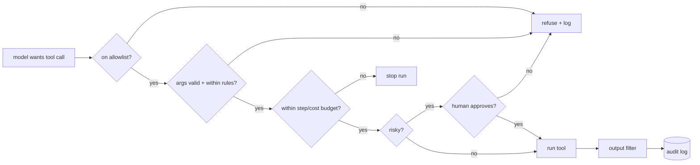

# Agent Guardrails
> **Level:** Advanced · **Reading time:** 8 min · **Phase:** 4 · Agentic AI

**In one line:** Guardrails are checks in your code that limit what an agent can see and do (allowed tools, valid arguments, step and cost limits, input and output filters), no matter what the model decides.

## Explain it like I'm new
A new driver can steer, but the road has lane markings, speed limits, and barriers on dangerous bends. The driver mostly stays safe on their own; the barriers stop the worst outcomes when they don't.

An agent is a capable but unreliable driver. It can misunderstand, hallucinate tool arguments, or be tricked by **prompt injection** (instructions hidden in a web page, email, or file it reads). Guardrails are the barriers:
- **Allowlist:** only these tools can be called, by this agent.
- **Validation:** arguments must match the schema and business rules.
- **Limits:** max steps, max cost, max time.
- **Approval:** risky actions need a human ([Human in the Loop](14-human-in-the-loop.md)).
- **Filters:** check inputs (block obvious attacks, strip secrets) and outputs (no leaked personal data, valid format).

The golden rule: **guardrails live in code, not in the prompt.** "Never delete files" in a system prompt is a request. A delete tool that isn't on the allowlist is a fact.

## How it works
Layers, from outside in:

1. **Least privilege.** Give the agent only the tools it needs, with the narrowest scope (read-only DB user, one folder, one API scope).
2. **Allowlist check** on every tool call. Unknown or disallowed tool → refuse.
3. **Argument validation.** Schema check, then business rules (amount ≤ limit, path inside the sandbox, recipient in the company domain).
4. **Budget limits.** Max steps, tokens, cost, wall-clock time across the whole run.
5. **Approval gate** for irreversible actions.
6. **Untrusted content handling.** Mark tool outputs and documents as data. Don't let them change permissions. Consider stripping or flagging instruction-like text.
7. **Output checks.** Validate format, scan for secrets or personal data, apply content policy.
8. **Audit log.** Record every call, check, and decision.



## Code example
From [`agent_multi.py`](../code/agent_multi.py): a `Guardrails` object that enforces an allowlist and a step cap, and marks risky tools for approval.

```python
class GuardrailError(Exception):
    pass

class Guardrails:
    def __init__(self, allowed_tools, max_steps=10, risky_tools=()):
        self.allowed, self.risky = set(allowed_tools), set(risky_tools)
        self.max_steps, self.steps = max_steps, 0

    def check(self, tool):
        self.steps += 1
        if self.steps > self.max_steps:
            raise GuardrailError(f"max_steps={self.max_steps} exceeded")
        if tool not in self.allowed:
            raise GuardrailError(f"tool '{tool}' is not on the allowlist")

    def needs_approval(self, tool):
        return tool in self.risky

g = Guardrails(["write_text"], max_steps=2)
g.check("write_text")                   # ok
try:
    g.check("send_email")
except GuardrailError as e:
    print(e)                            # tool 'send_email' is not on the allowlist
```

An argument-level business rule, added on top of schema validation from [`agent_react.py`](../code/agent_react.py):

```python
import os

SANDBOX = os.path.realpath("/tmp/agent-sandbox")

def safe_path(path):
    full = os.path.realpath(os.path.join(SANDBOX, path))
    if not full.startswith(SANDBOX + os.sep):
        raise GuardrailError("path escapes the sandbox")
    return full
```

**In real projects**, frameworks offer hooks for these checks (for example, tool-level callbacks or graph interrupts in LangGraph). Run code-executing tools in a real sandbox (container or VM with no secrets and restricted network).

## When to use it / when not to
Always. The question is how strict.

| Agent can... | Minimum guardrails |
|---|---|
| Only read public data | allowlist, step cap, output format check |
| Read private data | + per-user access filters, output PII/secret scan |
| Write or act externally | + argument rules, approval for irreversible actions, audit log |
| Run code | + sandbox with no secrets, network limits, timeouts |

## Common mistakes
- Relying on the system prompt for safety.
- One agent with every tool "just in case".
- Validating schema but not business rules (a valid JSON refund of ₹10,00,000 is still a problem).
- Treating text from tools, web pages, or other agents as trusted instructions.
- No global budget, so a multi-agent system can run up costs even if each agent has a limit.

## Interview questions
**1. Why can't a system prompt alone keep an agent safe?**
<details><summary>Answer</summary>
The model may misunderstand, ignore, or be manipulated out of prompt instructions, for example by prompt injection in content it reads. Only checks in code around tool execution reliably block disallowed actions.
</details>

**2. List five guardrails you'd add to a production agent.**
<details><summary>Answer</summary>
Tool allowlist with least privilege, argument schema plus business-rule validation, max steps / token / cost / time limits, human approval for irreversible actions, input and output filtering (injection, secrets, PII), sandboxing for code execution, and audit logging.
</details>

**3. How do you defend an agent that browses the web against prompt injection?**
<details><summary>Answer</summary>
Treat page content as untrusted data, keep high-risk tools unavailable or approval-gated during browsing, validate every action in code, limit data the agent can send out (no secrets in context, restricted destinations), and monitor/log. No single filter fully solves it, so use layers.
</details>

## Go deeper
- [OWASP Top 10 for Large Language Model Applications](https://owasp.org/www-project-top-10-for-large-language-model-applications/)
- [Not what you've signed up for: Indirect Prompt Injection (Greshake et al., 2023)](https://arxiv.org/abs/2302.12173)
- [Anthropic docs: Tool use with Claude](https://docs.anthropic.com/en/docs/build-with-claude/tool-use)

**Prev:** [Agent Evaluation](15-agent-evaluation.md) · **Next:** [Phase 5 · Frameworks](../../05-frameworks/README.md) · **Back to phase:** [Phase 4](../README.md)
