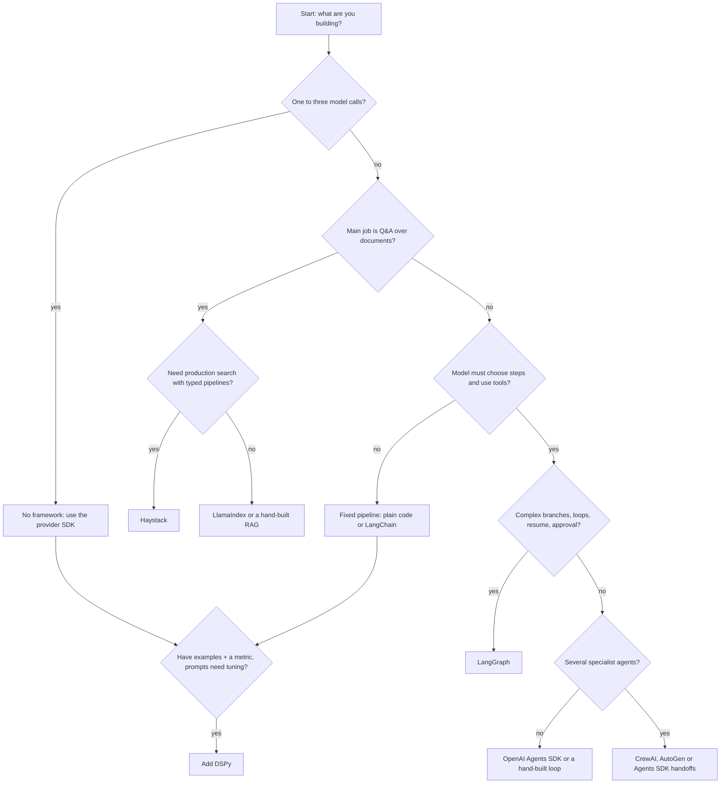

# Phase 5 — Frameworks

**Goal:** Understand what the popular LLM frameworks are for, how each maps to ideas you already know (retriever, agent loop, memory), and when to use none of them.

**Who it's for:** Learners who finished [Phase 4 — Agentic AI](../04-agentic-ai/README.md).
**Prerequisites:** Phases 1–4. You should know RAG, tool calling and the agent loop.

## Overview

Every framework here packages patterns you can already write by hand. Learning the pattern first means you can judge a framework instead of being trapped by it. Each topic gives a from-scratch stdlib version, then (where the API is stable and well known) a short "In real projects" snippet.

## Topics

| # | Topic | Level | Link |
|---|-------|-------|------|
| 1 | LangChain | Beginner | [01-langchain.md](topics/01-langchain.md) |
| 2 | LangGraph | Intermediate | [02-langgraph.md](topics/02-langgraph.md) |
| 3 | LlamaIndex | Beginner | [03-llamaindex.md](topics/03-llamaindex.md) |
| 4 | OpenAI Agents SDK | Intermediate | [04-openai-agents-sdk.md](topics/04-openai-agents-sdk.md) |
| 5 | CrewAI | Intermediate | [05-crewai.md](topics/05-crewai.md) |
| 6 | AutoGen | Advanced | [06-autogen.md](topics/06-autogen.md) |
| 7 | DSPy | Advanced | [07-dspy.md](topics/07-dspy.md) |
| 8 | Haystack | Intermediate | [08-haystack.md](topics/08-haystack.md) |

**Learning order:** 1 → 2 → 3 → 4 first (the most common). Then 5 → 6 for multi-agent ideas, 7 for prompt optimization, and 8 for production search pipelines.

## Framework comparison

| Framework | Core idea | Choose it when | Skip it when |
|-----------|-----------|----------------|--------------|
| **No framework** | Plain SDK calls and functions | One to three LLM calls, a small RAG, or you need full control and easy debugging | You need many integrations or checkpointed state |
| LangChain | Composable runnables (`a \| b \| c`) | You want many integrations and quick RAG chains | A single model call is all you do |
| LangGraph | Stateful graph of nodes and edges | Branches, loops, retries, human approval, resumable agents | The flow is a straight line |
| LlamaIndex | Documents → index → query engine | Q&A over many documents and file types | Your corpus fits in one prompt |
| OpenAI Agents SDK | Agent + Runner + handoffs | Tool-using agents with few concepts and built-in tracing | You need complex durable workflows |
| CrewAI | Role-based crew of agents | Work that splits cleanly into roles; demos | One agent with tools can do it |
| AutoGen | Agents that converse | Agent debate, review loops, code-writing experiments | Workflows must be fixed and testable |
| DSPy | Signatures + optimizers | You have examples and a metric and want prompts tuned automatically | No data or no way to score outputs |
| Haystack | Typed pipelines of components | Production search/RAG with swappable stores and evaluation | A quick one-file prototype |

Honest note: frameworks change fast and APIs break between versions. Many production teams use plain code plus one or two libraries. Start without a framework and adopt one when you feel a specific pain it solves.

## Decision flowchart



## How to run the code

```bash
cd ai-engineer-roadmap
python 05-frameworks/code/fw_mini_graph.py
python 05-frameworks/code/fw_mini_chain.py
python -m pytest -q 05-frameworks/code
```

| File | Idea |
|------|------|
| [fw_mini_graph.py](code/fw_mini_graph.py) | State-machine runner with nodes, edges and conditional routing (LangGraph's idea) |
| [fw_mini_chain.py](code/fw_mini_chain.py) | Pipe-style chain with `\|` (LCEL's idea) |

No network, API keys or installs are needed beyond pytest.

## Phase checkpoint quiz

1. **What do all these frameworks wrap?**
   <details><summary>Answer</summary>Patterns from earlier phases: prompting, retrieval, the agent loop with tools, and memory or state.</details>
2. **When is no framework the best choice?**
   <details><summary>Answer</summary>For a few model calls, small RAG, or when you need to see and control every prompt and retry.</details>
3. **What does `a | b | c` mean in LangChain?**
   <details><summary>Answer</summary>LCEL: output of each runnable feeds the next, forming a chain.</details>
4. **Why use a graph for agents?**
   <details><summary>Answer</summary>It makes branches, loops and state explicit, so flows can be tested, resumed and paused for approval.</details>
5. **What is a "node" in LlamaIndex versus LangGraph?**
   <details><summary>Answer</summary>LlamaIndex: a chunk of a document. LangGraph: a function step in the graph.</details>
6. **What three objects define the OpenAI Agents SDK?**
   <details><summary>Answer</summary>Agent, Runner, and handoffs (plus tools, guardrails and tracing around them).</details>
7. **What must you have before DSPy helps?**
   <details><summary>Answer</summary>Labelled examples and a metric that scores outputs.</details>
8. **Why can multi-agent frameworks be worse than one agent?**
   <details><summary>Answer</summary>More calls mean more cost, latency and failure points, with no gain on simple tasks.</details>
9. **Why must multi-agent chats have a termination condition?**
   <details><summary>Answer</summary>Otherwise agents may talk indefinitely and burn tokens.</details>
10. **How do you protect yourself from API churn?**
    <details><summary>Answer</summary>Keep framework code thin and behind your own functions, pin versions, and read the current docs, not old tutorials.</details>

Interview practice: [Agents and MCP answers](../08-interview-prep/03-agents-and-mcp.md).

## Next

[Phase 6 — MCP](../06-mcp/README.md)

---

<p align="center">
  <b>Saurabh Pathak</b> · AI Engineer &amp; Full-Stack Developer<br/>
  <a href="https://github.com/techsaurabh-394">GitHub</a> ·
  <a href="https://www.linkedin.com/in/tech-saurabh/">LinkedIn</a> ·
  <a href="https://mernstackdev.com">Blog</a> ·
  <a href="mailto:saurabhpathak394@gmail.com">saurabhpathak394@gmail.com</a><br/>
  <a href="https://buymeacoffee.com/saurabhdev"></a>
</p>
