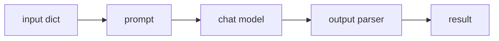

# LangChain

> **Level:** Beginner · **Reading time:** 11 min · **Phase:** 5 — Frameworks

**In one line:** LangChain is a Python library of building blocks (prompts, models, parsers, retrievers, tools) that you join together with a pipe operator.

**Before you start:** You should know what an LLM API call is ([Calling an LLM API](../../03-llm-concepts/topics/16-calling-an-llm-api.md)) and the basic RAG idea ([What is RAG](../../01-rag-foundations/topics/01-what-is-rag.md)).

## Explain it like I'm new

Think of a kitchen assembly line. One person chops, one cooks, one plates. Each does one job and hands the result on. LangChain gives you the stations. You decide the order.

Without a framework, you write the glue yourself: build a prompt string, call the model's API, parse the reply. LangChain wraps each of those steps in a common interface so they snap together and so you can swap one part (say, the model provider) without rewriting the rest.

**Words to know:**

- **Runnable** — any step with the same interface (`invoke`, `batch`, `stream`).
- **Prompt template** — a string with `{placeholders}` filled from a dict.
- **Chat model** — a wrapper around a provider's LLM API.
- **Output parser** — turns the model's reply into a string, JSON or an object.
- **LCEL** (LangChain Expression Language) — the `a | b | c` syntax that builds a chain of runnables.
- **Retriever** — a runnable that takes a query and returns documents (Phase 1).
- **Tool** — a function the model may ask to call (Phase 4).
- **API** — a way for your code to send a request to a service (here, an LLM provider) and get a reply back.
- **Pipe operator (`|`)** — in Python it can be given a custom meaning. Here `a | b` means "run a, then feed its output into b".
- **invoke / batch / stream** — run the step once, run it on a list of inputs, or get the reply piece by piece as it is produced.

<!-- anim:05-langchain-flow -->
## Watch it


*It plays on a loop. Read the caption in the box, one step at a time. Want to go at your own pace? [Step through it with Previous and Next](https://techsaurabh-394.github.io/ai-engineer-roadmap/#05-langchain-flow).*

## How it works

1. Input dict goes into the prompt template, which produces messages.
2. The chat model turns messages into a reply.
3. The parser converts the reply into the final value.



**Mapping to earlier phases:** a RAG chain is `retriever | format docs | prompt | model | parser` — exactly the pipeline from Phase 1. An agent is a loop around a model with tools — Phase 4. LangChain's own agent loop is built on [LangGraph](02-langgraph.md).

### Worked example

Here is one input travelling through the three-step chain from the repo's offline demo ([`fw_mini_chain.py`](../code/fw_mini_chain.py)). The "model" is a fake that echoes the last word in capitals, so we need no network or key. I ran this and pasted the real values.

| Step | What goes in | What comes out |
|------|--------------|----------------|
| Start | `{'letter': 'a'}` | (the input dict) |
| Prompt template | `{'letter': 'a'}` | `'Name a fruit starting with a please apple'` |
| Fake model | that prompt string | `'ANSWER: APPLE'` |
| Output parser | `'ANSWER: APPLE'` | `'APPLE'` |

The final result of `chain.invoke(...)` is `APPLE`. Each step only knew about its own input and output. The `|` just passed each result to the next step.

With a real model, only the middle row changes: a provider's reply replaces the fake one. Check the current docs for exact imports and package names.

## Code example

From scratch, stdlib only. This is the core idea in about 15 lines (full version: [`fw_mini_chain.py`](../code/fw_mini_chain.py)):

```python
class Step:
    def __init__(self, fn):
        self.fn = fn
    def invoke(self, value):
        return self.fn(value)
    def __or__(self, other):
        return Step(lambda v: other.invoke(self.invoke(v)))

prompt = Step(lambda d: f"Translate to French: {d['text']}")
model = Step(lambda p: "Bonjour")          # fake model, no network
parser = Step(lambda s: s.strip().lower())

chain = prompt | model | parser
print(chain.invoke({"text": "Hello"}))     # bonjour
```

**In real projects** (needs `pip install langchain-openai` and an API key; check the docs for current package names):

```python
from langchain_core.prompts import ChatPromptTemplate
from langchain_core.output_parsers import StrOutputParser
from langchain_openai import ChatOpenAI

prompt = ChatPromptTemplate.from_template("Translate to French: {text}")
chain = prompt | ChatOpenAI(model="gpt-4o-mini") | StrOutputParser()
print(chain.invoke({"text": "Hello"}))
```

## When to use it / when not to

- Use it when you want many ready-made integrations (vector stores, loaders, model providers) and a common interface.
- Use it for quick prototypes of RAG chains.
- Skip it for a single model call. A direct provider SDK call is shorter and easier to debug.
- Skip it if the abstraction hides what you need to see (exact prompt, retries, token counts). Use tracing (LangSmith or your own logging) to see inside.

## Common mistakes

- Using old tutorials. The API has changed a lot; check the current docs.
- Treating chains as agents. A chain has a fixed path; an agent decides its own path.
- Not printing the final prompt. Most bugs are in the prompt text.
- Pulling in the whole library for one small feature.
- Confusing a *prompt template* with the final prompt. The template has `{placeholders}`; the final prompt is what the model actually receives after they are filled.

## Recap

If you remember only three things:

- LangChain is a box of building blocks (prompt, model, parser, retriever, tool) that you join with `|` so each step passes its output to the next.
- A chain has a fixed path. An agent chooses its own path, which is a different thing.
- For one model call, skip the framework. Print the final prompt when something goes wrong, because most bugs live there.

## Interview questions

1. **What is LCEL?**
   <details><summary>Answer</summary>A syntax where runnables are joined with `|`. Each step shares the same interface, so chains support invoke, batch and stream with no extra code.</details>
2. **Chain vs agent?**
   <details><summary>Answer</summary>A chain follows a path you fixed in code. An agent lets the model choose the next step in a loop, usually by calling tools.</details>
3. **Name a downside of using LangChain.**
   <details><summary>Answer</summary>Extra abstraction layers make debugging harder and the API changes often. For simple tasks, a plain SDK call is clearer.</details>

## Go deeper

- https://python.langchain.com/

**Prev:** [Phase 5 overview](../README.md) · **Next:** [LangGraph](02-langgraph.md) · **Back to phase:** [Phase 5](../README.md)
