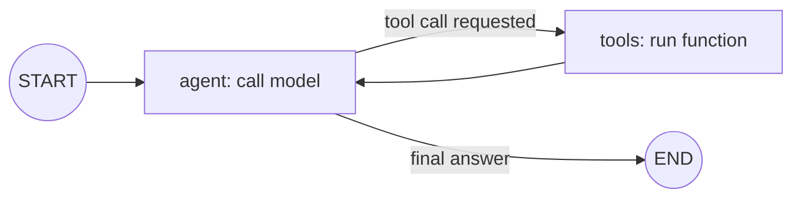

# LangGraph

> **Level:** Intermediate · **Reading time:** 10 min · **Phase:** 5 — Frameworks

**In one line:** LangGraph lets you describe an agent or workflow as a graph of steps (nodes) joined by edges, with shared state passed along.

## Explain it like I'm new

Think of a subway map. Stations are steps. Tracks say where you can go next. Some stations are junctions: you pick a track based on a sign. A loop line lets you go around again.

A plain agent loop (Phase 4) is `while not done: think, act`. That works until you need branches, retries, human approval or several agents. A graph makes the control flow explicit and visible, so you can reason about it, test it and pause it.

Vocabulary:

- **State** — the data shared by all nodes (often a typed dict with a message list).
- **Node** — a function that reads state and returns updates.
- **Edge** — a fixed link from one node to the next.
- **Conditional edge** — a router function that picks the next node from the state.
- **START / END** — special entry and exit points.
- **Checkpointer** — saves state after each step, enabling memory across turns, resume after a crash and human-in-the-loop pauses.

## How it works

1. Define the state shape.
2. Add nodes (functions) and edges.
3. Compile the graph.
4. Invoke with an initial state. The runtime runs a node, merges its updates into state, follows the edge, and repeats until END.



**Mapping to earlier phases:** the agent loop from [Phase 4](../../04-agentic-ai/README.md) is this exact graph: model node, tool node, and a conditional edge that checks "did the model ask for a tool?". Memory (Phase 4) maps to state plus a checkpointer.

## Code example

From scratch, using this repo's [`fw_mini_graph.py`](../code/fw_mini_graph.py):

```python
from fw_mini_graph import MiniGraph, END

g = MiniGraph()
g.add_node("write", lambda s: {"draft": s.get("draft", "") + "word "})
g.add_node("review", lambda s: {"ok": len(s["draft"].split()) >= 3})
g.set_entry("write").add_edge("write", "review")
g.add_conditional_edge("review", lambda s: END if s["ok"] else "write")

print(g.run({})["draft"])   # word word word
```

**In real projects** (`pip install langgraph`):

```python
from typing import TypedDict
from langgraph.graph import StateGraph, START, END

class State(TypedDict):
    text: str

def shout(state: State) -> dict:
    return {"text": state["text"].upper()}

builder = StateGraph(State)
builder.add_node("shout", shout)
builder.add_edge(START, "shout")
builder.add_edge("shout", END)
graph = builder.compile()
print(graph.invoke({"text": "hello"}))   # {'text': 'HELLO'}
```

Conditional routing uses `add_conditional_edges`; see the docs for its exact form.

## When to use it / when not to

- Use it for agents with branches, loops, retries, approval steps or several cooperating agents.
- Use it when you need to save and resume state.
- Skip it for a straight-line pipeline. A function that calls three other functions is enough.
- Skip it if you cannot yet draw your workflow on paper. Draw first.

## Common mistakes

- Forgetting a loop limit, so a bad router cycles forever (the mini runner has `max_steps` for this reason).
- Putting too much into state, making it hard to inspect.
- Mutating state in place instead of returning updates.
- Using a graph where a simple `if` would do.

## Interview questions

1. **Why a graph instead of a while loop?**
   <details><summary>Answer</summary>Control flow becomes explicit data. You can visualize it, add branches, checkpoint state and pause for a human without tangled code.</details>
2. **What does a checkpointer give you?**
   <details><summary>Answer</summary>Saved state after each step: conversation memory across turns, resuming after failure, and human-in-the-loop interrupts.</details>
3. **What is a conditional edge?**
   <details><summary>Answer</summary>An edge whose destination is chosen by a function of the current state, such as "if the model requested a tool, go to the tools node".</details>

## Go deeper

- https://langchain-ai.github.io/langgraph/

**Prev:** [LangChain](01-langchain.md) · **Next:** [LlamaIndex](03-llamaindex.md) · **Back to phase:** [Phase 5](../README.md)
