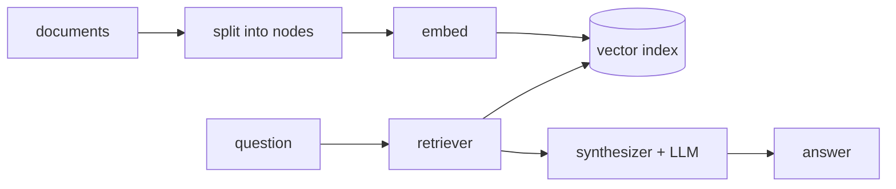

# LlamaIndex

> **Level:** Beginner · **Reading time:** 8 min · **Phase:** 5 — Frameworks

**In one line:** LlamaIndex is a library focused on connecting your own documents to an LLM: load, split, index, retrieve and answer.

## Explain it like I'm new

Imagine a librarian. You hand over a pile of documents. The librarian files them, and when you ask a question, fetches the right pages and reads them to answer you. LlamaIndex is that librarian, written as code.

It is data-centric. Where LangChain is a general toolbox, LlamaIndex puts the document pipeline first: many loaders, many chunking strategies, many index types, and query engines on top.

Vocabulary:

- **Document** — a raw source (a PDF, a web page) with metadata.
- **Node** — a chunk of a document. (Not the same as a graph node.)
- **Index** — a data structure over nodes. The common one is a vector index.
- **Retriever** — fetches the top-k nodes for a query.
- **Response synthesizer** — builds the prompt from retrieved nodes and calls the LLM.
- **Query engine** — retriever plus synthesizer: question in, answer out.
- **Chat engine** — a query engine with conversation memory.

## How it works

1. Load documents.
2. Split into nodes (chunks).
3. Embed each node and store the vectors in the index.
4. At query time, embed the question, fetch top-k nodes.
5. Put the nodes in a prompt and ask the LLM.



**Mapping:** this is the RAG pipeline from [Phase 1](../../01-rag-foundations/README.md) with each stage named. Advanced options (re-ranking, hybrid search) are in [Phase 2](../../02-advanced-rag/README.md).

## Code example

From scratch, stdlib only: word-overlap retrieval standing in for embeddings.

```python
docs = ["Paris is the capital of France.", "The Nile is a river in Africa."]

def score(q, d):
    return len(set(q.lower().split()) & set(d.lower().split()))

def query_engine(question, k=1):
    top = sorted(docs, key=lambda d: score(question, d), reverse=True)[:k]
    prompt = "Context:\n" + "\n".join(top) + f"\nQuestion: {question}"
    return prompt   # a real engine would send this to an LLM

print(query_engine("capital of France?"))
```

**In real projects** (`pip install llama-index`, needs an API key for the default models):

```python
from llama_index.core import VectorStoreIndex, SimpleDirectoryReader

documents = SimpleDirectoryReader("data").load_data()
index = VectorStoreIndex.from_documents(documents)
query_engine = index.as_query_engine()
print(query_engine.query("What does the report say about revenue?"))
```

Defaults hide the embedding model, chunk size and top-k. Read the docs and set them on purpose.

## When to use it / when not to

- Use it when the main job is question answering over many documents or file types.
- Use it when you want ready loaders and index types without writing them.
- Skip it for a tiny corpus (a few pages fit in one prompt).
- Skip it if you need full control of chunking and ranking and prefer your own 100 lines.

## Common mistakes

- Trusting default chunk size for every document type.
- Not checking which nodes were retrieved before blaming the LLM.
- Re-indexing on every run instead of persisting the index.
- Mixing up "node" here with "node" in graph frameworks.

## Interview questions

1. **What is a query engine?**
   <details><summary>Answer</summary>A retriever plus a response synthesizer. It takes a question, fetches relevant chunks and asks the LLM to answer from them.</details>
2. **LlamaIndex vs LangChain?**
   <details><summary>Answer</summary>LlamaIndex centres on data ingestion and retrieval over documents. LangChain is a broader toolbox for chains and integrations. They overlap and can be combined.</details>
3. **What does "node" mean in LlamaIndex?**
   <details><summary>Answer</summary>A chunk of a document with metadata and relationships, the unit that is embedded and retrieved.</details>

## Go deeper

- https://docs.llamaindex.ai/

**Prev:** [LangGraph](02-langgraph.md) · **Next:** [OpenAI Agents SDK](04-openai-agents-sdk.md) · **Back to phase:** [Phase 5](../README.md)
