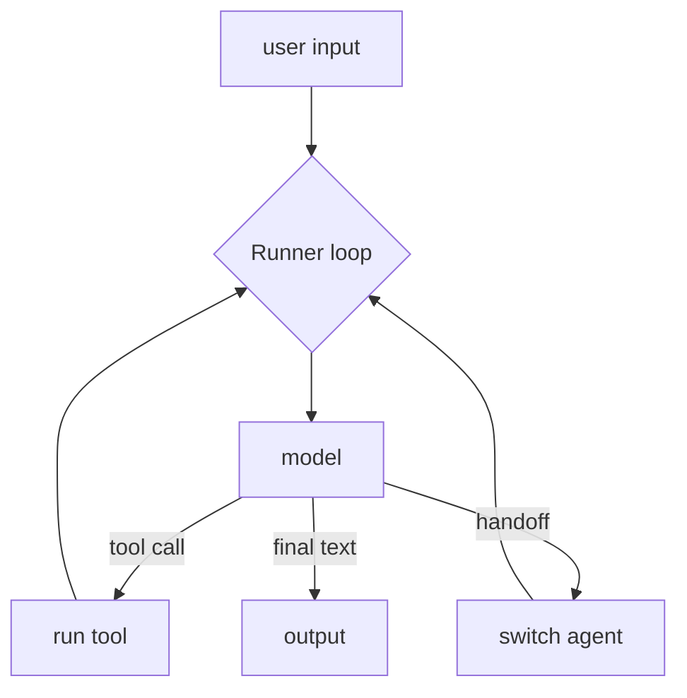

# OpenAI Agents SDK

> **Level:** Intermediate · **Reading time:** 9 min · **Phase:** 5 — Frameworks

**In one line:** The OpenAI Agents SDK is a small Python library with three main ideas: an Agent (model plus instructions plus tools), a Runner that runs the agent loop, and handoffs between agents.

## Explain it like I'm new

Think of a help desk. A front-desk person answers simple questions and, for billing, passes you to a billing specialist. Each person has a role (instructions) and a set of things they can do (tools). The SDK models this directly.

It keeps the number of concepts low. You do not write the loop. The Runner calls the model, runs any tools it asks for, feeds results back, and stops when the model gives a final answer.

Vocabulary:

- **Agent** — a model, instructions (system prompt) and a list of tools.
- **Tool** — usually a Python function; its signature and docstring describe it to the model.
- **Runner** — runs the loop until a final output.
- **Handoff** — one agent passes the conversation to another.
- **Guardrail** — a check on inputs or outputs that can stop a run.
- **Tracing** — a record of each model call and tool call in a run.
- **Session** — stored conversation history (memory) across runs.

## How it works

1. You define an agent with instructions and tools.
2. The Runner sends the input and tool descriptions to the model.
3. If the model asks for a tool, the Runner executes it and appends the result.
4. If the model asks for a handoff, the Runner switches the active agent.
5. Otherwise the reply is the final output.



**Mapping:** this is the ReAct-style agent loop from [Phase 4](../../04-agentic-ai/README.md), packaged. Handoffs are the multi-agent routing pattern. Sessions are conversation memory.

## Code example

From scratch, stdlib only, with a scripted fake model:

```python
def get_time(city): return f"12:00 in {city}"
TOOLS = {"get_time": get_time}

def fake_model(messages):
    if messages[-1]["role"] == "user":
        return {"tool": "get_time", "args": {"city": "Paris"}}
    return {"final": "It is " + messages[-1]["content"]}

def run(user_input, max_turns=5):
    messages = [{"role": "user", "content": user_input}]
    for _ in range(max_turns):
        out = fake_model(messages)
        if "final" in out:
            return out["final"]
        result = TOOLS[out["tool"]](**out["args"])
        messages.append({"role": "tool", "content": result})
    raise RuntimeError("too many turns")

print(run("What time is it in Paris?"))   # It is 12:00 in Paris
```

**In real projects** (`pip install openai-agents`, needs `OPENAI_API_KEY`):

```python
from agents import Agent, Runner

agent = Agent(name="Assistant", instructions="You are a concise assistant.")
result = Runner.run_sync(agent, "Write a haiku about recursion.")
print(result.final_output)
```

Tools, handoffs and guardrails are added through `Agent` options; see the docs for the current forms.

## When to use it / when not to

- Use it for tool-using agents and simple multi-agent handoffs with little code.
- Use it when you want built-in tracing.
- Skip it if you need complex branching or durable state; a graph framework fits better.
- Check provider support in the docs if you do not use OpenAI models.

## Common mistakes

- Vague tool docstrings. The model chooses tools from them.
- No turn limit.
- Giving one agent too many tools instead of splitting roles.
- Skipping guardrails on tools that change data.

## Interview questions

1. **What does the Runner do?**
   <details><summary>Answer</summary>It runs the agent loop: call the model, execute requested tools, apply handoffs, and stop at a final output or turn limit.</details>
2. **What is a handoff?**
   <details><summary>Answer</summary>Transfer of the conversation from one agent to a more suitable agent, such as triage to billing.</details>
3. **Why have tracing?**
   <details><summary>Answer</summary>Agent runs are multi-step and non-deterministic. A trace of each call lets you find which step went wrong.</details>

## Go deeper

- https://openai.github.io/openai-agents-python/

**Prev:** [LlamaIndex](03-llamaindex.md) · **Next:** [CrewAI](05-crewai.md) · **Back to phase:** [Phase 5](../README.md)
