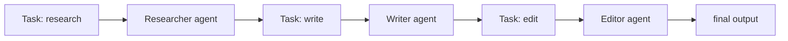

# CrewAI

> **Level:** Intermediate · **Reading time:** 8 min · **Phase:** 5 — Frameworks

**In one line:** CrewAI organizes several LLM agents as a "crew" where each agent has a role and goal and works through assigned tasks.

## Explain it like I'm new

Think of a small newsroom. A researcher gathers facts, a writer drafts, an editor checks. Each has a job title and a clear task. CrewAI uses this team metaphor: you describe roles and tasks in plain language, and the framework runs them in order.

It suits workflows that already look like a pipeline of roles. The cost is that every agent is an extra LLM call or many, so runs are slower and pricier than one well-written prompt.

Vocabulary (check the docs for exact current options):

- **Agent** — a role, a goal and a backstory, plus optional tools.
- **Task** — a description of work and its expected output, assigned to an agent.
- **Crew** — the group of agents and tasks, and how they run.
- **Process** — the execution style, such as sequential (one after another) or hierarchical (a manager delegates).
- **Tool** — a function an agent may call.

## How it works

1. Define agents with roles and goals.
2. Define tasks and assign each to an agent.
3. Group them in a crew.
4. Start the crew. In sequential mode, each task's output becomes context for the next.



**Mapping:** this is the multi-agent pattern from [Phase 4](../../04-agentic-ai/README.md): specialist agents passing work along. Each agent is an agent loop with its own prompt. Memory is the context handed from task to task.

## Code example

From scratch, stdlib only. A sequential crew with fake LLM calls:

```python
def make_agent(role):
    def agent(task, context):
        # a real agent would call an LLM with role + task + context
        return f"[{role}] did '{task}' using: {context or 'nothing'}"
    return agent

crew = [
    (make_agent("researcher"), "collect facts"),
    (make_agent("writer"), "draft article"),
    (make_agent("editor"), "polish draft"),
]

context = ""
for agent, task in crew:
    context = agent(task, context)
print(context)
```

**In real projects:** CrewAI is defined with `Agent`, `Task` and `Crew` classes, often configured with YAML files. Its API has changed between versions, so follow the current quickstart: https://docs.crewai.com/

## When to use it / when not to

- Use it when your task splits cleanly into roles and you want quick, readable setup.
- Use it for demos and content pipelines.
- Skip it if one agent with tools can do the job. More agents mean more cost and more failure points.
- Skip it when you need exact control over branching and state; use a graph framework.

## Common mistakes

- Creating many agents for what is one prompt.
- Vague task descriptions and no expected output.
- No review step, so errors pass down the chain.
- Not logging each agent's output, making failures hard to find.

## Interview questions

1. **What are the three core CrewAI objects?**
   <details><summary>Answer</summary>Agent (role, goal), Task (work and expected output) and Crew (the team and its process).</details>
2. **Sequential vs hierarchical process?**
   <details><summary>Answer</summary>Sequential runs tasks in a fixed order. Hierarchical adds a manager agent that delegates and reviews.</details>
3. **When is multi-agent worse than single-agent?**
   <details><summary>Answer</summary>When the task is simple. Extra agents add latency, cost and places for errors without adding ability.</details>

## Go deeper

- https://docs.crewai.com/

**Prev:** [OpenAI Agents SDK](04-openai-agents-sdk.md) · **Next:** [AutoGen](06-autogen.md) · **Back to phase:** [Phase 5](../README.md)
