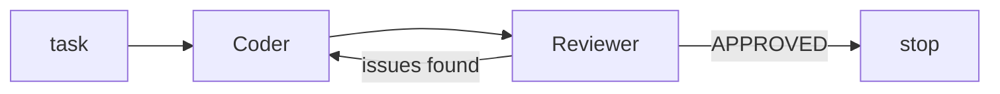

# AutoGen

> **Level:** Advanced · **Reading time:** 8 min · **Phase:** 5 — Frameworks

**In one line:** AutoGen is Microsoft's framework for multi-agent systems where agents talk to each other by sending messages.

## Explain it like I'm new

Think of a group chat. A coder posts a script, a reviewer replies with problems, the coder fixes them, and the chat ends when the reviewer says "approved". AutoGen builds agent systems around that conversation model.

The key idea is that agents are message-passing actors. Control flow comes from who talks to whom, and when the conversation stops.

Vocabulary (check the docs, since the project has had major version changes and several APIs):

- **Agent** — an entity that receives messages and replies, backed by an LLM, a human or code.
- **Team / group chat** — several agents taking turns under a rule, such as round-robin.
- **Termination condition** — a rule that ends the chat (a keyword, a max number of messages).
- **Tool** — a function an agent can call, including running generated code.
- **Human proxy** — an agent that asks a person for input.

## How it works

1. Create agents with roles.
2. Place them in a team with a turn-taking rule.
3. Send a task as the first message.
4. Agents reply in turn. Each sees the shared history.
5. The run stops on the termination condition.



**Mapping:** this is the multi-agent pattern from [Phase 4](../../04-agentic-ai/README.md), with the shared message history as memory. The reviewer loop is the "critic" or reflection pattern.

## Code example

From scratch, stdlib only. Two fake agents in a round-robin chat with a termination rule:

```python
def coder(history):
    return "code v2" if any("fix" in m for m in history) else "code v1"

def reviewer(history):
    return "APPROVED" if history[-1] == "code v2" else "please fix the bug"

def chat(task, agents, max_msgs=10):
    history = [task]
    for i in range(max_msgs):
        msg = agents[i % len(agents)](history)
        history.append(msg)
        if "APPROVED" in msg:
            break
    return history

print(chat("write a function", [coder, reviewer]))
```

**In real projects:** AutoGen is split into layers and its API differs across versions. Read the current docs before writing code: https://microsoft.github.io/autogen/

## When to use it / when not to

- Use it for research and prototypes of agents that debate, review or write and run code.
- Use it when conversation between agents is the natural model.
- Skip it for fixed, predictable workflows. Plain code or a graph is easier to test.
- Be careful with code execution: run it in a sandbox.

## Common mistakes

- No termination condition, so agents chat forever and burn tokens.
- Running model-written code directly on your machine.
- Letting history grow without limit, which exceeds the context window.
- Using old tutorials from a different major version.

## Interview questions

1. **What is a termination condition?**
   <details><summary>Answer</summary>A rule that stops a multi-agent chat, such as a keyword or a maximum message count. Without one, cost can grow without limit.</details>
2. **How does AutoGen differ from a graph framework?**
   <details><summary>Answer</summary>Control flow emerges from conversation between agents, rather than from edges you define in advance.</details>
3. **Why sandbox code execution?**
   <details><summary>Answer</summary>Model-written code is untrusted. A sandbox (container) limits damage from bugs or malicious output.</details>

## Go deeper

- https://microsoft.github.io/autogen/

**Prev:** [CrewAI](05-crewai.md) · **Next:** [DSPy](07-dspy.md) · **Back to phase:** [Phase 5](../README.md)
