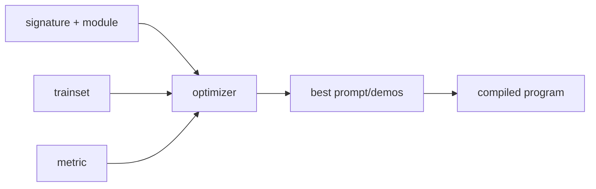

# DSPy

> **Level:** Advanced · **Reading time:** 9 min · **Phase:** 5 — Frameworks

**In one line:** DSPy lets you declare what an LLM step should do (inputs and outputs) as code, then uses an optimizer to find good prompts instead of you hand-writing them.

## Explain it like I'm new

Hand-tuned prompts are like hand-tuned engine settings: they work for one car on one day. Change the model and they break. DSPy treats prompts like model weights: you give examples and a score, and it searches for better instructions or few-shot examples.

You write a **signature**, a typed contract such as "question -> answer". You wrap it in a **module**. An **optimizer** then tunes the prompt against a **metric** you define.

Vocabulary:

- **Signature** — declares input and output fields of an LLM call.
- **Module** — a reusable piece that uses a signature (for example `Predict`, or a reasoning variant).
- **Metric** — a function that scores an output (exact match, a judge, a check).
- **Optimizer** — a procedure that tries prompt variants or examples and keeps what scores best.
- **Trainset** — labelled examples for optimizing.

## How it works

1. Write a signature and a module.
2. Prepare a small trainset and a metric.
3. Run an optimizer. It tries candidate prompts or demos and scores each on the trainset.
4. Keep the best-scoring program and save it.



**Mapping:** the optimizer loop is the evaluation habit from [Phase 3](../../03-llm-concepts/README.md) and [Phase 7](../../07-production-ai/README.md) made automatic: measure, change, measure again. It can tune the generation step of a RAG pipeline from [Phase 1](../../01-rag-foundations/README.md).

## Code example

From scratch, stdlib only: pick the best instruction by score on a tiny trainset. The "model" is a fake that obeys keywords.

```python
def fake_model(instruction, question):
    if "brief" in instruction:
        return question.split()[-1]       # short answer
    return "The answer is " + question.split()[-1]

trainset = [("capital of France Paris", "Paris"), ("largest planet Jupiter", "Jupiter")]
metric = lambda pred, gold: pred == gold

candidates = ["Be verbose.", "Be brief."]

def score(instruction):
    return sum(metric(fake_model(instruction, q), a) for q, a in trainset)

print(max(candidates, key=score))   # Be brief.
```

**In real projects** (`pip install dspy`, needs a configured LM):

```python
import dspy

dspy.configure(lm=dspy.LM("openai/gpt-4o-mini"))
qa = dspy.Predict("question -> answer")
print(qa(question="What is the capital of France?").answer)
```

Optimizers and typed class-based signatures are covered in the docs.

## When to use it / when not to

- Use it when you have a metric and examples, and prompt quality matters across model changes.
- Use it for multi-step pipelines where hand-tuning each prompt is slow.
- Skip it with no labelled data or no way to score output; an optimizer needs both.
- Skip it for one-off prompts. Writing the prompt by hand is faster.

## Common mistakes

- A weak metric. The optimizer will improve exactly what you measure, even if it is wrong.
- Too few examples, so it overfits the trainset.
- Not holding out a validation set.
- Expecting it to fix bad retrieval or bad data.

## Interview questions

1. **What is a DSPy signature?**
   <details><summary>Answer</summary>A declaration of an LLM step's input and output fields, such as "question -> answer", separate from the prompt text.</details>
2. **How is DSPy different from LangChain?**
   <details><summary>Answer</summary>LangChain composes components; you write the prompts. DSPy generates and optimizes prompts from a signature, examples and a metric.</details>
3. **Why does the metric matter most?**
   <details><summary>Answer</summary>The optimizer maximizes it. A metric that does not match real quality produces prompts that score well and work badly.</details>

## Go deeper

- https://dspy.ai/

**Prev:** [AutoGen](06-autogen.md) · **Next:** [Haystack](08-haystack.md) · **Back to phase:** [Phase 5](../README.md)
