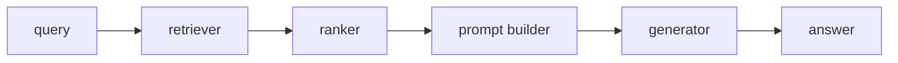

# Haystack

> **Level:** Intermediate · **Reading time:** 8 min · **Phase:** 5 — Frameworks

**In one line:** Haystack, from deepset, builds search and RAG systems as pipelines of components whose inputs and outputs are connected explicitly.

## Explain it like I'm new

Think of plumbing. Each component is a pipe section with a labelled inlet and outlet. You connect the retriever's outlet to the prompt builder's inlet, and the builder's outlet to the generator. Because every connection is named, you can see and check the whole system.

Haystack emphasises production search: document stores, retrievers, rankers and evaluation. Pipelines can also branch and loop.

Vocabulary (see the docs for exact class names):

- **Component** — one step with declared inputs and outputs.
- **Pipeline** — components plus the connections between them.
- **Document store** — where documents and vectors are kept.
- **Retriever** — fetches documents from a store.
- **Ranker** — reorders retrieved documents (re-ranking, Phase 2).
- **Generator** — a component that calls an LLM.
- **Prompt builder** — fills a template with documents and the question.

## How it works

1. Create components.
2. Add them to a pipeline.
3. Connect outputs to inputs by name; the pipeline checks types.
4. Run the pipeline with inputs for the entry components.



**Mapping:** this is the RAG pipeline of [Phase 1](../../01-rag-foundations/README.md) with the re-ranking stage from [Phase 2](../../02-advanced-rag/README.md) as a first-class part.

## Code example

From scratch, stdlib only: components with named inputs and outputs, wired together.

```python
class Pipeline:
    def __init__(self):
        self.components, self.links = {}, []
    def add(self, name, fn):
        self.components[name] = fn
    def connect(self, src, dst):
        self.links.append((src, dst))
    def run(self, name, value):
        value = self.components[name](value)
        for src, dst in self.links:
            if src == name:
                return self.run(dst, value)
        return value

p = Pipeline()
p.add("retrieve", lambda q: [d for d in ["cats purr", "dogs bark"] if q in d])
p.add("prompt", lambda docs: "Context: " + " ".join(docs))
p.connect("retrieve", "prompt")
print(p.run("retrieve", "cats"))   # Context: cats purr
```

**In real projects:** Haystack 2.x uses `Pipeline`, `add_component` and `connect`. Class names and import paths differ by version and integration, so copy from the current tutorials: https://docs.haystack.deepset.ai/

## When to use it / when not to

- Use it for search-heavy production RAG where typed, inspectable pipelines and evaluation matter.
- Use it when you want swappable document stores and retrievers.
- Skip it for a quick prototype with one file of data.
- Skip it if your team already runs a stack you are happy with.

## Common mistakes

- Connecting components with mismatched output and input names.
- Following Haystack 1.x tutorials for a 2.x install.
- Not evaluating retrieval separately from generation.
- Skipping a ranker and sending noisy documents to the LLM.

## Interview questions

1. **What is a Haystack component?**
   <details><summary>Answer</summary>A step with declared, named inputs and outputs. The pipeline connects them and checks that connections make sense.</details>
2. **Why are named connections useful?**
   <details><summary>Answer</summary>The data flow is explicit and checkable, so you can inspect and debug a pipeline instead of tracing hidden state.</details>
3. **Where does a ranker fit?**
   <details><summary>Answer</summary>After retrieval and before the prompt builder. It reorders candidates so the best few reach the LLM.</details>

## Go deeper

- https://docs.haystack.deepset.ai/

**Prev:** [DSPy](07-dspy.md) · **Next:** [Phase 6 — MCP](../../06-mcp/README.md) · **Back to phase:** [Phase 5](../README.md)
