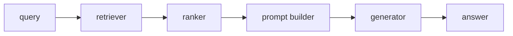

# Haystack

> **Level:** Intermediate · **Reading time:** 10 min · **Phase:** 5 — Frameworks

**In one line:** Haystack, from deepset, builds search and RAG systems as pipelines of components whose inputs and outputs are connected explicitly.

**Before you start:** You should know the RAG pipeline steps ([What is RAG](../../01-rag-foundations/topics/01-what-is-rag.md)) and what a vector database stores ([Vector databases](../../01-rag-foundations/topics/10-vector-databases.md)).

## Explain it like I'm new

Think of plumbing. Each component is a pipe section with a labelled inlet and outlet. You connect the retriever's outlet to the prompt builder's inlet, and the builder's outlet to the generator. Because every connection is named, you can see and check the whole system.

Haystack emphasises production search: document stores, retrievers, rankers and evaluation. Pipelines can also branch and loop.

**Words to know (see the docs for exact class names):**

- **Component** — one step with declared inputs and outputs.
- **Pipeline** — components plus the connections between them.
- **Document store** — where documents and vectors are kept.
- **Retriever** — fetches documents from a store.
- **Ranker** — reorders retrieved documents (re-ranking, Phase 2).
- **Generator** — a component that calls an LLM.
- **Prompt builder** — fills a template with documents and the question.
- **Re-ranking** — a second pass that sorts the retrieved documents again, with a better but slower scorer.
- **Type check** — confirming that what one component outputs is what the next one expects to receive.

<!-- anim:08-haystack -->
## Watch it


*It plays on a loop. Read the caption in the box, one step at a time. Want to go at your own pace? [Step through it with Previous and Next](https://techsaurabh-394.github.io/ai-engineer-roadmap/#08-haystack).*

## How it works

1. Create components.
2. Add them to a pipeline.
3. Connect outputs to inputs by name; the pipeline checks types.
4. Run the pipeline with inputs for the entry components.



**Mapping:** this is the RAG pipeline of [Phase 1](../../01-rag-foundations/README.md) with the re-ranking stage from [Phase 2](../../02-advanced-rag/README.md) as a first-class part.

### Worked example

The code example below wires two components, `retrieve` and `prompt`, with a named link. I ran it with `p.run("retrieve", "cats")`.

1. Input `"cats"` enters the `retrieve` component.
2. `retrieve` keeps the documents that contain `cats`. Of `"cats purr"` and `"dogs bark"`, only the first matches. It outputs `['cats purr']`.
3. The pipeline looks at its links and finds `retrieve -> prompt`. So it passes `['cats purr']` into `prompt`.
4. `prompt` joins the documents and returns `Context: cats purr`.
5. `prompt` has no outgoing link, so that value is the final result.

If the link had been missing, the run would have stopped after step 2 with the raw list. Explicit links are what make a pipeline easy to inspect. Check the current docs for the exact Haystack classes.

## Code example

From scratch, stdlib only: components with named inputs and outputs, wired together.

```python
class Pipeline:
    def __init__(self):
        self.components, self.links = {}, []
    def add(self, name, fn):
        self.components[name] = fn
    def connect(self, src, dst):
        self.links.append((src, dst))
    def run(self, name, value):
        value = self.components[name](value)
        for src, dst in self.links:
            if src == name:
                return self.run(dst, value)
        return value

p = Pipeline()
p.add("retrieve", lambda q: [d for d in ["cats purr", "dogs bark"] if q in d])
p.add("prompt", lambda docs: "Context: " + " ".join(docs))
p.connect("retrieve", "prompt")
print(p.run("retrieve", "cats"))   # Context: cats purr
```

**In real projects:** Haystack 2.x uses `Pipeline`, `add_component` and `connect`. Class names and import paths differ by version and integration, so copy from the current tutorials: https://docs.haystack.deepset.ai/

## When to use it / when not to

- Use it for search-heavy production RAG where typed, inspectable pipelines and evaluation matter.
- Use it when you want swappable document stores and retrievers.
- Skip it for a quick prototype with one file of data.
- Skip it if your team already runs a stack you are happy with.

## Common mistakes

- Connecting components with mismatched output and input names.
- Following Haystack 1.x tutorials for a 2.x install.
- Not evaluating retrieval separately from generation.
- Skipping a ranker and sending noisy documents to the LLM.

## Recap

If you remember only three things:

- Haystack builds search and RAG systems as pipelines of components whose inputs and outputs are connected explicitly.
- Its typed, inspectable pipelines and swappable document stores suit search-heavy production RAG, where evaluation matters.
- For a quick prototype on one small file, it is more setup than you need.

## Interview questions

1. **What is a Haystack component?**
   <details><summary>Answer</summary>A step with declared, named inputs and outputs. The pipeline connects them and checks that connections make sense.</details>
2. **Why are named connections useful?**
   <details><summary>Answer</summary>The data flow is explicit and checkable, so you can inspect and debug a pipeline instead of tracing hidden state.</details>
3. **Where does a ranker fit?**
   <details><summary>Answer</summary>After retrieval and before the prompt builder. It reorders candidates so the best few reach the LLM.</details>

## Go deeper

- https://docs.haystack.deepset.ai/

**Prev:** [DSPy](07-dspy.md) · **Next:** [Phase 6 — MCP](../../06-mcp/README.md) · **Back to phase:** [Phase 5](../README.md)
