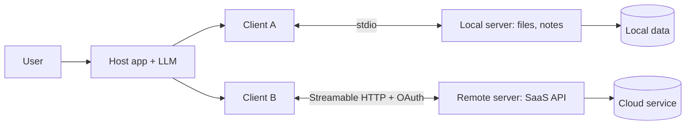

# Phase 6 — MCP (Model Context Protocol)

**Goal:** understand the Model Context Protocol well enough to explain it, secure it, and build your own server.
**Who it's for:** learners who finished agents and frameworks and want tools that work across AI apps.
**Time:** about 3 to 4 hours.
**Prerequisites:** [Phase 4 — Agentic AI](../04-agentic-ai/README.md) and [Phase 5 — Frameworks](../05-frameworks/README.md). Basic JSON. Node.js 18+ only if you build the TypeScript server.

## Overview
MCP is an open standard (JSON-RPC 2.0 messages) that connects AI apps (hosts) to tools and data (servers). One server works with any compliant client. Servers offer three primitives: tools (model-controlled), resources (application-controlled) and prompts (user-controlled).




## Topics
| # | Topic | Level | Link |
|---|-------|-------|------|
| 1 | Model Context Protocol | Beginner | [01-model-context-protocol.md](topics/01-model-context-protocol.md) |
| 2 | MCP Server | Beginner | [02-mcp-server.md](topics/02-mcp-server.md) |
| 3 | MCP Client | Intermediate | [03-mcp-client.md](topics/03-mcp-client.md) |
| 4 | MCP Tools | Intermediate | [04-mcp-tools.md](topics/04-mcp-tools.md) |
| 5 | MCP Resources | Intermediate | [05-mcp-resources.md](topics/05-mcp-resources.md) |
| 6 | MCP Prompts | Intermediate | [06-mcp-prompts.md](topics/06-mcp-prompts.md) |
| 7 | Build a Custom MCP Server | Advanced | [07-build-a-custom-mcp-server.md](topics/07-build-a-custom-mcp-server.md) |

**Learning order:** read 1 to 7 in order. Run the Python toy after topic 2. Build the TypeScript server during topic 7.

## How to run the code
Offline Python toy (stdlib only) that simulates `initialize`, `tools/*`, `resources/*` and `prompts/*`:
```bash
python 06-mcp/code/mcp_mini_jsonrpc.py
python -m pytest -q 06-mcp/code
```
Real TypeScript server ([source](code/hello-mcp-server/src/index.ts)):
```bash
cd 06-mcp/code/hello-mcp-server
npm ci
npm run build
```
Then add it to `claude_desktop_config.json` as shown in [topic 3](topics/03-mcp-client.md).

## Security checklist
- [ ] Give each server the least access it needs (one folder, read-only credentials).
- [ ] Require human approval for tools that write, delete, send or spend.
- [ ] Treat all tool output and resource text as untrusted (prompt injection).
- [ ] Validate every input (type, length, allowed values). Never build shell or SQL from model text.
- [ ] Mark read-only tools honestly with annotations. Treat annotations from unknown servers as hints only.
- [ ] Read the code of third-party servers before installing. A stdio server runs with your user permissions.
- [ ] Remote servers: HTTPS plus OAuth-based authorization per the [current spec](https://modelcontextprotocol.io/specification). Never ship static shared tokens in config.
- [ ] Keep secrets in env vars. Log to stderr, never print secrets.
- [ ] Limit the number of tools and output size sent to the model.

## Phase checkpoint quiz
<details><summary>1. What problem does MCP solve?</summary>It replaces custom per-app, per-tool integrations with one protocol. A server works with any MCP client.</details>

<details><summary>2. Who controls tools, resources and prompts?</summary>Tools: the model. Resources: the application. Prompts: the user.</details>

<details><summary>3. What is the message format?</summary>JSON-RPC 2.0 (requests with <code>id</code>, replies with <code>result</code> or <code>error</code>, notifications without <code>id</code>).</details>

<details><summary>4. Describe the initialize handshake.</summary>Client sends <code>initialize</code> with version and capabilities. Server replies with its version, capabilities and serverInfo. Client sends the <code>notifications/initialized</code> notification.</details>

<details><summary>5. stdio vs Streamable HTTP?</summary>stdio: local child process, JSON-RPC over stdin/stdout. Streamable HTTP: HTTP-based, for remote or shared servers, with OAuth-based authorization.</details>

<details><summary>6. Why must a stdio server not log to stdout?</summary>stdout carries the protocol messages; extra text corrupts them. Use stderr.</details>

<details><summary>7. Protocol error vs <code>isError</code>?</summary>Protocol errors (unknown tool, bad params) use the JSON-RPC <code>error</code> field. A tool that ran but failed returns a result with <code>isError: true</code>.</details>

<details><summary>8. MCP vs function calling vs A2A?</summary>Function calling is a model API feature inside one app. MCP is a shared protocol between AI apps and tool servers. A2A is a protocol between agents.</details>

<details><summary>9. Name two MCP security risks and a defense for each.</summary>Prompt injection via tool output: treat it as untrusted and require approval. Over-broad access: least privilege and narrow tools.</details>

<details><summary>10. What does <code>resources/read</code> return?</summary>A <code>contents</code> array with <code>uri</code>, <code>mimeType</code> and <code>text</code> or <code>blob</code>.</details>

More interview answers: [Agents and MCP](../08-interview-prep/03-agents-and-mcp.md).

**Next:** [Phase 7 — Production AI](../07-production-ai/README.md)

---

<p align="center">
  <b>Saurabh Pathak</b> · AI Engineer &amp; Full-Stack Developer<br/>
  <a href="https://github.com/techsaurabh-394">GitHub</a> ·
  <a href="https://www.linkedin.com/in/tech-saurabh/">LinkedIn</a> ·
  <a href="https://mernstackdev.com">Blog</a> ·
  <a href="mailto:saurabhpathak394@gmail.com">saurabhpathak394@gmail.com</a><br/>
  <a href="https://buymeacoffee.com/saurabhdev"></a>
</p>
