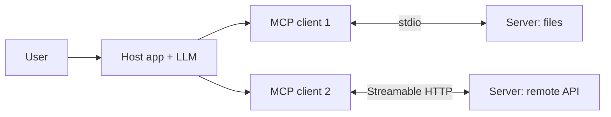

# Model Context Protocol
> **Level:** Beginner · **Reading time:** 9 min · **Phase:** 6 — MCP

**In one line:** The Model Context Protocol (MCP) is an open standard that lets any AI app talk to any tool or data source through one shared message format.

## Explain it like I'm new
Think of a USB-C port. Before it, every device had its own charger. After it, one cable fits many devices.

MCP plays that role for AI apps. Before MCP, if you wanted a chat app to read your files, you wrote custom code. If you wanted a second app to do the same, you wrote it again. With MCP, you write one **server** that exposes your files. Any MCP-aware **client** (such as Claude Desktop or an IDE) can use it.

Three words you need:
- **Host:** the AI app the user sees (Claude Desktop, an IDE, your own agent).
- **Client:** the connector inside the host. Each client holds a 1:1 connection to one server.
- **Server:** a small program that exposes capabilities.

A server can offer three kinds of things (called **primitives**): **tools** (actions), **resources** (data to read) and **prompts** (reusable templates).

## How it works
1. The host starts a client for each configured server.
2. The client opens a **transport** (stdio or Streamable HTTP).
3. Client and server do the **initialize handshake** and agree on a protocol version and capabilities.
4. The client lists what the server offers (`tools/list`, `resources/list`, `prompts/list`).
5. The model decides to use a tool; the host asks the user to approve; the client sends `tools/call`.
6. The result goes back into the model's context.

All messages are **JSON-RPC 2.0**: a simple format where a request has `jsonrpc`, `id`, `method`, `params`, and the reply has the same `id` with either `result` or `error`.



### Who controls what
| Primitive | Controlled by | Meaning |
|---|---|---|
| Tools | The **model** | The LLM decides when to call them |
| Resources | The **application** | The app decides what data to attach |
| Prompts | The **user** | The user picks them (like slash commands) |

## Code example
The runnable toy in [`code/mcp_mini_jsonrpc.py`](../code/mcp_mini_jsonrpc.py) shows the real message shapes without a network. Here is the first request and reply:

```python
import json
request = {"jsonrpc": "2.0", "id": 1, "method": "initialize",
           "params": {"protocolVersion": "2025-06-18", "capabilities": {},
                      "clientInfo": {"name": "demo", "version": "0.1"}}}
print(json.dumps(request))
# The server answers with the same id and a result:
# {"jsonrpc":"2.0","id":1,"result":{"protocolVersion":"2025-06-18",
#   "capabilities":{"tools":{}},"serverInfo":{"name":"hello","version":"1.0.0"}}}
```
The version string changes over time. Check the [current spec](https://modelcontextprotocol.io/specification).

## When to use it / when not to
| | Plain function calling | MCP | A2A |
|---|---|---|---|
| What it is | Model API feature: you pass tool schemas, the model returns a call | Protocol between an AI app and tool/data servers | Protocol between agents (agent-to-agent) |
| Who runs the tool | Your own app code | A separate server process | Another agent |
| Reuse across apps | Low: tied to your code | High: any MCP client | High: any A2A agent |
| Best for | One app, a few tools | Shared tools, data, many hosts | Agents that delegate to other agents |

- Use MCP when several apps should share tools, or when you want ready-made servers.
- Skip it when you have one app and two simple functions. Plain function calling is less work.

## Common mistakes
- Thinking MCP replaces function calling. Hosts usually use function calling inside, then route calls to MCP servers.
- Mixing up host, client and server.
- Trusting any server you find online. A server runs code with your permissions.
- Assuming A2A and MCP compete. MCP connects agents to tools; A2A connects agents to agents.

## Interview questions
1. **What problem does MCP solve?**
<details><summary>Answer</summary>It removes the need for custom integration code for every app and tool pair. One server works with any MCP client.</details>

2. **Name the three primitives and who controls each.**
<details><summary>Answer</summary>Tools (model-controlled), resources (application-controlled), prompts (user-controlled).</details>

3. **What message format does MCP use?**
<details><summary>Answer</summary>JSON-RPC 2.0, over stdio or Streamable HTTP.</details>

## Go deeper
- [modelcontextprotocol.io](https://modelcontextprotocol.io/)
- [MCP specification](https://modelcontextprotocol.io/specification)

**Prev:** [Phase 5](../../05-frameworks/README.md) · **Next:** [02-mcp-server.md](02-mcp-server.md) · **Back to phase:** [Phase 6](../README.md)
