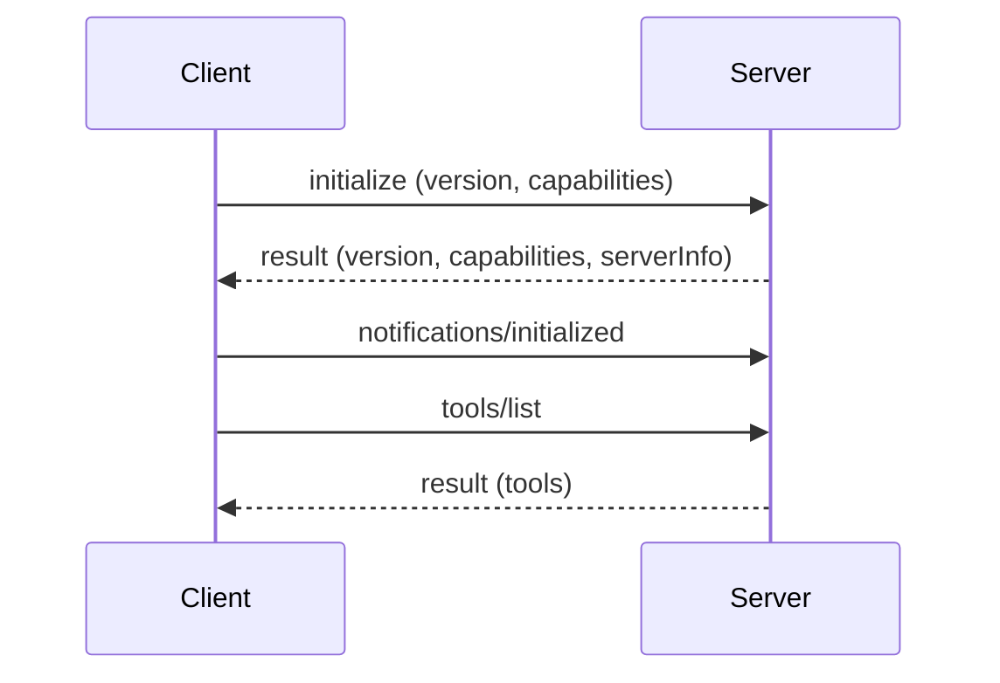

# MCP Server
> **Level:** Beginner · **Reading time:** 9 min · **Phase:** 6 — MCP

**In one line:** An MCP server is a program that exposes tools, resources and prompts to MCP clients over a transport such as stdio.

## Explain it like I'm new
A server is like a restaurant kitchen with a menu. The menu lists what you can order (tools, resources, prompts). The client is the waiter who carries orders in and dishes out. The kitchen does the real work and does not care which diner asked.

In MCP, "server" does not mean a big machine in the cloud. Most servers are small programs that run on your laptop. The host starts them as child processes and talks to them through stdin and stdout. That is the **stdio transport**.

## How it works
1. The server starts and waits for messages.
2. It receives `initialize` with the client's protocol version and capabilities.
3. It replies with its own version, **capabilities** (which primitives it supports) and `serverInfo`.
4. It receives the `notifications/initialized` notification. A **notification** has no `id` and gets no reply.
5. It now answers `tools/list`, `tools/call`, `resources/list`, `resources/read`, `prompts/list`, `prompts/get`.
6. Capabilities decide what is allowed. If the server did not declare `tools`, the client should not call tools.

### Two transports
| | stdio | Streamable HTTP |
|---|---|---|
| Where it runs | Local child process of the host | Anywhere: local or remote |
| Message path | JSON-RPC lines on stdin/stdout | HTTP POST (and optional streaming) to one endpoint |
| Auth | Inherits your user permissions; credentials via env vars | HTTP-level auth; the spec describes OAuth-based authorization |
| Good for | Personal tools, files, dev | Shared or hosted services |

Streamable HTTP replaced the older HTTP+SSE transport. Check the [transports page](https://modelcontextprotocol.io/specification) in the current spec for details.



**Stdio rule:** stdout is the protocol channel. Never `print()` or `console.log()` there. Log to stderr.

## Code example
The real server in this repo is [`code/hello-mcp-server/src/index.ts`](../code/hello-mcp-server/src/index.ts). Its skeleton:

```typescript
import { McpServer } from "@modelcontextprotocol/sdk/server/mcp.js";
import { StdioServerTransport } from "@modelcontextprotocol/sdk/server/stdio.js";

const server = new McpServer({ name: "hello-mcp-server", version: "1.0.0" });
// ... server.registerTool(...) calls go here ...
await server.connect(new StdioServerTransport());
console.error("hello-mcp-server running on stdio"); // stderr, not stdout
```

The Python version that runs offline is [`code/mcp_mini_jsonrpc.py`](../code/mcp_mini_jsonrpc.py). Its `MiniMcpServer.handle()` takes one JSON string and returns one JSON string (or `None` for notifications).

**In real projects** (official `mcp` Python SDK):
```python
from mcp.server.fastmcp import FastMCP

mcp = FastMCP("hello")

@mcp.tool()
def add_numbers(a: float, b: float) -> float:
    """Add two numbers and return the sum."""
    return a + b

if __name__ == "__main__":
    mcp.run()  # stdio by default
```

## When to use it / when not to
- Write a server when you want the same capability in many AI apps.
- Write a server to wrap an internal API with safe, narrow tools.
- Do not expose a whole database or a raw shell. Expose small, specific actions.
- Prefer stdio for personal use. Use Streamable HTTP when many users need one hosted server.

## Common mistakes
- Logging to stdout, which corrupts the JSON-RPC stream.
- Skipping input validation. The model can send bad arguments.
- Declaring capabilities you do not implement.
- Running a remote server with no authentication.

## Interview questions
1. **What happens during initialization?**
<details><summary>Answer</summary>The client sends `initialize` with its version and capabilities. The server replies with its version, capabilities and info. The client then sends `notifications/initialized`.</details>

2. **Why must a stdio server not write logs to stdout?**
<details><summary>Answer</summary>stdout carries the JSON-RPC messages. Extra text breaks parsing. Use stderr.</details>

3. **stdio vs Streamable HTTP?**
<details><summary>Answer</summary>stdio is a local child process. Streamable HTTP runs over HTTP and suits remote, shared servers that need real authorization.</details>

## Go deeper
- [MCP specification](https://modelcontextprotocol.io/specification)
- [Official docs](https://modelcontextprotocol.io/)

**Prev:** [01-model-context-protocol.md](01-model-context-protocol.md) · **Next:** [03-mcp-client.md](03-mcp-client.md) · **Back to phase:** [Phase 6](../README.md)
