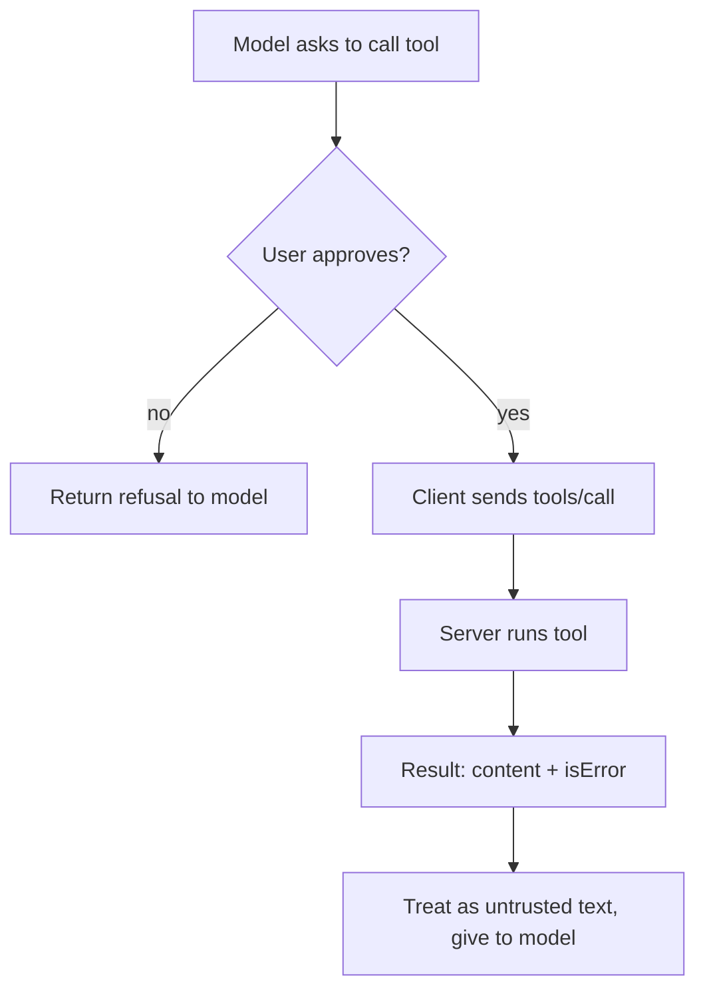

# MCP Client
> **Level:** Intermediate · **Reading time:** 9 min · **Phase:** 6 — MCP

**In one line:** An MCP client is the part of an AI app that connects to one MCP server, negotiates capabilities and sends its requests.

## Explain it like I'm new
Picture a phone. The phone app is the host. Inside it, each contact connection is a client. You do not talk to the cell tower yourself; the client handles the call setup.

The host (Claude Desktop, an IDE, your agent) contains the LLM and the user interface. For each server, it creates one client. The client's job is plumbing: open the transport, do the handshake, send requests, match replies to requests by `id`, and hand results back. The host's job is judgment: which tools to show the model and whether the user approves a call.

## How it works
1. **Read config.** The host reads a list of servers (see the config below).
2. **Launch or connect.** For stdio, spawn the process. For Streamable HTTP, connect to the URL.
3. **Initialize.** Send `initialize` with your protocol version and your capabilities, then `notifications/initialized`.
4. **Discover.** Call `tools/list`, `resources/list`, `prompts/list` for what the server declared.
5. **Give tools to the model.** Convert each MCP tool (`name`, `description`, `inputSchema`) into the model API's tool format.
6. **Route calls.** When the model asks for a tool, ask the user to approve if needed, send `tools/call`, and feed the result back.



### Claude Desktop config
Claude Desktop reads `claude_desktop_config.json`. Each entry under `mcpServers` has a `command` and `args`, and optionally `env`. Use absolute paths, then restart the app:

```json
{
  "mcpServers": {
    "hello": {
      "command": "node",
      "args": ["/absolute/path/to/06-mcp/code/hello-mcp-server/dist/index.js"]
    }
  }
}
```
Build first: `cd 06-mcp/code/hello-mcp-server && npm ci && npm run build`. The config file location depends on your OS; see the [docs](https://modelcontextprotocol.io/).

## Code example
The in-process toy client from [`code/mcp_mini_jsonrpc.py`](../code/mcp_mini_jsonrpc.py):

```python
from mcp_mini_jsonrpc import MiniMcpClient, MiniMcpServer

client = MiniMcpClient(MiniMcpServer())
client.connect()                       # initialize + notifications/initialized
print([t["name"] for t in client.list_tools()])
result = client.call_tool("add_numbers", {"a": 2, "b": 40})
print(result["content"][0]["text"])    # 42
```
Each call builds `{"jsonrpc": "2.0", "id": N, "method": ..., "params": ...}` and increments `id`.

**In real projects** (TypeScript SDK, same package as the hello server; check the SDK docs for your version):
```typescript
import { Client } from "@modelcontextprotocol/sdk/client/index.js";
import { StdioClientTransport } from "@modelcontextprotocol/sdk/client/stdio.js";

const client = new Client({ name: "my-host", version: "1.0.0" });
await client.connect(new StdioClientTransport({
  command: "node",
  args: ["dist/index.js"],
}));
const { tools } = await client.listTools();
const result = await client.callTool({ name: "add_numbers", arguments: { a: 2, b: 40 } });
```

## When to use it / when not to
- Write your own client when building an agent or host that should use existing MCP servers.
- Do not write a client just to call one function you own. Call it directly.
- Show tool names and arguments to the user before running risky calls.

## Common mistakes
- Auto-approving every tool call.
- Connecting to many servers and sending the model hundreds of tools. Tool choice gets worse; filter them.
- Ignoring `isError` in the result.
- Passing secrets to servers you do not trust.

## Interview questions
1. **Host vs client?**
<details><summary>Answer</summary>The host is the AI app. It contains one client per server. The client manages that one connection.</details>

2. **How are replies matched to requests?**
<details><summary>Answer</summary>By the JSON-RPC `id`. Notifications have no `id` and get no reply.</details>

3. **Why keep a human in the loop?**
<details><summary>Answer</summary>Tools can change real systems, and the model can be tricked by injected text. Approval is a safety check.</details>

## Go deeper
- [MCP specification](https://modelcontextprotocol.io/specification)
- [Official docs](https://modelcontextprotocol.io/)

**Prev:** [02-mcp-server.md](02-mcp-server.md) · **Next:** [04-mcp-tools.md](04-mcp-tools.md) · **Back to phase:** [Phase 6](../README.md)
