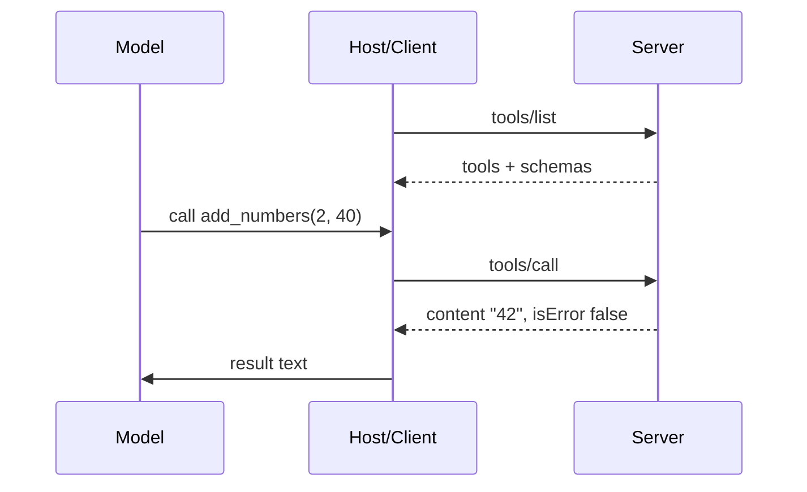

# MCP Tools
> **Level:** Intermediate · **Reading time:** 10 min · **Phase:** 6 — MCP

**In one line:** Tools are actions a server exposes, each with a name, a description and a JSON Schema for its input, and the model decides when to call them.

## Explain it like I'm new
A tool is a button on a remote control. The label (description) tells the model what the button does. The model presses it by sending a name and arguments. A tool is **model-controlled**: the LLM chooses to use it, usually with the user's approval.

**JSON Schema** is a standard way to describe the shape of JSON: "an object with a number `a` and a number `b`, both required". The server publishes one per tool so the model knows what to send.

## How it works
1. Client sends `tools/list`.
2. Server replies with tools: `name`, `description`, `inputSchema` (and optional `title`, `annotations`).
3. The model picks a tool. Client sends `tools/call` with `name` and `arguments`.
4. Server validates arguments, runs the tool and replies with `content` (a list of items, e.g. `{"type":"text","text":"42"}`) and `isError`.

Request and reply (shapes from the spec; the mini toy produces them):
```json
{"jsonrpc":"2.0","id":2,"method":"tools/call",
 "params":{"name":"add_numbers","arguments":{"a":2,"b":40}}}

{"jsonrpc":"2.0","id":2,
 "result":{"content":[{"type":"text","text":"42"}],"isError":false}}
```

**Two kinds of failure.** An unknown tool or bad arguments is a **protocol error**: a JSON-RPC `error` object (code `-32602`, "invalid params"). A tool that runs but fails (a file is missing) should return a normal `result` with `isError: true`, so the model can read the message and recover. Check the [tools page of the spec](https://modelcontextprotocol.io/specification) for current guidance.

**Annotations** are hints such as `readOnlyHint`. They help clients decide how to ask for approval. Treat them as hints, not guarantees, from servers you do not trust.



## Code example
From [`code/hello-mcp-server/src/index.ts`](../code/hello-mcp-server/src/index.ts) (real, builds in CI):

```typescript
server.registerTool(
  "word_count",
  {
    title: "Word count",
    description: "Count the words in a piece of text.",
    inputSchema: { text: z.string().min(1) },
    annotations: { readOnlyHint: true },
  },
  async ({ text }) => ({ content: [{ type: "text", text: String(text.trim().split(/\s+/).length) }] })
);
```
`zod` turns `inputSchema` into JSON Schema and validates input before your function runs. An empty string is rejected.

Python toy version, with the same two failure types (see [`code/mcp_mini_jsonrpc.py`](../code/mcp_mini_jsonrpc.py)):
```python
try:
    client.call_tool("nope", {})           # protocol error -> RpcError(-32602)
except Exception as e:
    print(e)
print(client.call_tool("add_numbers", {"a": 1, "b": "x"})["isError"])  # True
```

## When to use it / when not to
- Use tools for actions and computed answers: search, create a ticket, run a query.
- Use a **resource** instead when you only expose read-only data.
- Make tools narrow. `create_note(title, body)` beats `run_sql(query)`.
- Describe each tool in plain words. The description is the model's only guide.

## Common mistakes
- Vague descriptions, so the model picks the wrong tool.
- Building shell commands or SQL from model arguments (injection risk).
- Returning huge outputs that flood the context.
- Treating tool output as trusted. It can contain instructions planted by an attacker (**prompt injection**).
- Marking a destructive tool read-only.

## Interview questions
1. **Protocol error vs `isError`?**
<details><summary>Answer</summary>Protocol errors (unknown tool, bad params) use the JSON-RPC `error` field. Tool execution failures return a normal result with `isError: true` so the model can adapt.</details>

2. **Why are tools "model-controlled"?**
<details><summary>Answer</summary>The LLM decides when to call them based on descriptions. Hosts should still ask the user to approve.</details>

3. **What is the risk in tool output?**
<details><summary>Answer</summary>It is untrusted text and may carry prompt injection. Do not let it grant itself more permissions.</details>

## Go deeper
- [MCP specification](https://modelcontextprotocol.io/specification)
- [Official docs](https://modelcontextprotocol.io/)

**Prev:** [03-mcp-client.md](03-mcp-client.md) · **Next:** [05-mcp-resources.md](05-mcp-resources.md) · **Back to phase:** [Phase 6](../README.md)
