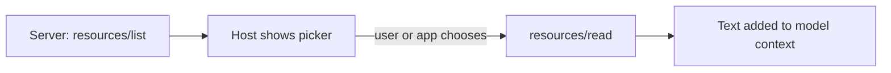

# MCP Resources
> **Level:** Intermediate · **Reading time:** 8 min · **Phase:** 6 — MCP

**In one line:** Resources are read-only data a server exposes, each identified by a URI, which the host application chooses to load into context.

## Explain it like I'm new
A resource is a book on a library shelf. The librarian (the application) decides which books to put on your desk. The reader (the model) does not walk the shelves on its own. This is **application-controlled**.

A **URI** is just an address, like `file:///notes/todo.md` or `notes://welcome`. The server picks the scheme. Resources can be files, database rows, logs, API responses or anything readable.

## How it works
1. Server declares the `resources` capability.
2. Client sends `resources/list`; server returns items with `uri`, `name`, and often `mimeType`.
3. The host (or the user, through a picker) selects some.
4. Client sends `resources/read` with the `uri`.
5. Server returns `contents`: a list of items with `uri`, `mimeType` and `text` (or `blob` for binary).

```json
{"jsonrpc":"2.0","id":3,"method":"resources/read","params":{"uri":"notes://welcome"}}

{"jsonrpc":"2.0","id":3,"result":{"contents":[
  {"uri":"notes://welcome","mimeType":"text/plain","text":"Hello from a resource."}]}}
```

**Resource templates** describe a family of URIs, such as `notes://{title}`, so a server need not list every item. Servers can also notify clients when a resource list or content changes, if they declare those capabilities. Check the [resources page of the spec](https://modelcontextprotocol.io/specification) for the exact capability flags.



### Tool or resource?
| | Tool | Resource |
|---|---|---|
| Controlled by | Model | Application |
| Has side effects | Often | No (read-only) |
| Takes arguments | Yes (schema) | Only via URI / template |
| Example | `create_note` | `notes://welcome` |

## Code example
Using the offline toy ([`code/mcp_mini_jsonrpc.py`](../code/mcp_mini_jsonrpc.py)):
```python
print(client.list_resources())
# [{'uri': 'notes://welcome', 'name': 'Welcome', 'mimeType': 'text/plain'}]
print(client.read_resource("notes://welcome")[0]["text"])
```
Reading an unknown URI returns a JSON-RPC error (the toy uses code `-32002`; check the spec for the current code).

**In real projects** (TypeScript SDK; same package as the hello server, but not used in that file. Check the SDK docs for your version):
```typescript
server.registerResource(
  "welcome",
  "notes://welcome",
  { title: "Welcome note", mimeType: "text/plain" },
  async (uri) => ({ contents: [{ uri: uri.href, text: "Hello from a resource." }] })
);
```
Python equivalent (`mcp` 2.x `MCPServer`, called `FastMCP` in 1.x):
```python
@mcp.resource("notes://welcome")
def welcome() -> str:
    return "Hello from a resource."
```

## When to use it / when not to
- Use resources for documents, configs and reference data you want the app to attach.
- Do not hide side effects in a resource read. Use a tool.
- Do not serve secrets as resources. Anything loaded into context may be echoed.
- Validate URIs. A path-like URI must not escape its allowed folder.

## Common mistakes
- Using resources when the model needs to query on demand (a tool fits better).
- Path traversal: `file:///../../etc/passwd`.
- Returning very large files with no limit.
- Assuming every client supports resources. Support varies, so check your host.

## Interview questions
1. **Who controls resources?**
<details><summary>Answer</summary>The application. It (or the user via UI) decides what to load, not the model.</details>

2. **What does `resources/read` return?**
<details><summary>Answer</summary>A `contents` array with `uri`, `mimeType` and `text` or `blob`.</details>

3. **Resource vs tool?**
<details><summary>Answer</summary>Resources are read-only data selected by the app. Tools are actions the model chooses to run.</details>

## Go deeper
- [MCP specification](https://modelcontextprotocol.io/specification)
- [Official docs](https://modelcontextprotocol.io/)

**Prev:** [04-mcp-tools.md](04-mcp-tools.md) · **Next:** [06-mcp-prompts.md](06-mcp-prompts.md) · **Back to phase:** [Phase 6](../README.md)
