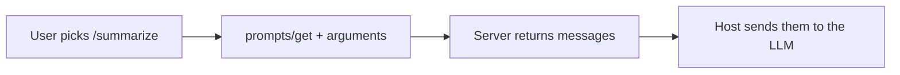

# MCP Prompts
> **Level:** Intermediate · **Reading time:** 7 min · **Phase:** 6 — MCP

**In one line:** Prompts are reusable message templates a server offers, which the user picks explicitly, much like slash commands.

## Explain it like I'm new
A prompt is a form letter with blanks. You choose "complaint letter", fill in the name and date, and get a finished message. In MCP, the server ships the template. The user selects it (for example by typing `/summarize`). That makes prompts **user-controlled**: neither the model nor the app picks them silently.

Why not just paste text? Because a good server author knows the best wording for their tools. A "code review" prompt can set up the right instructions and even embed a resource.

## How it works
1. Server declares the `prompts` capability.
2. Client sends `prompts/list`. Each prompt has a `name`, `description` and `arguments` (each with a name and whether it is required).
3. The user selects one and fills the arguments.
4. Client sends `prompts/get` with `name` and `arguments`.
5. Server returns `messages`: a list of `{role, content}` items that the host inserts into the conversation.

```json
{"jsonrpc":"2.0","id":4,"method":"prompts/get",
 "params":{"name":"summarize","arguments":{"text":"MCP is a protocol."}}}

{"jsonrpc":"2.0","id":4,"result":{
  "description":"Ask the model to summarize some text.",
  "messages":[{"role":"user","content":{"type":"text","text":"Summarize this:\nMCP is a protocol."}}]}}
```
Content can also be an image, audio or an embedded resource. Check the [prompts page of the spec](https://modelcontextprotocol.io/specification) for the full list.



### All three primitives
| Primitive | Controlled by | Typical method | Example |
|---|---|---|---|
| Tool | Model | `tools/call` | `add_numbers` |
| Resource | Application | `resources/read` | `notes://welcome` |
| Prompt | User | `prompts/get` | `/summarize` |

## Code example
Offline toy ([`code/mcp_mini_jsonrpc.py`](../code/mcp_mini_jsonrpc.py)):
```python
print(client.list_prompts()[0]["name"])        # summarize
got = client.get_prompt("summarize", {"text": "MCP is a protocol."})
print(got["messages"][0]["content"]["text"])
```
A missing required argument produces a JSON-RPC error (`-32602`).

**In real projects** (TypeScript SDK, not used in the hello server; check the SDK docs for your version):
```typescript
import { z } from "zod";

server.registerPrompt(
  "summarize",
  { title: "Summarize", description: "Summarize some text.", argsSchema: { text: z.string() } },
  ({ text }) => ({
    messages: [{ role: "user", content: { type: "text", text: `Summarize this:\n${text}` } }],
  })
);
```
Python (`mcp` 2.x `MCPServer`, called `FastMCP` in 1.x):
```python
@mcp.prompt()
def summarize(text: str) -> str:
    return f"Summarize this:\n{text}"
```

## When to use it / when not to
- Use prompts for repeatable workflows the user triggers: review code, draft a note, explain an error.
- Do not use a prompt to run actions. Use a tool.
- Keep arguments few and clear.
- Remember that prompt text goes to the model. Never put user-supplied strings in without care (injection).

## Common mistakes
- Confusing prompts with system prompts. MCP prompts are templates the user invokes.
- Hard-coding secrets into templates.
- Assuming the host shows prompts. Some clients do not support them yet.
- Forgetting to validate arguments.

## Interview questions
1. **Who controls prompts?**
<details><summary>Answer</summary>The user. They choose a prompt explicitly, like a slash command.</details>

2. **What does `prompts/get` return?**
<details><summary>Answer</summary>A list of messages (role and content) ready to put into the conversation, plus an optional description.</details>

3. **Prompt vs tool?**
<details><summary>Answer</summary>A prompt produces messages for the model. A tool runs an action and returns a result.</details>

## Go deeper
- [MCP specification](https://modelcontextprotocol.io/specification)
- [Official docs](https://modelcontextprotocol.io/)

**Prev:** [05-mcp-resources.md](05-mcp-resources.md) · **Next:** [07-build-a-custom-mcp-server.md](07-build-a-custom-mcp-server.md) · **Back to phase:** [Phase 6](../README.md)
