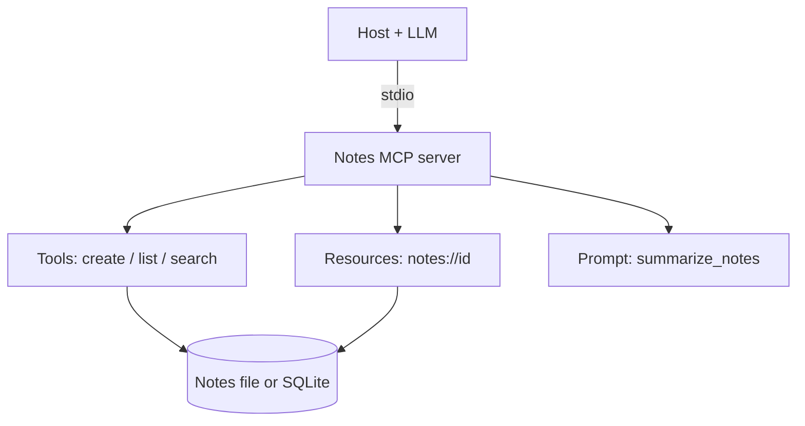

# Build a Custom MCP Server
> **Level:** Advanced · **Reading time:** 12 min · **Phase:** 6 — MCP

**In one line:** Build a small notes server step by step: design narrow tools, validate input, expose notes as resources, add a prompt, test it and connect it to a host safely.

## Explain it like I'm new
Building a server is like writing a tiny API for an AI instead of a human. A human reads docs. The model reads your tool descriptions and schemas. So the craft is: few clear actions, strict inputs, small outputs.

You will build a **notes server**. A fuller, finished version lives in [mcp-notes-server](https://github.com/techsaurabh-394/mcp-notes-server) (persistence, search, tests and a Claude Desktop config). Read it after this walkthrough.

## How it works
1. **Pick the job.** "Let the model save and find my notes."
2. **Design narrow tools.** `create_note(title, body)`, `list_notes()`, `search_notes(query)`. No raw SQL, no shell.
3. **Define schemas.** Required fields, max lengths, types. Reject the rest.
4. **Choose storage.** Start in memory, then a JSON file or SQLite. Keep writes inside one folder.
5. **Expose resources.** Each note as `notes://{id}`, so the app can attach it.
6. **Add a prompt.** `summarize_notes` for the user to trigger.
7. **Pick the transport.** stdio for local use.
8. **Test.** Unit-test the logic and the JSON-RPC shapes (see below).
9. **Connect and review.** Add to the host config, test with approvals on.



## Code example
**Step A: the real starting point.** Copy [`code/hello-mcp-server`](../code/hello-mcp-server/src/index.ts). It already has registration, `zod` validation, annotations and stdio.

**Step B: add a tool.** Same SDK calls as the hello file; the storage is yours:
```typescript
const notes = new Map<string, string>();

server.registerTool(
  "create_note",
  {
    title: "Create note",
    description: "Save a note with a title and body.",
    inputSchema: { title: z.string().min(1).max(100), body: z.string().max(5000) },
    annotations: { readOnlyHint: false, destructiveHint: false },
  },
  async ({ title, body }) => {
    notes.set(title, body);
    return { content: [{ type: "text", text: `Saved "${title}"` }] };
  }
);
```
**Step C: report failures as results.**
```typescript
async ({ query }) => {
  const hits = [...notes.keys()].filter((t) => t.includes(query));
  if (hits.length === 0)
    return { isError: true, content: [{ type: "text", text: "No notes match." }] };
  return { content: [{ type: "text", text: hits.join("\n") }] };
}
```
**Step D: add a resource and a prompt** using `registerResource` and `registerPrompt` as shown in [topic 05](05-mcp-resources.md) and [topic 06](06-mcp-prompts.md). Check the SDK docs for your version.

**Step E: build and run.**
```bash
cd 06-mcp/code/hello-mcp-server
npm ci && npm run build
node dist/index.js        # waits on stdin; logs only to stderr
```
**Step F: test the protocol offline.** Run [`code/mcp_mini_jsonrpc.py`](../code/mcp_mini_jsonrpc.py) to see every message shape, and run its tests:
```bash
python -m pytest -q 06-mcp/code
```
**Step G: connect.** Use the `claude_desktop_config.json` from [topic 03](03-mcp-client.md). You can also try the official MCP Inspector (see the [docs](https://modelcontextprotocol.io/)).

**In real projects** (Python `MCPServer`, called `FastMCP` in `mcp` 1.x):
```python
from mcp.server.mcpserver import MCPServer

mcp = MCPServer("notes")
notes: dict[str, str] = {}

@mcp.tool()
def create_note(title: str, body: str) -> str:
    """Save a note with a title and body."""
    notes[title] = body
    return f"Saved {title}"

@mcp.resource("notes://{title}")
def read_note(title: str) -> str:
    return notes[title]

@mcp.prompt()
def summarize_notes() -> str:
    return "Summarize my notes in five bullets."

if __name__ == "__main__":
    mcp.run()
```

### Security checklist for your server
- Least privilege: the server only touches its own folder.
- Validate every input: type, length, allowed characters.
- No shell or SQL built from model text.
- Never print secrets; keep them in env vars.
- Remote server? Use HTTPS and the spec's OAuth-based authorization. Check the [current spec](https://modelcontextprotocol.io/specification).
- Assume tool output may be read by a model that can be manipulated.

## When to use it / when not to
- Build custom when no existing server fits, or you must wrap private data.
- Do not build when a maintained server already does the job. Reuse it and review its code.
- Start with 3 tools or fewer. Add more only when needed.

## Common mistakes
- One giant `do_anything` tool.
- No limits on size, so one call fills the context.
- Writing to stdout.
- Skipping tests of failure paths.
- Letting note text act as instructions to the model. Treat stored text as data.

## Interview questions
1. **How would you design a notes server safely?**
<details><summary>Answer</summary>Narrow tools, validated inputs, storage limited to one folder, read-only hints where true, approvals on writes, logs to stderr.</details>

2. **How do you test a server without an LLM?**
<details><summary>Answer</summary>Unit-test the logic and send raw JSON-RPC requests (`initialize`, `tools/list`, `tools/call`), or use the MCP Inspector.</details>

3. **When would you move from stdio to Streamable HTTP?**
<details><summary>Answer</summary>When many users or remote hosts need one shared server. Then add HTTPS and authorization.</details>

## Go deeper
- [mcp-notes-server (full example)](https://github.com/techsaurabh-394/mcp-notes-server)
- [MCP specification](https://modelcontextprotocol.io/specification)
- [Official docs](https://modelcontextprotocol.io/)

**Prev:** [06-mcp-prompts.md](06-mcp-prompts.md) · **Next:** [Phase 7](../../07-production-ai/README.md) · **Back to phase:** [Phase 6](../README.md)
