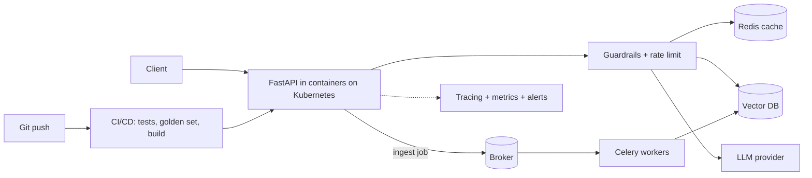

# Phase 7 — Production AI

**Goal:** learn what changes when an AI demo becomes a real service: APIs, containers, caching, queues, monitoring, security, cost control and deployment.

**Who it's for:** learners who have built a RAG app or agent (phases 1–6) and want to run it for real users.

**Prerequisites:** basic Python, and the earlier phases, especially [Phase 6 — MCP](../06-mcp/README.md). No cloud account is needed for the code here.

## Topics

| # | Topic | Level |
|---|---|---|
| 01 | [FastAPI for AI](topics/01-fastapi-for-ai.md) | Beginner |
| 02 | [Docker](topics/02-docker.md) | Beginner |
| 03 | [Kubernetes](topics/03-kubernetes.md) | Intermediate |
| 04 | [Redis](topics/04-redis.md) | Intermediate |
| 05 | [Celery](topics/05-celery.md) | Intermediate |
| 06 | [RabbitMQ](topics/06-rabbitmq.md) | Intermediate |
| 07 | [Monitoring](topics/07-monitoring.md) | Intermediate |
| 08 | [LangSmith](topics/08-langsmith.md) | Intermediate |
| 09 | [MLflow](topics/09-mlflow.md) | Intermediate |
| 10 | [Prompt Versioning](topics/10-prompt-versioning.md) | Intermediate |
| 11 | [AI Security](topics/11-ai-security.md) | Intermediate |
| 12 | [Guardrails](topics/12-guardrails.md) | Intermediate |
| 13 | [Observability](topics/13-observability.md) | Intermediate |
| 14 | [Cost Optimization](topics/14-cost-optimization.md) | Intermediate |
| 15 | [Deploy a Production AI Application](topics/15-deploy-a-production-ai-application.md) | Advanced |

**Learning order:** read 01 to 15 in order. Topics 1–3 give you a running, packaged service. 4–6 add speed and background work. 7–10 add visibility and change control. 11–14 add safety and cost control. 15 puts it all together.

## How to run the code
All demos are offline, use only the standard library, and need no API key. From the repo root:

```bash
python -m pytest -q 07-production-ai/code
python 07-production-ai/code/prod_guardrails.py
python 07-production-ai/code/prod_observability.py
```

| File | Used in topic |
|---|---|
| [`prod_cache_ratelimit.py`](code/prod_cache_ratelimit.py) | 04, 14 |
| [`prod_task_queue.py`](code/prod_task_queue.py) | 05, 06 |
| [`prod_observability.py`](code/prod_observability.py) | 07, 13 |
| [`prod_prompt_registry.py`](code/prod_prompt_registry.py) | 10 |
| [`prod_guardrails.py`](code/prod_guardrails.py) | 11, 12 |

## Production-readiness checklist
**Reliability**
- [ ] Timeouts on every external call
- [ ] Retries with backoff, and a fallback (cached answer, other model, or clear error)
- [ ] `/health` route, resource limits, several replicas
- [ ] Slow work (ingestion) runs in a queue, with idempotent tasks

**Security and privacy**
- [ ] Retrieved text and tool results treated as untrusted
- [ ] Least-privilege credentials; human approval for destructive actions
- [ ] Input and output guardrails; PII redacted before logging
- [ ] Access control applied before retrieval
- [ ] Secrets in a secret manager or environment, never in prompts, images or Git

**Quality and change control**
- [ ] Golden set runs in CI
- [ ] Prompts in Git with version and hash logged per request
- [ ] Canary or A/B rollout and a one-command rollback

**Observability and cost**
- [ ] Request ID, traces, and tokens, latency and cost per request
- [ ] Alerts on error rate, p95 latency and daily spend
- [ ] Cache, `max_tokens`, right-sized models and tuned top-k

## Architecture



## Checkpoint quiz
**1. Why put document ingestion in a Celery worker?**
<details><summary>Answer</summary>It is slow and can fail. A queue keeps API responses fast, allows retries, and scales workers separately.</details>

**2. What is the difference between a container and a Kubernetes pod setup?**
<details><summary>Answer</summary>A container packages one app and its dependencies. Kubernetes runs and manages many containers: scaling, restarts, rollouts and health checks.</details>

**3. What should a cache key include?**
<details><summary>Answer</summary>The normalized question, the prompt version and any user or data scope, so users never get stale or private answers meant for someone else.</details>

**4. Why track p95 latency, not just the average?**
<details><summary>Answer</summary>Averages hide the slow tail. p95 shows what the slowest 5% of users experience.</details>

**5. Why version prompts?**
<details><summary>Answer</summary>A prompt edit can change behavior like a code change. Versions let you compare, roll out slowly, and roll back.</details>

**6. What is indirect prompt injection?**
<details><summary>Answer</summary>Hostile instructions hidden in content the system retrieves, such as a web page or file, which the model may follow.</details>

**7. Name two limits of keyword guardrails.**
<details><summary>Answer</summary>Attackers can rephrase or encode text, and regex PII detection misses names and addresses. Use guardrails as one layer with least privilege and approvals.</details>

**8. Give three ways to cut LLM cost.**
<details><summary>Answer</summary>Cache answers, route easy tasks to smaller models, trim context with lower top-k, cap output with max_tokens, and batch offline work.</details>

**9. What do you record on every LLM call?**
<details><summary>Answer</summary>Model, prompt version, input and output tokens, latency, cost, errors and the request ID, with sensitive content redacted.</details>

**10. What should CI run for an AI app?**
<details><summary>Answer</summary>Lint, unit tests, the golden-set evaluation, a secret scan and the image build.</details>

**Next:** [Phase 8 — Interview Prep](../08-interview-prep/README.md)

---

<p align="center">
  <b>Saurabh Pathak</b> · AI Engineer &amp; Full-Stack Developer<br/>
  <a href="https://github.com/techsaurabh-394">GitHub</a> ·
  <a href="https://www.linkedin.com/in/tech-saurabh/">LinkedIn</a> ·
  <a href="https://mernstackdev.com">Blog</a> ·
  <a href="mailto:saurabhpathak394@gmail.com">saurabhpathak394@gmail.com</a><br/>
  <a href="https://buymeacoffee.com/saurabhdev"></a>
</p>
