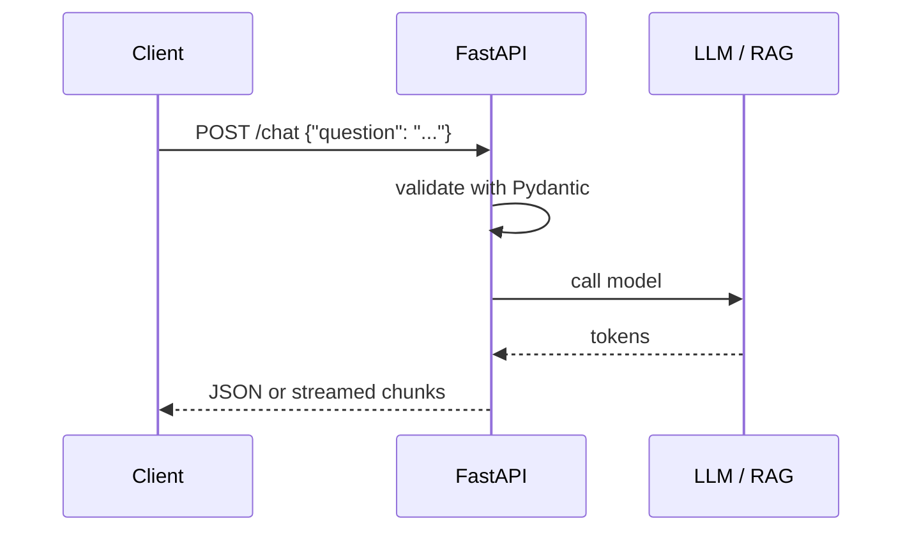

# FastAPI for AI
> **Level:** Beginner · **Reading time:** 9 min · **Phase:** 7 — Production AI

**In one line:** FastAPI is a Python web framework that turns your AI function into an HTTP API with automatic input validation and docs.

## Explain it like I'm new
Think of a restaurant. The kitchen (your model or RAG pipeline) cooks the food. The waiter (the API) takes orders in a fixed format, passes them to the kitchen, and brings back the plate. Customers never walk into the kitchen.

An **API** (application programming interface) lets other programs call your code over the network. **HTTP** is the protocol they use. A client sends a request to a **route** such as `POST /chat`, and your server sends back a response, usually **JSON**.

FastAPI helps with three things. It uses **Pydantic** models to check that incoming data has the right shape. It builds interactive docs at `/docs`. And it supports `async` code, which lets one server handle many slow network calls (like LLM calls) at the same time.

LLM answers can take many seconds. **Streaming** sends the answer in small pieces as the model produces them, so the user sees text right away.

## How it works
1. The client sends `POST /chat` with a JSON body.
2. FastAPI parses the body into a Pydantic model. Bad input gets a `422` error automatically.
3. Your function runs: check cache, retrieve context, call the LLM.
4. FastAPI converts the return value to JSON, or streams chunks.
5. Middleware and logging record latency and errors.



## Code example
The core idea, stdlib only: validate input, then call a function. This is what FastAPI automates.

```python
def handle_chat(body: dict) -> dict:
    question = body.get("question")
    if not isinstance(question, str) or not question.strip():
        return {"status": 422, "error": "question must be a non-empty string"}
    answer = f"(fake model) You asked: {question}"
    return {"status": 200, "answer": answer}

print(handle_chat({"question": "What is RAG?"}))
print(handle_chat({}))
```

### In real projects
Install with `pip install fastapi uvicorn`. Run with `uvicorn main:app --reload`.

```python
from fastapi import FastAPI
from fastapi.responses import StreamingResponse
from pydantic import BaseModel

app = FastAPI()


class ChatRequest(BaseModel):
    question: str
    max_tokens: int = 300


class ChatResponse(BaseModel):
    answer: str


@app.get("/health")
def health():
    return {"status": "ok"}


@app.post("/chat", response_model=ChatResponse)
async def chat(req: ChatRequest):
    answer = await call_llm(req.question, req.max_tokens)  # your function
    return ChatResponse(answer=answer)


async def token_stream(question: str):
    async for token in call_llm_stream(question):  # your async generator
        yield token


@app.post("/chat/stream")
async def chat_stream(req: ChatRequest):
    return StreamingResponse(token_stream(req.question), media_type="text/plain")
```

`call_llm` and `call_llm_stream` are placeholders for your provider's client. Keep API keys in environment variables. See the [FastAPI docs](https://fastapi.tiangolo.com/) for streaming, dependencies and testing.

## When to use it / when not to
- Use it for model-serving APIs, RAG backends and agent endpoints in Python.
- Use `async def` when you await network calls. Use plain `def` for CPU-bound work; FastAPI runs it in a thread pool.
- Do not run heavy model inference inside the request path on a small server. Use a separate worker or a model server.
- For a quick demo UI only, a notebook or Streamlit may be enough.

## Common mistakes
- Calling a blocking function (like a sync HTTP client) inside `async def`. It freezes all other requests.
- No timeout on the LLM call, so requests hang forever.
- No `/health` route, so Docker and Kubernetes cannot check the service.
- Returning raw exception text to users. It can leak internals.
- Loading the model on every request instead of once at startup.

## Interview questions
**1. Why use Pydantic models for an LLM API?**
<details><summary>Answer</summary>They validate and document input and output. Bad requests fail early with clear errors, before you spend tokens.</details>

**2. When does streaming help?**
<details><summary>Answer</summary>When answers are long. The user sees the first tokens in about the time-to-first-token instead of waiting for the full answer. Total time stays the same.</details>

**3. What is wrong with a blocking call inside an async route?**
<details><summary>Answer</summary>It blocks the event loop, so every other request waits. Use an async client or run the blocking code in a thread.</details>

## Go deeper
- [FastAPI documentation](https://fastapi.tiangolo.com/)

**Prev:** [Phase 6 — MCP](../../06-mcp/README.md) · **Next:** [02-docker.md](02-docker.md) · **Back to phase:** [Phase 7](../README.md)
