# Docker
> **Level:** Beginner · **Reading time:** 9 min · **Phase:** 7 — Production AI

**In one line:** Docker packs your app and everything it needs into an image that runs the same way on any machine.

**Before you start:** [FastAPI for AI](01-fastapi-for-ai.md). It helps to know what a web API is and what `requirements.txt` lists.

## Explain it like I'm new
Think of a lunchbox. You pack the food, the fork and the napkin. Wherever you open it, you get the same meal. "It works on my laptop" stops being a problem because the laptop's Python version no longer matters.

An **image** is the read-only package (your code, Python, libraries). A **container** is a running copy of an image. A **Dockerfile** is the recipe that builds the image. A **registry** (Docker Hub, GitHub Container Registry) stores images so servers can pull them.

Images are built in **layers**. Each Dockerfile instruction makes a layer. Docker caches layers, so if nothing changed in a step, it reuses the old layer. That is why order matters: copy `requirements.txt` and install packages *before* copying your code. Your code changes often; dependencies rarely.

**Words to know:**
-

<!-- anim:02-docker -->
## Watch it


*It plays on a loop. Read the caption in the box, one step at a time. Want to go at your own pace? [Step through it with Previous and Next](https://techsaurabh-394.github.io/ai-engineer-roadmap/#02-docker).*

## How it works
1. Write a `Dockerfile`.
2. `docker build -t rag-api:1.0 .` builds the image.
3. `docker run -p 8000:8000 --env-file .env rag-api:1.0` starts a container.
4. Push the image to a registry; your server or Kubernetes pulls it.

```text
Dockerfile step            Layer cached until...
FROM python:3.12-slim      base image changes
COPY requirements.txt      requirements.txt changes
RUN pip install ...        (reruns only if the line above changed)
COPY . .                   any code file changes   <- changes most often, goes last
```

### Worked example
You build the Dockerfile above for the first time. Every step runs, and each result is saved as a layer.

You then edit only `main.py` and rebuild:
1. `FROM python:3.12-slim`: nothing changed, so the layer is reused.
2. `COPY requirements.txt .`: the file is the same, so it is reused.
3. `RUN pip install ...`: its input is unchanged, so it is reused. This is the slow step you just skipped.
4. `COPY . .`: your code changed, so this layer and everything after it rebuild.

If `COPY . .` came first, step 4's change would invalidate the `pip install` layer too, and every edit would reinstall all packages. The stdlib sketch below shows the same idea: its second line prints `pip install: cached` and `copy code: rebuilt`.

## Code example
Stdlib sketch of the layer-cache idea: a step reruns only if its input hash changes.

```python
import hashlib

cache = {}

def run_step(name, inputs: str):
    key = (name, hashlib.sha256(inputs.encode()).hexdigest())
    if key in cache:
        return f"{name}: cached"
    cache[key] = True
    return f"{name}: rebuilt"

reqs = "fastapi\nuvicorn"
print(run_step("pip install", reqs), run_step("copy code", "v1"))
print(run_step("pip install", reqs), run_step("copy code", "v2"))  # code changed only
```

### In real projects
A Dockerfile for a Python API: slim base, dependencies first, non-root user.

```dockerfile
FROM python:3.12-slim

ENV PYTHONDONTWRITEBYTECODE=1 \
    PYTHONUNBUFFERED=1

WORKDIR /app

# 1. dependencies first: this layer is cached until requirements.txt changes
COPY requirements.txt .
RUN pip install --no-cache-dir -r requirements.txt

# 2. then the code
COPY . .

# 3. do not run as root
RUN useradd --create-home appuser
USER appuser

EXPOSE 8000
CMD ["uvicorn", "main:app", "--host", "0.0.0.0", "--port", "8000"]
```

Add a `.dockerignore` file listing `.git`, `.env`, `__pycache__` and `.venv` so secrets and junk never enter the image. Never `COPY` your `.env` into an image. Pass secrets at run time. See the [Docker docs](https://docs.docker.com/).

## When to use it / when not to
- Use it for every service you deploy, and for local databases (Redis, Postgres) via Docker Compose.
- Pin versions (`python:3.12-slim`, pinned `requirements.txt`) for repeatable builds.
- Large local models can make images many gigabytes. Consider mounting model files as a volume or downloading at startup.
- GPU workloads need extra setup (a GPU-enabled runtime). Check the docs for your platform.

## Common mistakes
- `COPY . .` before installing requirements. Every code edit reinstalls all packages.
- Running as root.
- Baking API keys into the image.
- Using the `latest` tag in production. You cannot tell what version is running.
- Forgetting `--host 0.0.0.0`, so the app is unreachable from outside the container.

## Recap

**If you remember only three things:**
- An image is the package; a container is a running copy of it.
- Docker reuses cached layers, so put rarely-changing steps (dependencies) before often-changing ones (code).
- Never put secrets in the image. Pass them at run time.

## Interview questions
**1. Image vs container?**
<details><summary>Answer</summary>An image is the packaged, read-only template. A container is a running instance of it.</details>

**2. Why copy requirements.txt before the code?**
<details><summary>Answer</summary>Layer caching. Dependencies are reinstalled only when requirements change, which makes rebuilds fast.</details>

**3. How do you pass an API key to a container safely?**
<details><summary>Answer</summary>At run time through environment variables or a secrets manager, never inside the image or the repo.</details>

## Go deeper
- [Docker documentation](https://docs.docker.com/)

**Prev:** [01-fastapi-for-ai.md](01-fastapi-for-ai.md) · **Next:** [03-kubernetes.md](03-kubernetes.md) · **Back to phase:** [Phase 7](../README.md)
