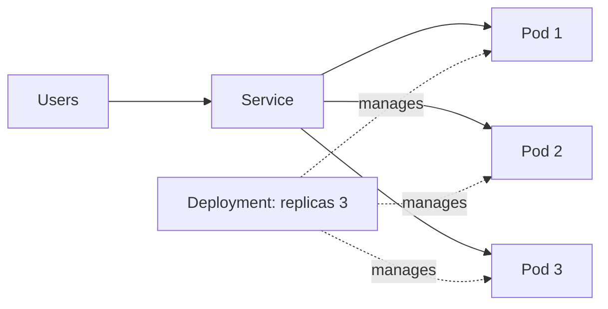

# Kubernetes
> **Level:** Intermediate · **Reading time:** 10 min · **Phase:** 7 — Production AI

**In one line:** Kubernetes runs many containers across many machines and keeps them healthy, scaled and reachable.

## Explain it like I'm new
Think of a shift manager at a busy store. You say "I want 3 cashiers at all times." If one goes home sick, the manager calls in a replacement. If the line grows, the manager adds more. You describe the goal; the manager does the work.

Kubernetes (often "K8s") works the same way. You write a **desired state** in YAML. Kubernetes keeps comparing reality to it and fixes differences.

Key words:
- **Pod:** the smallest unit; one or more containers running together.
- **Deployment:** says "run N copies of this pod" and handles rolling updates.
- **Service:** a stable address that load-balances across pods, because pod IPs change.
- **Probes:** health checks. A **liveness** probe restarts a stuck container. A **readiness** probe keeps traffic away until the app is ready (important when a model takes time to load).
- **Resource requests/limits:** how much CPU and memory a pod is guaranteed and how much it may use.

## How it works
1. You build and push an image to a registry.
2. You apply a Deployment and a Service with `kubectl apply -f`.
3. The scheduler places pods on nodes that have enough free resources.
4. The Service sends traffic only to pods that pass readiness.
5. An autoscaler (HPA) can add pods when CPU is high.



## Code example
Stdlib sketch of the control loop: compare desired and actual, then fix.

```python
desired = 3
pods = ["pod-a", "pod-b"]  # one crashed

def reconcile(desired, pods):
    while len(pods) < desired:
        pods.append(f"pod-{len(pods)}")
    while len(pods) > desired:
        pods.pop()
    return pods

print(reconcile(desired, pods))
```

### In real projects
A minimal Deployment and Service for the API from topic 1:

```yaml
apiVersion: apps/v1
kind: Deployment
metadata:
  name: rag-api
spec:
  replicas: 2
  selector:
    matchLabels:
      app: rag-api
  template:
    metadata:
      labels:
        app: rag-api
    spec:
      containers:
        - name: api
          image: ghcr.io/your-org/rag-api:1.0.0   # use a pinned tag
          ports:
            - containerPort: 8000
          env:
            - name: LLM_API_KEY
              valueFrom:
                secretKeyRef:
                  name: llm-secrets
                  key: api-key
          readinessProbe:
            httpGet:
              path: /health
              port: 8000
            initialDelaySeconds: 5
            periodSeconds: 10
          livenessProbe:
            httpGet:
              path: /health
              port: 8000
            initialDelaySeconds: 15
            periodSeconds: 20
          resources:
            requests:
              cpu: "250m"
              memory: "256Mi"
            limits:
              cpu: "1"
              memory: "512Mi"
---
apiVersion: v1
kind: Service
metadata:
  name: rag-api
spec:
  selector:
    app: rag-api
  ports:
    - port: 80
      targetPort: 8000
```

The numbers are starting points, not recommendations; measure your own app. Create the secret with `kubectl create secret generic llm-secrets --from-literal=api-key=...`. See the [Kubernetes docs](https://kubernetes.io/docs/).

## When to use it / when not to
- Use it when you run several services, need rolling updates, autoscaling and self-healing.
- Skip it for a single small app. A managed platform or one VM with Docker Compose is simpler.
- Kubernetes has a real learning curve and operating cost. Managed offerings from cloud providers reduce it.

## Common mistakes
- No resource limits, so one pod starves its neighbours.
- A liveness probe that fails while the model is still loading, causing restart loops. Use readiness, or a startup delay.
- Secrets written in plain YAML in Git.
- Using the `latest` image tag.
- Scaling pods but forgetting the LLM provider's rate limits.

## Interview questions
**1. Readiness vs liveness probe?**
<details><summary>Answer</summary>Readiness decides whether the pod receives traffic. Liveness decides whether the container should be restarted.</details>

**2. Why a Service in front of pods?**
<details><summary>Answer</summary>Pods come and go and their IPs change. A Service gives a stable name and load-balances across healthy pods.</details>

**3. Do you always need Kubernetes for an LLM app?**
<details><summary>Answer</summary>No. For small apps a managed container platform or a single VM is cheaper to run. Use Kubernetes when scale and operations justify it.</details>

## Go deeper
- [Kubernetes documentation](https://kubernetes.io/docs/)

**Prev:** [02-docker.md](02-docker.md) · **Next:** [04-redis.md](04-redis.md) · **Back to phase:** [Phase 7](../README.md)
