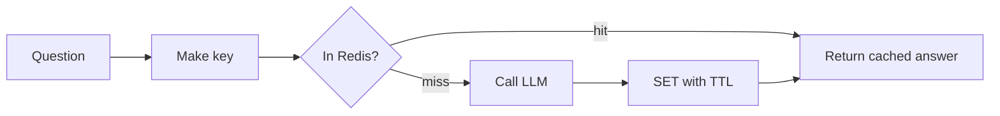

# Redis
> **Level:** Intermediate · **Reading time:** 9 min · **Phase:** 7 — Production AI

**In one line:** Redis is a very fast in-memory data store, used in AI apps for caching answers, rate limiting and sharing state.

## Explain it like I'm new
Think of a sticky note on your monitor. Looking up a phone number in a big directory takes a minute. If you wrote it on a note, you read it in a second. But sticky notes get old, so you throw them out after a while.

Redis is the sticky-note wall for your servers. Data lives in memory, so reads take well under a millisecond on a good network. An LLM call takes seconds and costs money, so answering a repeat question from Redis saves both.

Key ideas:
- **Key-value:** you store a value under a key, such as `answer:<hash>`.
- **TTL (time to live):** the key deletes itself after N seconds. This stops stale answers from living forever.
- **Exact cache:** the key is a hash of the exact prompt. Same text, same hit.
- **Semantic cache:** you embed the question and look for a *similar* earlier question. It catches rephrasing but can return a wrong answer if the similarity threshold is too loose.

## How it works
1. A request arrives. Normalize the question (trim, lowercase).
2. Build a key, such as `sha256(model + prompt_version + question)`.
3. `GET` the key. On hit, return it.
4. On miss, call the LLM, then `SET key value EX 3600`.
5. Track hit rate. If it is very low, the cache is not paying for itself.



## Code example
A stdlib exact cache with TTL and hit-rate stats. See [`prod_cache_ratelimit.py`](../code/prod_cache_ratelimit.py) (tests in `test_prod_cache_ratelimit.py`).

```python
import hashlib, sys
sys.path.insert(0, "07-production-ai/code")
from prod_cache_ratelimit import TTLCache

cache = TTLCache(ttl=3600)

def answer(question, model="demo-model"):
    key = hashlib.sha256(f"{model}|{question.strip().lower()}".encode()).hexdigest()
    hit = cache.get(key)
    if hit is not None:
        return hit
    result = f"(LLM answer to: {question})"  # pretend LLM call
    cache.set(key, result)
    return result

for q in ["What is RAG?", "what is rag? ", "What is MCP?"]:
    answer(q)
print("hit rate:", round(cache.hit_rate, 2))
```

### In real projects
With the `redis` Python package (`pip install redis`) and a running Redis server:

```python
import hashlib
import redis

r = redis.Redis(host="localhost", port=6379, decode_responses=True)

def cached_answer(question: str, model: str = "my-model") -> str:
    key = "answer:" + hashlib.sha256(f"{model}|{question.strip().lower()}".encode()).hexdigest()
    hit = r.get(key)
    if hit is not None:
        return hit
    result = call_llm(question)          # your function
    r.set(key, result, ex=3600)          # expires in 1 hour
    return result
```

For a semantic cache, store an embedding next to each answer and search by vector similarity. Redis supports vector search, but check the [Redis docs](https://redis.io/docs/) for the current setup, or use a dedicated library. Include the model name and prompt version in the key, otherwise a prompt change keeps serving old answers.

## When to use it / when not to
| Cache type | Good for | Risk |
|---|---|---|
| Exact | FAQs, repeated queries, fixed prompts | Low hit rate on free-form text |
| Semantic | Rephrased questions | Wrong answer if threshold is loose |

- Do not cache answers that depend on the user (private data) unless the key includes the user or tenant.
- Do not cache time-sensitive answers with a long TTL.

## Common mistakes
- No TTL, so memory fills up and answers go stale.
- Cache key missing the model, prompt version or tenant.
- Caching error responses.
- A semantic threshold picked by guess, with no test on real queries.
- Treating Redis as the only copy of important data. It is a cache first.

## Interview questions
**1. Exact vs semantic cache?**
<details><summary>Answer</summary>Exact matches identical text through a hash key. Semantic matches similar meaning through embeddings. Semantic hits more often but can return a wrong answer.</details>

**2. Why use a TTL?**
<details><summary>Answer</summary>It limits staleness and memory use. Documents and prompts change, so old answers must expire.</details>

**3. What should be in the cache key?**
<details><summary>Answer</summary>The normalized question, model, prompt version, and tenant or user if answers differ per user.</details>

## Go deeper
- [Redis documentation](https://redis.io/docs/)

**Prev:** [03-kubernetes.md](03-kubernetes.md) · **Next:** [05-celery.md](05-celery.md) · **Back to phase:** [Phase 7](../README.md)
