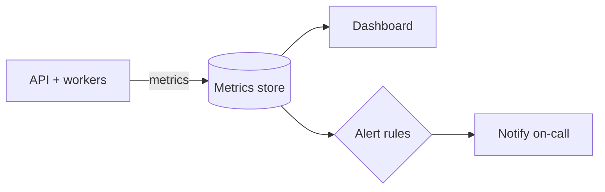

# Monitoring
> **Level:** Intermediate · **Reading time:** 8 min · **Phase:** 7 — Production AI

**In one line:** Monitoring means watching numbers about your running service and alerting a human when they go wrong.

## Explain it like I'm new
A car dashboard shows speed, fuel and engine temperature. You do not open the engine to know you are low on fuel. A warning light tells you.

Monitoring is the dashboard for your API. It answers: is it up, is it fast, is it failing, is it too expensive? **Alerting** is the warning light: a rule such as "error rate above 5% for 5 minutes" that pages someone.

Classic service metrics:
- **Traffic:** requests per second.
- **Errors:** share of failed requests.
- **Latency:** how long requests take. Use **percentiles**: p50 is the median, p95 means 95% of requests were faster. Averages hide slow outliers.
- **Saturation:** CPU, memory, queue length.

AI services add their own:
- **Time to first token** for streaming.
- **Tokens and cost** per request.
- **Cache hit rate.**
- **Provider errors and rate-limit (429) responses.**
- **Quality signals:** thumbs-down rate, empty-answer rate, guardrail blocks.

## How it works
1. Your app emits metrics (counters, histograms, gauges).
2. A collector scrapes or receives them and stores them as time series.
3. A dashboard graphs them.
4. Alert rules fire when a threshold is crossed.
5. An on-call person follows a runbook.



## Code example
Percentiles with a stdlib helper, from [`prod_observability.py`](../code/prod_observability.py):

```python
import sys
sys.path.insert(0, "07-production-ai/code")
from prod_observability import percentile

latencies_ms = sorted([120, 130, 125, 140, 135, 128, 132, 138, 127, 4000])
print("mean:", sum(latencies_ms) / len(latencies_ms))   # 507.5, looks bad for everyone
print("p50:", percentile(latencies_ms, 50))             # 130, the typical user
print("p95:", percentile(latencies_ms, 95))             # 4000, the slow tail
```
One slow call lifts the mean a lot but p50 stays honest, and p95 exposes the tail.

### In real projects
Many teams export metrics in the Prometheus format and view them in Grafana. Other options include cloud-provider monitoring or an all-in-one tool. Pick what your team already uses. In FastAPI you add a middleware that times each request and increments counters by route and status code. Alert on symptoms users feel (error rate, p95 latency) before internal causes. See the [FastAPI docs](https://fastapi.tiangolo.com/) for middleware.

## When to use it / when not to
- Use it for every deployed service from day one. Start with 4 numbers: traffic, errors, p95 latency, cost.
- Do not alert on everything. Too many alerts get ignored.
- Monitoring tells you *that* something is wrong. For *why* on a single request, use tracing (topics 8 and 13).

## Common mistakes
- Watching averages only.
- No alert on provider rate limits or cost spikes.
- Alerts with no owner or runbook.
- Logging full prompts with personal data into the metrics system.
- Dashboards nobody looks at. Review them in a regular meeting.

## Interview questions
**1. Why p95 instead of average latency?**
<details><summary>Answer</summary>Averages hide slow tails. p95 shows what the slowest 5% of users experience.</details>

**2. Name AI-specific metrics.**
<details><summary>Answer</summary>Tokens per request, cost per request, time to first token, cache hit rate, provider error rate, guardrail block rate, user feedback.</details>

**3. Monitoring vs observability?**
<details><summary>Answer</summary>Monitoring tracks known signals and alerts. Observability lets you ask new questions about a failure using traces, logs and metrics.</details>

## Go deeper
- [FastAPI documentation](https://fastapi.tiangolo.com/)

**Prev:** [06-rabbitmq.md](06-rabbitmq.md) · **Next:** [08-langsmith.md](08-langsmith.md) · **Back to phase:** [Phase 7](../README.md)
