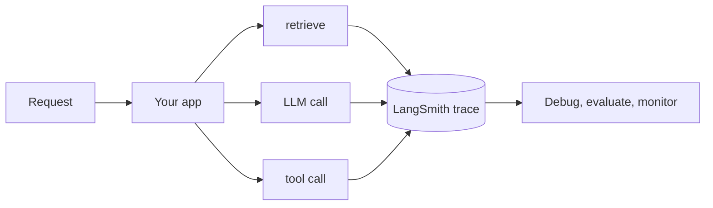

# LangSmith
> **Level:** Intermediate · **Reading time:** 7 min · **Phase:** 7 — Production AI

**In one line:** LangSmith is a hosted tool from the LangChain team that records every step of an LLM app run so you can debug, evaluate and monitor it.

## Explain it like I'm new
Think of a flight recorder. When something odd happens, you replay what the plane did. For an LLM app, odd things are common: a wrong answer, a slow reply, an agent stuck in a loop. Without a record, you guess.

A **trace** is the full record of one request. It is made of **runs** (also called spans): the retrieval step, the prompt, the model call, each tool call. Each run stores inputs, outputs, timing, token counts and errors. You open the trace in a web UI and see exactly what the model was given.

LangSmith also supports **datasets** (saved examples), **evaluations** (score your app on a dataset), prompt management and monitoring dashboards. It works with LangChain and LangGraph, and it can also trace code that does not use them.

## How it works
1. You turn on tracing, usually with environment variables and an API key.
2. As your app runs, each step is sent to LangSmith in the background.
3. You open the trace tree to inspect inputs, outputs, latency and cost.
4. You save bad cases into a dataset.
5. You run evaluations on the dataset after each change.



## Code example
The concept in stdlib: a decorator that records a run's name, inputs, output and time. Real tracers do this and send the data to a server.

```python
import time, functools

TRACE = []

def traced(fn):
    @functools.wraps(fn)
    def wrapper(*args, **kwargs):
        start = time.perf_counter()
        out = fn(*args, **kwargs)
        TRACE.append({"name": fn.__name__, "inputs": args,
                      "output": out, "ms": round((time.perf_counter() - start) * 1000, 2)})
        return out
    return wrapper

@traced
def retrieve(q): return ["doc about " + q]

@traced
def answer(q): return f"Based on {retrieve(q)[0]}"

answer("refunds")
for run in TRACE:
    print(run)
```

### In real projects
Setup details change between versions, so follow the current [LangSmith documentation](https://docs.smith.langchain.com/) and check the exact environment variable names there. In general you need an API key from your LangSmith account, a flag that enables tracing, and an optional project name to group runs. The docs also show how to mark your own functions as traced. Do not copy variable names from old blog posts.

## When to use it / when not to
- Use it when you build with LangChain or LangGraph, or want trace trees and dataset-based evals without building them.
- Consider alternatives if data must stay in your own infrastructure. Check the docs for self-hosting options and your data policy.
- Open-source and vendor-neutral tracing standards exist too. Topic 13 covers the general idea.

## Common mistakes
- Tracing production traffic that contains personal data without a data policy or redaction.
- Never looking at traces until an outage.
- Tracing but not saving failures into a dataset.
- Committing the API key to Git.
- Leaving full tracing on at high volume without checking cost or sampling options.

## Interview questions
**1. What is a trace?**
<details><summary>Answer</summary>The record of one request, made of nested runs (steps) with inputs, outputs, timing and errors.</details>

**2. How does tracing help with a wrong RAG answer?**
<details><summary>Answer</summary>You see which chunks were retrieved and the final prompt. That shows whether retrieval or generation failed.</details>

**3. Why build datasets from production failures?**
<details><summary>Answer</summary>They become regression tests. After each prompt or model change you check that old failures stay fixed.</details>

## Go deeper
- [LangSmith documentation](https://docs.smith.langchain.com/)

**Prev:** [07-monitoring.md](07-monitoring.md) · **Next:** [09-mlflow.md](09-mlflow.md) · **Back to phase:** [Phase 7](../README.md)
