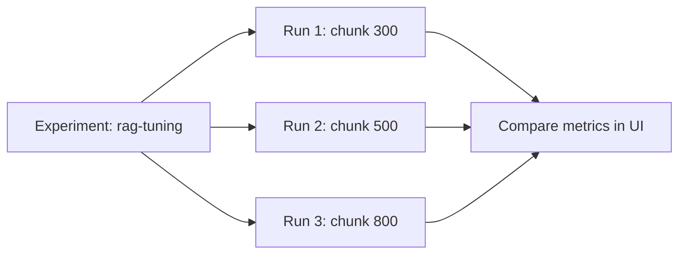

# MLflow
> **Level:** Intermediate · **Reading time:** 7 min · **Phase:** 7 — Production AI

**In one line:** MLflow is an open-source tool that records your experiments (settings, scores, files) so you can compare runs and reproduce the best one.

## Explain it like I'm new
Imagine a cooking notebook. Every time you try a recipe you write the ingredients, the oven temperature and how it tasted. Later you can say "the version with less salt at 180°C was best."

Without notes, AI work becomes chaos: "Which chunk size gave that good score last Tuesday?" MLflow is the notebook.

Words to know:
- **Run:** one try (one training, or one evaluation of your RAG pipeline).
- **Parameter:** an input setting, like `chunk_size=500`.
- **Metric:** a number result, like `hit_rate=0.82`. It can be logged over time.
- **Artifact:** a file you keep, such as a plot or a prompt file.
- **Experiment:** a group of related runs.
- **Model registry:** a place to version and promote models.

MLflow started with classic machine learning and also has features for LLM apps (tracing, evaluation). Check the [MLflow docs](https://mlflow.org/docs/latest/) for current GenAI features.

## How it works
1. Start a run.
2. Log parameters (what you changed).
3. Log metrics (what you measured).
4. Log artifacts (files).
5. Open the UI and compare runs in a table or chart.



## Code example
A stdlib mini-tracker with the same shape as MLflow's API:

```python
runs = []

class Run:
    def __init__(self): self.params, self.metrics = {}, {}
    def log_param(self, k, v): self.params[k] = v
    def log_metric(self, k, v): self.metrics[k] = v

def fake_eval(chunk_size):
    return {300: 0.71, 500: 0.82, 800: 0.76}[chunk_size]   # made-up demo scores

for size in (300, 500, 800):
    run = Run()
    run.log_param("chunk_size", size)
    run.log_metric("hit_rate", fake_eval(size))
    runs.append(run)

best = max(runs, key=lambda r: r.metrics["hit_rate"])
print("best:", best.params, best.metrics)
```

### In real projects
`pip install mlflow`, then:

```python
import mlflow

mlflow.set_experiment("rag-tuning")

for chunk_size in (300, 500, 800):
    with mlflow.start_run():
        mlflow.log_param("chunk_size", chunk_size)
        score = evaluate_pipeline(chunk_size)        # your function
        mlflow.log_metric("hit_rate", score)
```
Run `mlflow ui` and open the address it prints to compare runs. By default results are stored in a local `mlruns` folder; teams usually point to a shared tracking server. See the [MLflow docs](https://mlflow.org/docs/latest/).

## When to use it / when not to
- Use it to compare chunk sizes, embedding models, prompts and retrieval settings with real numbers.
- Use it when you train or fine-tune models and need a registry.
- For a handful of experiments, a spreadsheet works. Do not add a server you will not maintain.
- For per-request production debugging, use tracing (topics 8 and 13).

## Common mistakes
- Logging metrics but not the parameters, so you cannot reproduce the run.
- Changing the evaluation set between runs, which makes comparisons meaningless.
- Not logging the code version (Git commit) or prompt version.
- Running a tracking server with no access control on a public address.
- Chasing tiny score differences on a very small eval set.

## Interview questions
**1. Parameter vs metric?**
<details><summary>Answer</summary>A parameter is an input you choose. A metric is a measured result.</details>

**2. Why track experiments?**
<details><summary>Answer</summary>To compare options fairly and reproduce the best result later.</details>

**3. How would you use MLflow for RAG?**
<details><summary>Answer</summary>Log chunk size, embedding model, top-k and prompt version as parameters, and retrieval hit rate and answer quality scores as metrics, on a fixed eval set.</details>

## Go deeper
- [MLflow documentation](https://mlflow.org/docs/latest/)

**Prev:** [08-langsmith.md](08-langsmith.md) · **Next:** [10-prompt-versioning.md](10-prompt-versioning.md) · **Back to phase:** [Phase 7](../README.md)
