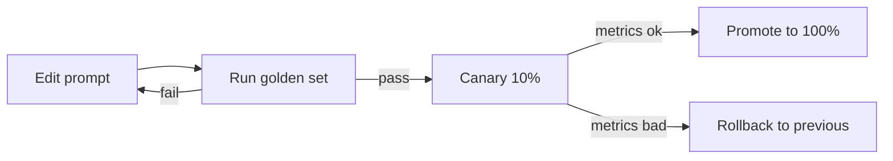

# Prompt Versioning
> **Level:** Intermediate · **Reading time:** 8 min · **Phase:** 7 — Production AI

**In one line:** Prompt versioning means treating prompts like code: each change gets a version, can be compared, rolled out slowly and rolled back.

## Explain it like I'm new
Think of a recipe card in a restaurant chain. If a chef edits it in pencil and every branch uses a different copy, customers get different food and nobody knows why. A good chain keeps numbered versions, tests a new one in a few branches, and can switch back.

A prompt change can alter answers as much as a code change. A one-word edit can break a JSON format. So you need to know *which prompt* produced *which answer*.

Ideas:
- **Version:** a number or Git tag for each prompt text.
- **Hash:** a short fingerprint of the text. If the text changes, the hash changes. It proves two servers use the same prompt.
- **Registry:** a place that stores versions and says which is active.
- **Rollback:** make the previous version active again.
- **A/B test:** serve version A to some users and B to others, then compare results.
- **Canary / shadow:** send a small share (or a silent copy) of traffic to the new version first.

## How it works
1. Store prompts in files in Git, or in a registry.
2. Give each change a version and hash.
3. Log the version and hash on every request (in the trace).
4. Run your golden test set on the new version before release.
5. Roll out to a small share of users. Compare quality, cost and latency.
6. Promote it, or roll back.



## Code example
See [`prod_prompt_registry.py`](../code/prod_prompt_registry.py) (stdlib, tested).

```python
import sys
sys.path.insert(0, "07-production-ai/code")
from prod_prompt_registry import PromptRegistry

reg = PromptRegistry()
reg.register("qa", "Answer briefly.")
reg.register("qa", "Answer briefly and cite the source.")

print(reg.history("qa"))                    # [(1, hash1), (2, hash2)]
prompt = reg.pick_ab("qa", 1, 2, user_id="user-42", percent_b=10)
print("served version", prompt["version"], prompt["hash"])   # same user, same version
print("rolled back to", reg.rollback("qa"))
```
`pick_ab` hashes the user ID, so a user keeps seeing the same version during a test.

### In real projects
The simplest real setup is a `prompts/` folder in Git with code review, tags, and CI that runs your golden set. Some teams use a prompt-management feature in tools such as LangSmith (see topic 8) or MLflow (topic 9). Check each tool's current docs. Whatever you pick, log `prompt_name`, `version` and `hash` with each request.

## When to use it / when not to
- Use it as soon as real users depend on your answers.
- A/B tests need enough traffic for a meaningful result. With a few users, rely on golden-set tests.
- For a personal script, a Git commit is enough.

## Common mistakes
- Prompts hard-coded in application code with no record of what ran.
- Not logging the prompt version per request.
- Changing prompt and model together, so you cannot tell which caused the shift.
- Skipping the golden set because "it is just a small edit".
- Forgetting to include the prompt version in the cache key (topic 4).

## Interview questions
**1. Why hash a prompt?**
<details><summary>Answer</summary>The hash identifies the exact text. You can verify every server runs the same prompt and tie a bad answer to the exact version.</details>

**2. How do you roll out a new prompt safely?**
<details><summary>Answer</summary>Run a golden set, release to a small share of traffic (canary or A/B), compare metrics, then promote or roll back.</details>

**3. Why keep A/B assignment sticky per user?**
<details><summary>Answer</summary>Users should not flip between versions mid-conversation, and results per group stay clean.</details>

## Go deeper
- [MLflow documentation](https://mlflow.org/docs/latest/)

**Prev:** [09-mlflow.md](09-mlflow.md) · **Next:** [11-ai-security.md](11-ai-security.md) · **Back to phase:** [Phase 7](../README.md)
