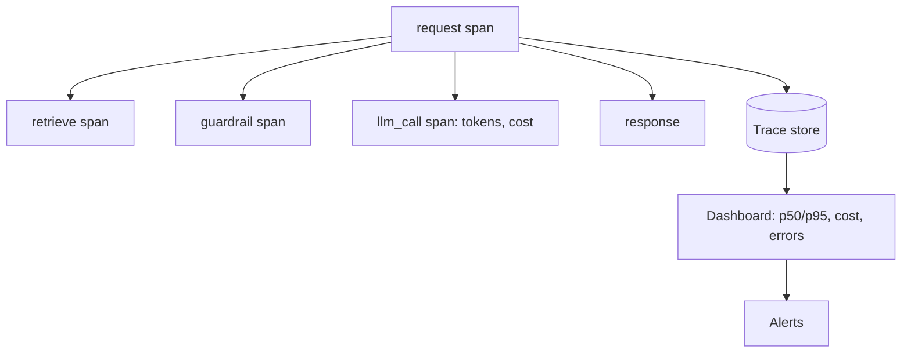

# Observability
> **Level:** Intermediate · **Reading time:** 10 min · **Phase:** 7 — Production AI

**In one line:** Observability means recording enough about each request (steps, time, tokens, cost, errors) that you can explain why the system behaved as it did.

## Explain it like I'm new
Think of a car dashboard plus a flight recorder. The dashboard shows speed and fuel now. The recorder lets you replay what happened after a problem.

There are three kinds of signals:
- **Logs:** timestamped text events ("guardrail blocked request 123").
- **Metrics:** numbers over time (requests per minute, error rate, p95 latency).
- **Traces:** the full story of one request, split into **spans**. A span is one timed step, such as "retrieve" or "llm_call".

**Latency** is how long something takes. **p50** is the median: half of requests are faster. **p95** means 95% are faster, so it shows the slow tail that users complain about. Averages hide that tail.

LLM apps add three things to watch on every request: **tokens** (the units a model reads and writes, which drive price), **latency** and **cost**.

## How it works
1. Give each request a **request ID** and pass it through every step.
2. Wrap each step (retrieval, rerank, LLM call, guardrail) in a span.
3. On LLM spans, record input tokens, output tokens, model name, prompt version (topic 10) and computed cost.
4. Record errors on the span.
5. Aggregate: counts, error rate, p50/p95 latency, total tokens, total cost, cache hit rate.
6. Alert on thresholds: error rate, p95 latency, daily spend.
7. Log carefully: no secrets, redact PII (topics 11 and 12).



Cost per call, with a tiny worked example (ILLUSTRATIVE prices of $0.001 per 1,000 input tokens and $0.002 per 1,000 output tokens):

```text
500 input tokens  -> 500/1000 * 0.001 = 0.0005
100 output tokens -> 100/1000 * 0.002 = 0.0002
cost = 0.0007
```

## Code example
[`prod_observability.py`](../code/prod_observability.py) is a tiny stdlib tracer:

```python
import sys
sys.path.insert(0, "07-production-ai/code")
from prod_observability import Tracer

t = Tracer()
with t.span("request"):
    with t.span("retrieve"):
        pass
    with t.span("llm_call", model="demo") as s:
        # ILLUSTRATIVE prices per 1,000 tokens
        s.record_usage(500, 100, price_in_per_1k=0.001, price_out_per_1k=0.002)

print(t.summary("llm_call"))
# {'count': 1, 'errors': 0, 'p50_ms': ..., 'p95_ms': ..., 'input_tokens': 500,
#  'output_tokens': 100, 'total_cost': 0.0007}
```
Spans nest through a stack, record errors if the block raises, and `summary()` returns counts, p50/p95, tokens and cost.

### In real projects
Teams usually use OpenTelemetry for traces and metrics, Prometheus and Grafana for dashboards (topic 7), and an LLM-specific tool such as LangSmith (topic 8). Use `logging` with JSON output and include the request ID in every line. Check each tool's current docs for setup.

## When to use it / when not to
- Add it before launch. You cannot debug a slow or wrong answer you did not record.
- Store prompt text only if policy allows. Otherwise store hashes and lengths.
- For a prototype, printing the summary is enough. Do not build dashboards before you have users.

## Common mistakes
- Watching only average latency and missing the p95 tail.
- Not tracking tokens, so the first sign of a cost problem is the bill.
- Logging raw prompts with PII or keys.
- No request ID, so logs from one request cannot be joined.
- Dashboards but no alerts: nobody looks at the dashboard at 3 a.m.

## Interview questions
**1. What is the difference between logs, metrics and traces?**
<details><summary>Answer</summary>Logs are event text, metrics are numbers over time, traces follow one request through its steps as spans.</details>

**2. Why use p95 instead of the average?**
<details><summary>Answer</summary>A few slow requests barely move the average but hurt real users. p95 shows the slow tail.</details>

**3. Which fields do you record on an LLM span?**
<details><summary>Answer</summary>Model, prompt version, input and output tokens, latency, cost, error, and request ID. Redact sensitive content.</details>

## Go deeper
- [OpenTelemetry documentation](https://opentelemetry.io/docs/)
- [Prometheus documentation](https://prometheus.io/docs/)

**Prev:** [12-guardrails.md](12-guardrails.md) · **Next:** [14-cost-optimization.md](14-cost-optimization.md) · **Back to phase:** [Phase 7](../README.md)
